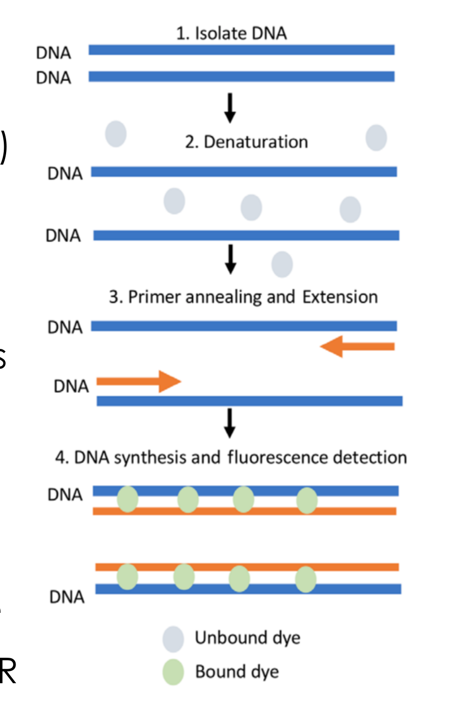
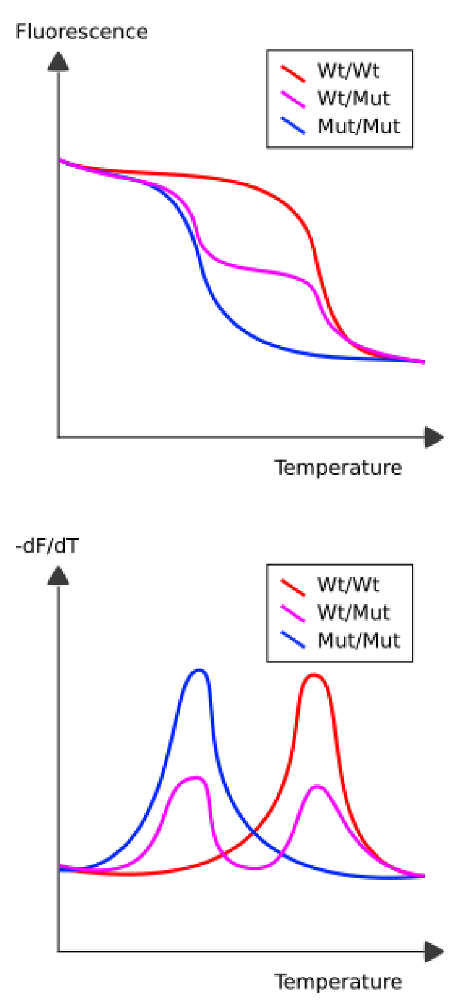

# Quantitative PCR

## Overview

Quantitative PCR estimates the starting abundance of a target from the cycle at which exponential amplification reaches a fluorescence threshold. Calibration, reference genes and sequence-specific detection make that estimate usable while exposing the assumptions behind absolute and relative quantification.

*Assumed throughout:* PCR, logarithms and gene expression.

## Section 16: Quantitative PCR and the cycle threshold

### Intuition

Exponential processes destroy information about their starting point once they saturate. Watching only the endpoint of a PCR is like returning to a petri dish after a week: the plate is full whether you seeded ten bacteria or ten thousand.

The information is in the *timing*, not the final amount. A sample that starts with more template crosses any given level sooner. If you watch continuously and record *when* the product passes a fixed level, that time is a measure of the starting amount. Because growth is exponential, the relationship is logarithmic: each halving of the starting material delays the crossing by exactly one cycle.

This is the whole idea. Everything else is making the measurement work: a way to see the product as it accumulates, and a sensible choice of where to put the threshold.

*Analogy:* judging how much money someone started with by watching a compound-interest account and noting the date it passes £1000. Twice the starting capital reaches the mark one doubling-time earlier. The analogy breaks down because PCR eventually runs out of reagents and stops compounding, so only the early part of the curve carries information.

### Mechanism

**1. Recap of PCR.** Template, forward and reverse primers, thermostable polymerase, dNTPs and Mg²⁺ are cycled between denaturation (95–98 °C), annealing (50–65 °C) and extension (72 °C), 30–40 times. Each cycle doubles the number of double-stranded products bounded by the two primers.

**2. Making the product visible: intercalating dye.** An intercalating dye such as SYBR Green is included. It fluoresces strongly when bound to double-stranded DNA and weakly when free, so the fluorescence of the tube is proportional to the amount of double-stranded product present.

Fluorescence is read once per cycle, at the end of extension when the product is double-stranded. A qPCR machine is a thermal cycler with a fluorimeter.

**3. The amplification curve.** Plotting fluorescence against cycle number gives a sigmoid with three regions:

- **Initiation.** The product is doubling, but the signal is below the instrument's noise. Amplification is happening; it simply cannot be seen.
- **Exponential.** The signal rises above noise while reagents are still in excess, so doubling continues. **This is the only region that carries quantitative information.**
- **Plateau.** dNTPs and primers are depleted and the polymerase loses activity, so the curve saturates. All samples converge here, which is exactly why endpoint PCR cannot quantify.

**4. The threshold and $C_t$.** A fluorescence threshold is set above the background noise but within the exponential phase. The **cycle threshold** $C_t$ (also written $C_q$) is the cycle number at which the amplification curve crosses it. It need not be an integer, since the crossing is interpolated between cycles.

### Derivation

Notation: $\rho_0$ is the initial concentration (or copy number) of the target; $\rho(n)$ after $n$ cycles; $F$ is fluorescence; $t$ is the threshold value of $F$; $E$ is the amplification efficiency, with $E = 1$ meaning perfect doubling.

**Step 1: growth law.** Each cycle multiplies the product by $(1+E)$. For ideal doubling, $E = 1$:
$$\rho(n) = \rho_0\,(1+E)^n \;\xrightarrow{\;E=1\;}\; \rho_0\,2^n \tag{23}$$

**Step 2: what is measured.** The intercalating dye binds in proportion to the amount of double-stranded product, so
$$F(n) \propto \rho(n) = \rho_0\,2^n \tag{24}$$

**Step 3: definition of $C_t$.** At $n = C_t$ the fluorescence equals the threshold:
$$\rho_0\,2^{C_t} \propto t \tag{25}$$

**Step 4: take logarithms.** Using $\log_{10}$ throughout:
$$\log\rho_0 + C_t\log 2 = \log t + \text{const}$$
$$\boxed{\;C_t = \frac{\log t - \log\rho_0 + \text{const}}{\log 2}\;}\tag{26}$$
so $C_t \propto \log t - \log\rho_0$. **$C_t$ is linear in $\log\rho_0$ with a negative slope**: more starting material gives a smaller $C_t$.

**Step 5: general efficiency.** Repeating steps 3–4 with $(1+E)^{C_t}$ in place of $2^{C_t}$:
$$C_t = \frac{\log t - \log\rho_0 + \text{const}}{\log(1+E)} \tag{27}$$
Differentiating with respect to $\log\rho_0$ gives the slope of a plot of $C_t$ against $\log_{10}\rho_0$:
$$\text{slope} = -\frac{1}{\log_{10}(1+E)} \qquad\Longrightarrow\qquad E = 10^{-1/\text{slope}} - 1 \tag{28}$$

**Sanity checks on (28).**
- Perfect doubling, $E=1$: slope $= -1/\log_{10}2 = -3.32$. A tenfold dilution delays $C_t$ by 3.32 cycles, because $\log_2 10 = 3.32$ doublings are needed to recover a factor of ten.
- A steeper (more negative) slope means *lower* efficiency: more cycles are needed to make up a tenfold difference.
- $E \to 0$: slope $\to -\infty$, and no amount of cycling separates the samples. Quantification fails.

### Motivation and explanation

**Why the threshold must sit in the exponential phase.** Equation (23) holds only while reagents are in excess. In the plateau, $\rho$ no longer depends on $\rho_0$, so (26) is meaningless there. Placing the threshold too high puts $C_t$ in the saturating region and compresses the differences between samples; too low and it sits in instrument noise, making $C_t$ irreproducible. The threshold must be above the noise and below the onset of depletion.

**Why $E$ is rarely exactly 1.** Primer annealing is not instantaneous and not every template is copied each cycle, so some templates are skipped. Inhibitors carried over from the sample (haem, humic acids, ethanol) reduce polymerase activity. Long or structured amplicons extend incompletely. Typical real efficiencies are 0.9–1.0, and an assay outside about 0.9–1.1 is usually redesigned rather than corrected for.

**Why efficiency matters so much.** It enters (27) as $\log(1+E)$ in the denominator, so it sets the *scale* converting cycles to concentration. Assuming $E=1$ when it is really 0.9 misestimates every fold-change, and the error compounds with the number of cycles separating the samples. This is why a standard curve is run.

Moving the common threshold upward within the exponential region delays every crossing, because more amplification is required. With the same efficiency and fluorescence response, it shifts the calibration intercept while preserving the cycle difference between samples. If those differences change substantially when the threshold is moved within that region, the curves are not behaving as the shared-efficiency model assumes; a visually tidy crossing alone is insufficient.

**Weaknesses of intercalating dye.** The dye binds *any* double-stranded DNA, so it reports primer dimers and mis-primed products as faithfully as the intended one. It cannot distinguish them, and since a primer dimer amplifies efficiently it can dominate the signal. This is the problem the melt curve (Section 17) and sequence-specific probes (Section 18) address.

### Worked example

Reading $\rho_0$ off a $C_t$, and checking efficiency. Computed in Python.

**1. Cycles per decade.** From (28) with $E = 1$: a tenfold dilution series should shift $C_t$ by $\log_2 10 = 3.32$ cycles per step. Measured slopes convert to efficiency as:

| Slope | $E$ | Interpretation |
|---|---|---|
| −3.10 | 1.10 | Above 100 %: usually inhibition or pipetting error, not real |
| −3.32 | 1.00 | Perfect doubling |
| −3.60 | 0.90 | 90 %, acceptable |
| −3.92 | 0.80 | 80 %, assay needs redesign |

**2. Dynamic range.** Suppose the threshold corresponds to $10^{10}$ copies and $E = 1$. From (26):

| $\rho_0$ (copies) | $C_t$ |
|---|---|
| $10^{6}$ | 13.3 |
| $10^{3}$ | 23.3 |
| 10 | 29.9 |
| 1 | 33.2 |

Six orders of magnitude in starting material span only 20 cycles. This compression is the strength and the weakness of the method: an enormous dynamic range fits in one run, but a 1-cycle error in $C_t$ is a twofold error in $\rho_0$, so precision in $C_t$ matters a great deal.

**3. Single-copy sensitivity.** A single target molecule gives $C_t \approx 33$, comfortably within a 40-cycle run. This is why qPCR detects a handful of viral genomes in a swab. It is also why contamination is such a serious problem: a single stray amplicon molecule from a previous reaction produces a positive result indistinguishable from a true one, which is why negative controls are run on every plate.

### Link to other topics

Equation (26) is the standard move for any exponential process: take logarithms and read the rate off a straight line, as with first-order reaction kinetics or $\ln(C/C_0)$ against time. The threshold crossing plays the role of a fixed conversion, and $C_t$ the time to reach it.

### Summary

Measuring fluorescence every cycle converts PCR from a detection method into a quantitative one. The information lies in *when* the curve crosses a threshold, and because growth is exponential that crossing is linear in $\log\rho_0$, equation (26).

## Section 17: Absolute and relative quantification, and melt-curve control

### Intuition

The two protocols answer different questions, and the difference is the same one that runs through all measurement: *absolute* against *comparative*.

If you need to know how many viral genomes are in a millilitre, you must compare against something of known quantity. There is no way round running standards, just as there is no way to weigh something without a calibrated balance.

If instead you only need to know whether a gene is expressed twice as strongly in treated cells as in untreated ones, calibration is unnecessary. The unknown constants in the $C_t$ relationship, the threshold, the instrument gain, the proportionality between dye and DNA, are the *same* in both reactions, so taking a difference cancels them. This is why relative quantification is the more common measurement: it is easier and it answers the question biologists usually ask.

The subtlety is that the two reactions are never quite identical. Different amounts of RNA are recovered, pipetting varies, cell numbers differ. A *reference gene* is measured alongside to absorb these differences, which is the second subtraction in $\Delta\Delta C_t$.

### Mechanism and derivation

#### Absolute quantification

1. Prepare a **serial dilution series** of a standard of known concentration, typically tenfold steps.
2. Run qPCR on all of them, obtaining a $C_t$ for each.
3. Plot $C_t$ against $\log_{10}\rho_0$ and fit a straight line. From Section 16, equation (27), this should be linear with slope $-1/\log_{10}(1+E)$. The fit both calibrates the assay and reports its efficiency.
4. Measure $C_t$ for the unknown, and read $\log\rho_0$ off the line.

The result is an absolute copy number, but only as good as the standard: its concentration must be known independently, and it must amplify with the same efficiency as the unknown.

#### Relative quantification: the $\Delta\Delta C_t$ method

The aim is the ratio $\rho_0^{\text{sample}}/\rho_0^{\text{control}}$ for a gene of interest, between two conditions.

**Four reactions** are run: the gene of interest and a reference gene, in each of the sample and the control. The **reference gene** is one expressed at a constant level regardless of condition, a *housekeeping gene*, present at the same copy number in both.

**Step 1: first difference, within each condition.** Define
$$\Delta C_t^{\text{sample}} = C_t^{\text{sample}} - C_t^{\text{ref}}, \qquad \Delta C_t^{\text{control}} = C_t^{\text{control}} - C_t^{\text{ref}} \tag{29}$$
each using its own reaction's reference.

**Step 2: what a $\Delta C_t$ means.** At perfect amplification efficiency, each assay has its own intercept, $b_{\mathrm{target}}$ or $b_{\mathrm{ref}}$, set by its threshold and fluorescence response:
$$C_t^{\mathrm{target}}=b_{\mathrm{target}}-\log_2\rho_0^{\mathrm{target}},\qquad C_t^{\mathrm{ref}}=b_{\mathrm{ref}}-\log_2\rho_0^{\mathrm{ref}}.$$
Subtracting gives $\Delta C_t=b_{\mathrm{target}}-b_{\mathrm{ref}}-\log_2(\rho_0^{\mathrm{target}}/\rho_0^{\mathrm{ref}})$. Therefore
$$\frac{\rho_0^{\text{target}}}{\rho_0^{\text{ref}}}=A\,2^{-\Delta C_t},\qquad A=2^{b_{\mathrm{target}}-b_{\mathrm{ref}}}.\tag{30}$$
The assay factor $A$ need not equal one. A single $\Delta C_t$ therefore does not directly give an absolute target/reference abundance ratio without cross-assay calibration. Crucially, $A$ cancels when the same two assays are compared between conditions.

A useful test is to imagine loading more of exactly the same RNA preparation into one reaction set. Target and reference should both appear earlier by the same cycle shift, leaving their difference unchanged. By contrast, a genuine target-specific expression change moves the target crossing without the matching reference shift. This is the causal distinction the first subtraction is designed to make; it works only for effects shared proportionally by both assays.

**Step 3: second difference, between conditions.** Dividing the two instances of (30):
$$\frac{\rho_0^{\text{sample}}/\rho_0^{\text{ref}}}{\rho_0^{\text{control}}/\rho_0^{\text{ref}}} = \frac{2^{-\Delta C_t^{\text{sample}}}}{2^{-\Delta C_t^{\text{control}}}} = 2^{-(\Delta C_t^{\text{sample}}-\Delta C_t^{\text{control}})}$$
Defining $\Delta\Delta C_t = \Delta C_t^{\text{sample}} - \Delta C_t^{\text{control}}$:
$$\boxed{\;\frac{\rho_0^{\text{sample}}}{\rho_0^{\text{control}}} = 2^{-\Delta\Delta C_t}\;}\tag{31}$$

**Step 4: with real efficiency.** Repeating with $(1+E)$ in place of 2:
$$\frac{\rho_0^{\text{sample}}}{\rho_0^{\text{control}}} = (1+E)^{-\Delta\Delta C_t} \tag{32}$$
so (31) assumes $E = 1$ *for both the target and the reference*. This is the method's main hidden assumption.

**Assumptions of (31), stated explicitly:**
1. Both amplicons amplify with efficiency $E = 1$, and with the *same* efficiency as each other.
2. The reference gene is genuinely unchanged between the conditions.
3. Each assay's threshold and response are consistent between sample and control. Target and reference may have different assay intercepts; those differences cancel in the second subtraction.

#### Melt-curve control

The intercalating dye of Section 16 reports *any* double-stranded DNA. The melt curve checks whether the signal is consistent with one dominant product at the expected melting temperature; it does not establish its sequence.

1. After the last cycle, ramp the temperature up slowly while continuously reading fluorescence.
2. As each product melts, its strands separate, the dye is released, and fluorescence falls. This is the melting transition of Section 03, read out by dye rather than by absorbance.
3. Plot $-dF/dT$. Each distinct product gives a **peak** at its own $T_m$.

**Reading the result:**
- *One sharp peak*: consistent with one dominant product. Different products can have similar melting temperatures, so this is a specificity check rather than proof of identity.
- *Multiple peaks, a shoulder, or a broad peak*: more than one product. Different amplicons have different lengths and GC contents, hence different $T_m$ (Section 04).
- A peak at *low* temperature is characteristically a **primer dimer**: two primers amplifying each other, giving a short product that melts early.

The melt curve can expose some specificity problems without running a gel. Validated high-resolution melting assays can also distinguish genotypes through melting-profile differences, including heteroduplex formation. A heterozygote does not necessarily give two resolved peaks, and routine melt analysis does not automatically identify a genotype.

### Motivation and explanation

**Why the reference gene is the weak point.** Equation (31) is only as good as assumption 2. Genes described as "housekeeping" (GAPDH, actin, 18S rRNA) are *not* constant under all conditions; their expression changes with cell cycle, confluence, hypoxia and many treatments. If the reference shifts between conditions, that shift appears directly in $\Delta\Delta C_t$ and is misread as a change in the gene of interest. Good practice is to validate the reference for the specific conditions, or to use the geometric mean of several.

**Why the differences cancel what they cancel.** It is worth being precise about which error each subtraction removes:
- The *first* difference (target minus reference, within one sample) cancels anything affecting both reactions of that sample equally: the amount of input material, RNA recovery, reverse-transcription efficiency, pipetting of the template.
- The *second* difference (sample minus control) cancels the fixed **intercepts** of the same target and reference assays, including consistent fluorescence thresholds and response factors. Amplification efficiency still sets the concentration-to-cycle slope and must be equal between assays, or explicitly accounted for; taking a second difference does not remove that requirement.

What neither cancels is a difference in the reference gene's true expression, or a difference in amplification efficiency between the two amplicons.

**Absolute or relative?** Absolute is needed when the number itself matters: viral load, copies per genome, quantifying a standard. Relative is needed when a comparison matters: gene expression under treatment, knockdown efficiency. Relative is less work and usually more precise, because the subtractions remove systematic error that absolute quantification has to control explicitly.

### Worked example

*A gene-expression measurement, with uncertainty.* Computed in Python.

Four reactions, all on one plate:

| | Gene of interest | Reference gene |
|---|---|---|
| Treated sample | $C_t = 22.4$ | $C_t = 18.1$ |
| Untreated control | $C_t = 25.9$ | $C_t = 18.3$ |

**Step 1.** $\Delta C_t^{\text{sample}} = 22.4 - 18.1 = 4.3$; $\Delta C_t^{\text{control}} = 25.9 - 18.3 = 7.6$.

**Step 2.** $\Delta\Delta C_t = 4.3 - 7.6 = -3.3$.

**Step 3.** Fold change $= 2^{-(-3.3)} = 2^{3.3} = 9.85$.

The treatment increases expression of the gene of interest about **tenfold**.

**Sense check.** The reference gene barely moved (18.1 against 18.3), so the two reactions were comparably loaded. The gene of interest appeared 3.5 cycles earlier in the treated sample, and $2^{3.5} = 11$, close to the answer. The reference correction of 0.2 cycles trimmed it to 9.85.

**Effect of assuming $E = 1$.** If both amplicons actually run at $E=0.9$, equation (32) gives $1.9^{3.3}=8.31547$ rather than $2^{3.3}=9.84916$. Reporting the latter overestimates the former by about 18.4%. Equivalently, correcting the original estimate lowers it by about 15.6%; the percentage differs because the reference denominator differs. The interpretation should use an efficiency measured for the assay and its operating range.

**Propagating uncertainty.** Suppose each $C_t$ has a standard deviation of 0.15 cycles from pipetting and curve fitting. $\Delta\Delta C_t$ is a combination of four independent measurements, so
$$\sigma_{\Delta\Delta C_t} = \sqrt{4}\times0.15 = 0.30\ \text{cycles}.$$
The fold change therefore carries a multiplicative uncertainty of $2^{0.30} = 1.23$, so the result is about 9.8 with a range of roughly 8.0 to 12.1.

**The practical consequence.** A fold change is uncertain by a factor of about 1.23 even with good technique. To claim a twofold change ($\Delta\Delta C_t = -1$) reliably, the uncertainty of 0.30 cycles must be small against 1 cycle, which it is but not overwhelmingly. **Changes below about 1.5-fold are not resolvable by this method** without many replicates, which is why small fold changes in the literature should be treated with suspicion.

### Link to other topics

Both subtractions are differential measurement: removing a common-mode error by taking a difference against a reference that experiences the same disturbance. It is the same principle as a differential pressure transducer, a Wheatstone bridge, or any tare weighing.

### Summary

A calibration curve converts $C_t$ into an absolute copy number and simultaneously reports efficiency. Two successive subtractions give a fold change, equation (31), with no calibration at all, because the unknown constants are shared and cancel.

## Section 18: Sequence-specific probes and RT-qPCR

### Intuition

Both designs solve the specificity problem the same way: add a *third* sequence-specific oligonucleotide besides the two primers, and arrange for it to fluoresce only when it has found its target. A primer dimer carries no probe site, so it amplifies invisibly. Specificity now rests on three independent recognition events rather than two.

The physical mechanism in both cases is **quenching**: a quencher near a fluorophore absorbs its energy and prevents emission, so fluorescence reports *distance*. The two designs differ in how the target changes that distance — TaqMan separates them irreversibly by cutting the probe in half, a beacon reversibly by unfolding.

*Analogy:* a lamp with a shade clamped over it. TaqMan smashes the clamp; a beacon swings the shade away on a hinge. Both let light out, but only one can be undone. The analogy breaks down because quenching is a distance-dependent energy transfer, not a physical blocking of light, so the signal rises smoothly as the two groups separate rather than switching on.

### Mechanism

#### TaqMan probe (hydrolysis probe)

1. **The probe** is a short oligonucleotide complementary to the target *between* the two primer sites, carrying a **fluorophore at the 5′ end** and a **quencher at the 3′ end**. Intact, the two are close and fluorescence is suppressed. Its 3′ end is chemically blocked, so the polymerase cannot extend it: it is a reporter, not a primer.
2. **During annealing** the probe binds alongside the primers.
3. **During extension** the polymerase advances from the forward primer until it meets the probe. Taq has **5′→3′ exonuclease activity**, so it hydrolyses the probe as it goes, releasing the fluorophore as a free fragment that diffuses away from the quencher. **Fluorescence rises.**

Each new copy destroys one probe, so fluorescence tracks the product as the intercalating dye does — but only for the correct sequence.

**Requirements.** Probe cleavage requires a polymerase with 5′ nuclease activity, such as Taq. A proofreading enzyme's 3′→5′ exonuclease activity alone does not supply this function. The probe is a doubly modified oligonucleotide (Section 06) and so expensive, and its $T_m$ must exceed the primers' so that it is already bound when extension begins.

#### Molecular beacon

The probe carries a fluorophore at one end and a quencher at the other, with the two ends complementary to each other so that it folds into a **stem-loop (hairpin)**. The stem holds fluorophore and quencher adjacent, so the free probe is dark. The **loop** is complementary to the target; when target is present the loop hybridises to it, and because that duplex is longer and more stable than the short stem, the hairpin is forced open, separating the two labels. **Fluorescence rises.**

**Against TaqMan:** the beacon is not consumed, since binding is reversible, and it needs no exonuclease activity. But it is harder to design — the stem must be stable enough to stay shut when free yet weak enough to open on binding, a narrow window set by the competition between two $T_m$ values (Section 04).

**Multiplexing.** Because specificity now resides in the probe rather than in a generic dye, several targets can be measured in one tube using probes with spectrally distinct fluorophores. This is impossible with an intercalating dye, which gives one undifferentiated signal.

#### RT-qPCR

Polymerases used in PCR need a DNA template, so RNA must first be converted. **Reverse transcriptase** synthesises complementary DNA (cDNA) from an RNA template.

**Choice of priming.** **Poly-T primers** (12–18 T's) prime at the 3′ poly-A tail carried by most eukaryotic mRNAs, converting the whole messenger population in one step — what a gene-expression study needs. **Sequence-specific primers** restrict conversion to the RNA region of interest and are useful for viral assays, whether or not the genome carries a poly-A tail. Random primers offer another route for RNA without poly-A tails.

Once cDNA exists, qPCR proceeds as before. Both steps can share one tube (**one-step** RT-qPCR), reducing handling and contamination risk at the cost of control.

**Note on naming.** "RT-PCR" means *reverse transcription* PCR, not *real-time* PCR. RT-qPCR means both: reverse transcription followed by quantitative PCR.

### Motivation and explanation

**Why the extra recognition event matters so much.** A primer dimer satisfies two recognition events (both primers) and amplifies efficiently because it is short. With an intercalating dye it is indistinguishable from product and can dominate the $C_t$. A probe adds a third requirement that a dimer cannot satisfy, because the dimer contains no internal probe site. The failure mode is removed rather than detected.

**What the probes cost in return.** Three oligonucleotides must be designed to work together at one annealing temperature: two primers and a probe with a higher $T_m$. Design is harder and the reagents are more expensive, so intercalating dye remains the default for routine work where a melt curve is adequate, and probes are used for diagnostics, multiplexing, and anything where a false positive matters.

**Where RT-qPCR adds error.** Reverse transcription is the least reproducible step in the workflow. Its efficiency varies with RNA quality, secondary structure in the transcript, and the enzyme, and it is typically well below 100 %. It therefore adds variance to every measurement, and it sits *before* the amplification, so its variability is amplified along with the template. This is why the reference gene of Section 17 is so valuable: it passes through the same reverse transcription and absorbs much of that variability in the first subtraction.

**RNA degrades.** RNA is chemically fragile (the 2′-OH, Section 01) and RNases are ubiquitous, so sample handling dominates the error budget in practice.

### Worked example

*COVID-19 testing by RT-qPCR.* This is the canonical application and it illustrates every element of Sections 16–18.

**The workflow.**
1. **Sample.** The swab goes into a detergent buffer, which lyses the viral envelope — inactivating the virus and releasing its RNA in one step.
2. **RNA extraction** gives total RNA: viral if present, plus abundant human RNA.
3. **Reverse transcription** with primers chosen for the viral targets. SARS-CoV-2 genomic RNA does have a 3′ poly-A tail; target-specific priming is an assay-design choice.
4. **qPCR with TaqMan probes** against several viral genes independently — typically the envelope (E) gene to screen and the replicase (ORF1ab) or RdRp to confirm. Using more than one guards against a false negative from a mutation in any single primer or probe site, which matters for an evolving virus (Section 15).
5. **Controls**, which are what make the result interpretable:
   - An **internal positive control** against an abundant human RNA, usually RNase P. If it fails, the swab collected no cells or extraction failed, so the test is *invalid* rather than negative. Without it, a badly taken swab looks exactly like an uninfected patient.
   - A **no-template negative control** for contamination, essential given the single-copy sensitivity of Section 16.
6. **Interpretation.** A $C_t$ below a cutoff of 35 or 40, depending on protocol, is positive.

**Why the cutoff exists, quantitatively.** From Section 16, each cycle is a factor of two. The difference between $C_t = 20$ and $C_t = 35$ is
$$2^{15} = 32\,768,$$
so a sample at the cutoff carries roughly 30 000 times less viral RNA than a strongly positive one. Beyond about 35 cycles two things happen: the copy number approaches one molecule, so Poisson sampling noise dominates and replicates disagree; and low-level non-specific amplification begins to cross the threshold on its own. The cutoff is where the measurement stops being reliable, not where the virus stops being present.

The two negative outcomes must be separated physically. A tube may contain no viral target because the original sample was negative, or because RNA was lost, degraded or inhibited during processing. A control that passes through the relevant steps tests the second route, while a no-template control tests contamination entering from reagents or handling. Neither substitutes for the other, and a control introduced after extraction cannot establish that extraction recovered the original RNA.

**Why $C_t$ is only a rough viral-load measure.** Since $C_t \propto -\log\rho_0$, a low $C_t$ means a high load, and this was used during the pandemic as a crude indicator of infectiousness. It is only semi-quantitative, because it also depends on how much material the swab happened to collect — which the RNase P control confirms was non-zero but does not normalise.

### Wider pathway

Sections 16–18 complete the quantification of a *known* sequence: design primers and a probe against something you can already name. Section 19 inverts the problem — finding a nucleic acid sequence that binds a chosen molecular target, when the sequence is not known in advance — and uses the PCR of this section as the amplification step in that search.

### Link to other topics

Both probes convert a binding event into an optical signal through a distance-dependent interaction, which is the design pattern behind most fluorescent biosensors. The internal control in the COVID assay is the same logic as a tracer in a process measurement: a known quantity carried through the whole procedure to confirm the procedure worked.

### Summary

Sequence-specific probes move the specificity from the primers alone to a third recognition event, so that primer dimers amplify without being seen: TaqMan by irreversible hydrolysis, beacons by reversible unfolding. Reverse transcription extends all of this to RNA, at the cost of the least reproducible step in the workflow.

## Conclusion

Threshold cycles become abundance estimates only when amplification efficiency, signal specificity and normalisation are controlled. The next unit develops aptamers and selex.
