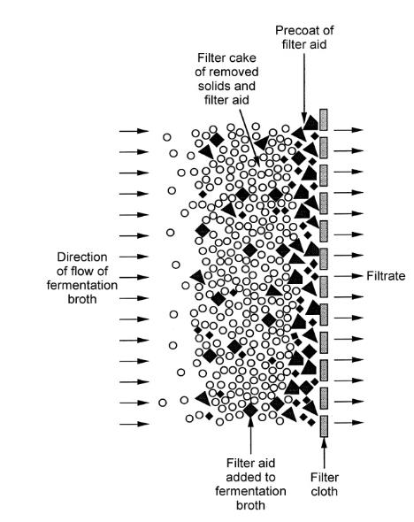
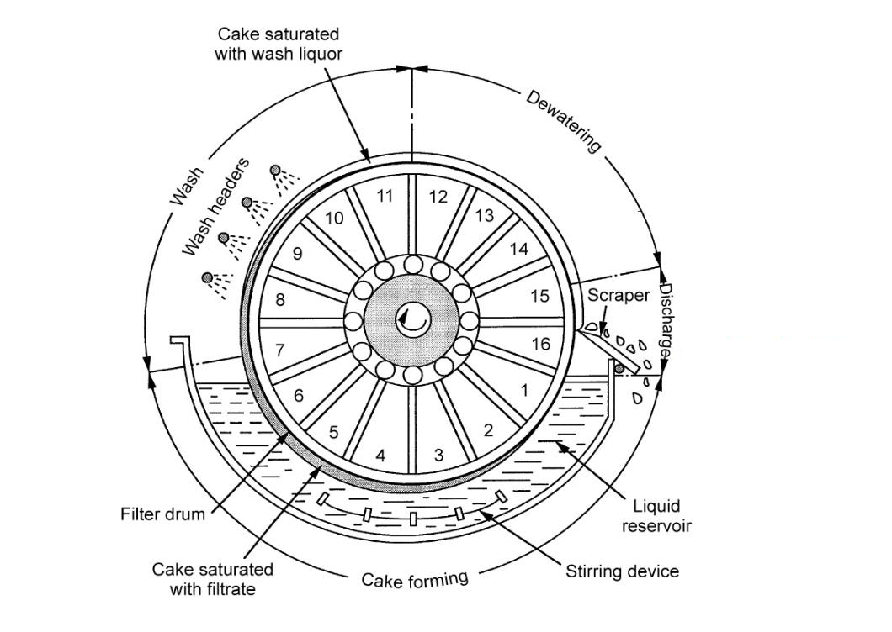

# Bioprocessing overview and filtration

## Overview

A bioprocess must deliver a useful product at scale, with upstream production and downstream recovery designed together. The recovery train first separates cells from liquid; filtration illustrates how equipment choice, cake growth and compressibility determine throughput and area.

*Assumed throughout:* material balances, transport and basic microbial cultivation.

## Section 31: Developing and scaling a bioprocess

### Intuition

A bioprocess is developed in stages of increasing size, and each stage exists to answer questions the previous one could not.

The reason is that biology does not scale geometrically. Doubling the diameter of a vessel multiplies its volume by eight but its surface area only by four, so oxygen transfer, heat removal and mixing all fall behind the demand of the cells inside. A culture that thrives in a shake flask may be starved of oxygen in a stirred tank of the same nominal composition.

Each scale therefore has a purpose: the microtitre plate screens *which organism*, the flask fixes *the medium*, the bench-top bioreactor measures *what the cells need*, and the pilot plant finds out *what breaks*.

*Analogy:* a recipe scaled from a domestic kitchen to a canteen. The ingredients are unchanged, but heating, stirring and timing all behave differently, and only cooking at the intermediate scale reveals it. The analogy breaks down because the cells here are alive and respond to the physical environment by changing their metabolism, so a scale-up failure can change the product, not just the yield.

### Mechanism

The route divides into three phases.

#### 1. Developing the microorganism (steps 1–11)

The product, if a protein, is encoded in DNA:
- the **gene of interest** is identified in a cell or tissue and extracted;
- it is **cloned into a plasmid** (Section 08);
- cells — commonly *E. coli* — are **transformed** with the plasmid, so that they express the recombinant protein;
- the host is chosen for its ability to produce the product efficiently, which depends not only on expression level but on **how easy it is to culture, harvest and process**.

That last criterion matters more than it appears: a host that expresses well but lyses easily or secretes proteases creates problems in every downstream step. Engineering considerations enter at the organism-selection stage, not after it.

Development is done in **microtitre plates**, screening a few hundred microlitre cultures in parallel, then in **shake flasks** (250 mL to 1 L). At this stage the medium composition, pH, temperature and other environmental conditions are optimised for growth and productivity.

#### 2. Scaling up (steps 12–14)

**Bench-top bioreactor (1–2 L).** The first vessel with instrumentation. Here one can control and measure stirrer speed, dissolved oxygen, pH and temperature, which a flask cannot. This allows the optimal growth conditions to be characterised properly and, importantly, reveals the culture's **shear sensitivity, oxygen requirement and foaming behaviour**. Process parameters — oxygen transfer rate, power number, Reynolds number, mixing time — can now be measured or computed.

**Pilot-scale bioreactor (100–1000 L).** Usually *geometrically similar* to the bench-top vessel, so that correlations can be carried across. Rates of air sparging and stirring must change to maintain adequate oxygen transfer, and productivity is often lost at this point and must be diagnosed.

#### 3. Industrial operation (steps 15–17)

Large-scale fermentation, then **product recovery** — the downstream processing of Sections 32–47 — then packaging and marketing.

### Motivation and explanation

**Why geometric similarity is not enough.** Keeping the vessel's shape fixed does not keep the *physics* fixed, because different quantities scale differently with size:
- volume, hence oxygen demand, scales as $L^3$;
- surface area for heat transfer scales as $L^2$;
- impeller tip speed, hence shear, scales as $L$ at fixed stirrer speed.

No single operating rule holds all of these constant. Scale-up is therefore done by choosing **one** criterion to preserve — constant power per unit volume, constant oxygen transfer coefficient $k_La$, or constant tip speed — and accepting that the others change. Which to preserve depends on what limits the culture, which is why the bench-top stage must identify the limiting factor first.

**Why productivity falls on scale-up.** Mixing times grow with vessel size, so cells in a large fermenter experience a *fluctuating* environment, circulating between oxygen-rich regions near the sparger and oxygen-poor regions elsewhere. In a 1 L vessel the culture is effectively uniform; in a 10 m³ vessel it is not. Cells respond to these excursions by shifting metabolism, often towards by-products.

A dissolved-oxygen reading at one probe does not describe the entire path travelled by a cell. If the cell consumes oxygen faster than mixing replenishes its local surroundings, it can experience repeated starvation even when the vessel-average value appears acceptable. Scale-up must therefore compare the timescale of local supply and mixing with cellular demand, rather than matching a single nominal concentration.

**Why the product dictates the host.** Bacteria grow fast and are cheap but cannot perform most post-translational modifications. A glycosylated therapeutic antibody (Section 28) is commonly made in mammalian cells, which grow relatively slowly, need complex media and can be shear-sensitive. The host must provide the required folding and glycosylation; alternative hosts need appropriate engineering. The choice propagates through the entire plant.

### Wider pathway

The organism is only the first half of the problem. Whatever is made must then be separated from a dilute, complex aqueous mixture, and that separation usually dominates the cost. Section 32 sets out why.

### Link to other topics

The scale-up problem is the familiar dimensional-analysis argument from transport processes: when several dimensionless groups cannot be matched simultaneously, one identifies the controlling mechanism and preserves the group that governs it, accepting distortion in the rest.

### Summary

A bioprocess is built in stages — plate, flask, bench-top, pilot, industrial — because biology does not scale geometrically: oxygen transfer, heat removal and mixing all fall behind volume as size grows. Each stage answers a question the previous one could not, with the bench-top reactor identifying the limiting factor that scale-up must then preserve.

## Section 32: Downstream processing — stages, logic and cost

### Intuition

Downstream processing is governed by one ratio: how much of the broth is product. If that fraction is $10^{-9}$, then $10^{9}$ parts of everything else must be removed, and no single operation can do it. A train of separations is needed, and the order in which they are placed decides the cost.

The ordering principle is simple: **remove the most material earliest**. Every unit downstream of a given point must be sized for the flow reaching it, so a step that cuts the volume tenfold makes everything after it ten times smaller. Cheap, crude, high-capacity operations go first; expensive, selective, low-capacity ones go last, when little is left to process.

*Analogy:* sorting a landfill for a lost ring. You do not start with tweezers and a magnifying glass; you shift the bulk mechanically first, then sieve, then inspect. The analogy breaks down because biological products are labile — they denature, they are digested by proteases released from broken cells, and they are lost at every transfer — so speed matters as much as order.

### Mechanism

#### What makes it difficult

- **Dilute.** Products are formed in dilute solution; both the medium and the cells are mostly water.
- **Labile.** Biological products tolerate only a narrow range of temperature, pressure, solvent and salt concentration, which rules out many conventional separation techniques.
- **Contamination control.** Hygienic or aseptic operation is designed around the product and its requirements. Short residence times can limit microbial growth, but do not replace suitable closed equipment, cleaning and aseptic controls where required.
- **Similar impurities.** The broth contains cells, proteins, sugars and other macromolecules **chemically similar to the desired product** — so the separation cannot rely on gross property differences.
- The main objective is separation, concentration and formulation. Changes of pH, solvent or salt can change protonation and conformation, so product stability still needs checking.

#### The five stages

1. **Cell removal** — usually the first step after fermentation. Filtration or centrifugation, exploiting **particle size and density**. The product may be the cells themselves, inside them, or in the medium, and the flowsheet branches accordingly.
2. **Cell disruption** — only if the product is intracellular. Mechanical, physical, chemical or enzymatic (Sections 38–41). The debris released must then be removed by the same methods as step 1.
3. **Primary isolation** — removes components with **substantially different properties** from the product. Non-selective, high-capacity: solvent extraction, two-phase aqueous extraction, adsorption, precipitation (Sections 42–45).
4. **Product enrichment** — **highly selective** methods separating the product from impurities with *similar* properties. Chromatography in its various forms (Sections 46–47).
5. **Final isolation** — the finished form. Liquids may be concentrated by ultrafiltration; solids are crystallised, then centrifuged or filtered and dried.

The branching in the flowsheet is decided by one question asked at the start — *where is the product?* — because that determines whether the cells are the product, must be broken open, or can simply be discarded.

At each branch, identify the stream carrying the product before discarding anything. For a secreted protein it is usually the clarified liquid; for an intracellular protein it is initially the cell-rich fraction. Purity, concentration and recovery then answer separate questions: how much impurity remains, how much liquid carries the product, and how much of the original product survives. A concentrated, pure fraction can still represent poor recovery if most of the product was sent to waste.

**Illustrative concentration and purity ranges through the train:** individual operations, including extraction and size-exclusion chromatography, can dilute the product.

| Step | Product concentration (g/L) | Product quality (%) |
|---|---|---|
| Harvest broth | 0.1–5 | 0.1–1 |
| Cell removal | 1–5 | 0.2–2 |
| Primary isolation | 5–50 | 1–10 |
| Product enrichment | 50–200 | 50–80 |
| Final isolation | 50–200 | 90–100 |

Two features are worth noting. **Cell removal barely improves purity** (0.1–1 % to 0.2–2 %) despite removing most of the mass — it removes bulk, not impurity. And **product enrichment does almost all the purification**, from about 10 % to 50–80 %, which is why the chromatography steps dominate cost.

### Motivation and explanation

**Why price tracks dilution.** The plot spans ten orders of magnitude in both axes and shows a clear inverse trend: the more dilute a product is in the starting material, the more it sells for. Ethanol and citric acid sit at high concentration and low price; factor VIII and urokinase at $10^{-6}$ kg/m³ and very high price.

Low starting concentration means a large volume must be processed per unit of product, and losses compound through the recovery train. That can make separation a large manufacturing cost. The plot illustrates a correlation; it does not show that separation cost alone sets selling price, which also depends on demand, development costs and market conditions.

**How much of the cost.** For well-characterised antibiotics such as penicillin, the ratio of fermentation cost to recovery cost is about **60:40**. For recombinant proteins and monoclonal antibodies the ratio **reverses, and can reach 20:80** — four times as much spent recovering the product as making it.

The reason is in the purity table. A small molecule such as penicillin is chemically distinct from everything else in the broth and can be extracted and crystallised. A therapeutic protein must be separated from thousands of *other proteins* of similar size, charge and solubility, which requires several chromatography steps, each with its own yield loss.

**Where the engineering opportunity lies.** Because initial concentration is so low for high-value products, recovery costs are high and so is the selling price. That leaves considerable room for innovation: improvements in downstream processing translate directly into cost reduction, and this is where chemical engineers have the clearest contribution to make in modern biological processes.

### Link to other topics

Placing the cheapest, least selective operation first and the most selective last is the standard ordering heuristic for any separation train, and it follows from the same argument as in distillation sequencing: each unit is sized for the flow it receives, so removing bulk early shrinks everything downstream.

### Summary

Downstream processing takes a dilute, labile, chemically similar mixture and concentrates the product through five stages ordered cheapest-and-crudest first. Cell removal takes out bulk without improving purity; enrichment by chromatography does the purification and dominates the cost.

## Section 33: Cell removal by filtration — equipment and operation

### Intuition

Dead-end filtration is the simplest solid–liquid separation: a barrier with openings smaller than the particles. Liquid passes, particles do not, and the two phases separate. Flow is driven by gravity or by an imposed pressure drop.

The difficulty is that the method destroys its own performance as it operates. Retained particles accumulate on the cloth as a **filter cake**, and that cake is itself a porous medium through which the liquid must now flow. Every particle removed makes the next one harder to remove. Flow declines as resistance increases. In the ideal finite-permeability Darcy model it remains positive at finite time; practical runs end when flux or capacity reaches an operating limit.

This is the defining feature of dead-end filtration and the reason for everything else in the note: filter aids exist to make the cake more porous, plate-and-frame presses are built to be opened and scraped, and rotary vacuum drums exist to remove the cake continuously.

*Analogy:* a sink strainer that slowly blocks with tea leaves. The analogy breaks down in an important way — the cake is not simply blockage. It is also an *active filter*, often finer than the cloth beneath it, so a filtration can improve in selectivity as it worsens in rate.

### Mechanism

**Dead-end filtration.** A physical barrier with openings smaller than the suspended particles impedes their motion while liquid flows past, separating the phases. The flow is driven by gravity or by a pressure drop across the filter.

**The cake problem.** The major issue is cake formation. As the cake builds, it imposes a greater resistance to liquid flow, so the throughput deteriorates during the run. At fixed pressure difference, flux decreases towards zero asymptotically in the ideal cake-filtration model. A practical run ends earlier at a throughput or capacity limit. Section 34 makes this quantitative.

**Two fixes for the cake**, both aimed at increasing its porosity:
- **Pre-coating.** The cloth is covered with a layer of filter aid before the run. This protects the cloth from blinding and improves efficiency, though it adds its own flow resistance.
- **Filter aids** added to the broth. **Kieselguhr** (diatomaceous earth) is the usual choice: naturally occurring, highly porous, irregular particles. Mixed into the broth, they are deposited along with the cells and hold the cake open, so the cake is more porous and less resistant.

The filter cloth itself is progressively covered by the cake, so after a short time it is the cake, not the cloth, that is doing the filtration.

#### Equipment

**Batch: plate-and-frame filter press.** Cloth is spread over plates and supported along ridges, which leave a free area for the filtrate to flow. Many plates in series give a large area in a compact unit, and cake builds on the upstream side of each cloth. When the space between plates is filled with cake, the press must be **dismantled and scraped**.

That is the limitation of the conventional exposed cake press: it is laborious and must be serviced frequently, and opening it makes aseptic operation difficult. It suits appropriate batch duties; enclosed sanitary filter designs require their own assessment.

**Continuous: rotary drum vacuum filter.** For large fermentations, the standard choice.

- A horizontal cylindrical drum, **0.5–3 m in diameter**, rotates slowly at **0.1–2 rpm**.
- A **vacuum is applied inside the drum**, drawing liquid from the immersed portion into the interior.
- As the drum rotates out of the reservoir, the cake on its surface is **sprayed with wash liquid**, recovering product held in the cake.
- Continued vacuum **dewaters** the washed cake.
- A **scraper** removes the cake before the surface re-enters the reservoir.

Each element of the drum therefore passes through cake formation, washing, dewatering and discharge once per revolution. The cake is removed continuously rather than accumulating, which is precisely what the batch press cannot do.

The drum is continuous for the plant while each small surface element follows a repeating batch cycle. Only the immersed fraction collects new cake; the emerged fraction spends its time washing, draining and discharging. Total drum area therefore cannot be treated as fully active filtration area at every instant. Changing the immersion fraction or rotation rate redistributes the time available for those competing duties.

It handles large volumes, suits separation of organisms, and is cheap and easy to operate — **but it is difficult to operate aseptically**, since the drum surface is open to the atmosphere.

### Motivation and explanation

**Why rotation speed is the key variable.** Cake thickness at the scraper is set by how long each element spends immersed, which is fixed by the rotation rate. Rotating faster gives a thinner cake and so a higher flux per unit area, but less time for washing and dewatering, so more product is lost in the wet cake and the discharged solids are wetter. Rotating slower gives better washing and drier cake at lower throughput. The 0.1–2 rpm range is the compromise, and the right value depends on whether product recovery or throughput dominates the economics.

**Why filter aids are a compromise.** Kieselguhr increases cake porosity and so raises the flow rate, but it also adds solid mass to be filtered and must be disposed of with the cells. If the product is *inside* the cells (Section 38), the filter aid ends up mixed with the material to be processed further, which is a nuisance. Filter aids are therefore used when the cells are waste, less readily when they are the product.

**Why asepsis is hard to maintain.** Both the plate-and-frame press and the rotary drum expose the cake to the atmosphere — one on dismantling, the other continuously. Where sterility matters, as in therapeutic protein manufacture, centrifugation in a closed vessel (Sections 35–37) or membrane filtration in a sealed module is used instead. The equipment described here belongs to large-volume, lower-value production such as antibiotics and enzymes.

### Link to other topics

The cake acting as a filter finer than the cloth that supports it is the same effect as a precoat layer in water treatment or a filter-aid body feed in clarification: the medium's role is to retain the first layer of solids, after which the solids do the separating.

### Summary

Dead-end filtration separates by size but degrades as it runs, because the retained cake becomes the dominant flow resistance. Filter aids and pre-coating keep the cake porous; plate-and-frame presses accept the cake and are dismantled to remove it; rotary drum vacuum filters remove it continuously with a scraper and so handle large volumes, at the cost of asepsis.

## Section 34: Dead-end filtration theory and filter sizing

### Intuition

Flow through the filter is driven by the pressure drop and opposed by two resistances in series: the **filter medium** (the cloth, constant) and the **cake** (growing). Flow rate is driving force over resistance, as in any transport problem.

The crucial feature is that the cake resistance is proportional to how much cake there is, and the amount of cake is proportional to how much filtrate has already passed. So the resistance grows in proportion to the volume collected, and the flow rate falls as that volume rises. Integrating a rate that decays with the amount already produced gives a time that scales as **volume squared** — the key result.

*Analogy:* paying off a debt where each payment increases the interest rate. The analogy breaks down because the cake also compresses under pressure, so pushing harder makes the obstacle worse — an effect with no financial equivalent, and the one that produces the surprising result at the end.

### Derivation

Notation: $A$ filter area (m²), $V_f$ filtrate volume (m³), $t$ filtration time (s), $\Delta p$ pressure drop (Pa), $\mu_f$ filtrate viscosity (Pa s), $M_c$ total mass of solids in the cake (kg), $\phi$ average specific cake resistance, $R_M$ filter medium resistance, $c$ mass of solids deposited per unit volume of filtrate (kg m⁻³).

**Step 1: the governing equation.** The filtrate flux (volumetric flow per unit area) equals the driving force divided by the total resistance:
$$\frac{1}{A}\frac{dV_f}{dt} = \frac{\Delta p}{\mu_f\left[\phi\left(\dfrac{M_c}{A}\right) + R_M\right]} \tag{43}$$
The two resistances add because they are **in series**: the liquid passes through the cake and then the medium. The cake term carries $M_c/A$, the mass of solids per unit area, because resistance scales with cake thickness.

**Step 2: relate cake mass to filtrate volume.** Every unit volume of filtrate deposits a fixed mass of solids, so
$$M_c = cV_f \tag{44}$$
This assumes the feed concentration is constant through the run. Substituting into (43):
$$\frac{1}{A}\frac{dV_f}{dt} = \frac{\Delta p}{\mu_f\left[\phi\left(\dfrac{cV_f}{A}\right) + R_M\right]} \tag{45}$$

Here $c$ is defined per volume of filtrate collected, rather than automatically being the solids concentration per volume of incoming broth. Some liquid remains in the wet cake, so these bases can differ appreciably for a concentrated suspension. The laboratory property group and the plant duty must use compatible volume and solids-loading definitions; otherwise an apparently correct area scaling transfers the wrong mass of cake per unit filtrate.

**Step 3: separate variables.** Rearranging (45) to put $V_f$ on one side and $t$ on the other:
$$dt = \frac{\mu_f}{A\Delta p}\left(\frac{\phi c}{A}V_f + R_M\right)dV_f \tag{46}$$

**Step 4: integrate** from $t=0$, $V_f=0$ to $t$, $V_f$. The right-hand side is linear in $V_f$, so the integral gives a quadratic:
$$t = \frac{\mu_f}{A\Delta p}\left(\frac{\phi c}{2A}V_f + R_M\right)V_f \tag{47}$$
The factor of 2 arises from integrating the linear term: the *average* cake resistance over the run is half its final value.

**Step 5: neglect the medium.** Once an appreciable cake has formed, the cloth contributes very little, so $R_M \ll \dfrac{\phi c}{2A}V_f$ and
$$t = \frac{\phi\,c\,\mu_f\,V_f^{\,2}}{2A^2\Delta p} \tag{48}$$

**Checks on (48).** Time rises as $V_f^2$, not $V_f$ — doubling the volume quadruples the time, because the later filtrate passes through a thicker cake. Time falls as $A^2$: doubling the area halves the required filtrate volume per unit area *and* halves the final cake thickness, so the gain is quadratic. More viscous or more concentrated broth takes proportionally longer.

**Step 6: cake compressibility.** Biological cakes are soft, so the cake compacts under pressure and its specific resistance rises:
$$\phi = \phi'\Delta p^{\,s} \tag{49}$$
with $\phi'$ a constant set by particle size and morphology, and $s$ the **cake compressibility** ($s = 0$ incompressible, $s = 1$ fully compressible). Substituting (49) into (48):
$$\boxed{\;t = \frac{\phi'\,c\,\mu_f\,V_f^{\,2}}{2A^2\,\Delta p^{\,1-s}}\;}\tag{50}$$

Rearranged for the design variable, the area:
$$A = \sqrt{\frac{\phi'c\,\mu_f\,V_f^{\,2}}{2t}}\;\Delta p^{\,(s-1)/2} \tag{51}$$

### Motivation and explanation

**What compressibility does to the pressure dependence.** In (50) the pressure appears as $\Delta p^{1-s}$, not $\Delta p$. The exponent on area in (51) is $(s-1)/2$:

| $s$ | Area exponent | Area increase on halving $\Delta p$ |
|---|---|---|
| 0 (incompressible) | −0.5 | ×1.41 |
| 0.5 | −0.25 | ×1.19 |
| 0.8 | −0.10 | ×1.07 |
| 1 (fully compressible) | 0 | ×1.00 |

At $s = 1$ the pressure drops out of the equation entirely: **raising the pressure gains nothing at all**, because the cake compresses in exact proportion to the extra driving force. Real biological cakes sit between these limits, and the weak dependence means pressure is a poor design variable — area is the one that matters, which is why (43) labels $A$ the key parameter.

**The physical picture.** A higher pressure drop squeezes the cake, closing the pores between particles and raising its resistance. The extra driving force is partly cancelled by the extra obstruction. For a soft mycelial or cellular cake this cancellation is substantial.

**When (50) fails.** It assumes constant $\Delta p$, constant feed concentration, a cake of uniform properties, and negligible medium resistance. The last fails at the start of a run, when there is no cake, and that is exactly when (48) predicts infinite flux. It also assumes no particles penetrate the medium; if they do, the cloth blinds and $R_M$ rises rather than staying constant.

### Worked example

*Scaling a penicillin broth filtration from the laboratory to a pilot plant.* All numbers computed in Python.

**Given.** A 30 mL sample of *Penicillium chrysogenum* broth is filtered on a 3 cm² filter at $\Delta p = 0.35$ bar, taking 4.5 min. The cake compressibility is $s = 0.5$. Medium resistance is negligible. 500 L of broth must be filtered in 1 hour at (a) 0.7 bar and (b) 0.35 bar.

**Step 1: find the broth property group from the lab test.** The quantities $\phi'$, $c$ and $\mu_f$ are not known individually, but (50) only ever needs their product. Rearranging (50):
$$\phi'c\,\mu_f = \frac{t\,2A^2\Delta p^{\,1-s}}{V_f^{\,2}}$$
$$= \frac{(4.5\times60\ \mathrm{s})\times2\times(3\times10^{-4}\ \mathrm{m^2})^2\times(0.35\times10^5\ \mathrm{Pa})^{0.5}}{(3\times10^{-5}\ \mathrm{m^3})^2} = 1.0\times10^{7}\ \mathrm{s\,m^{-2}\,Pa^{0.5}}$$

This is the point of the lab test: a single small-scale measurement collapses three unmeasurable properties into one group that transfers to any scale.

**Step 2: size the pilot filter** from (51), with $V_f=0.5$ m³ and $t=3600$ s. Use the unrounded laboratory group, $\phi'c\mu_f=1.0102475\times10^7\ \mathrm{s\,m^{-2}\,Pa^{0.5}}$, in both calculations.

(a) At $\Delta p = 0.7\times10^5$ Pa:
$$A = \sqrt{\frac{1.0102475\times10^{7}\times(0.5)^2}{2\times3600}}\,(0.7\times10^5)^{-0.25} = 1.15\ \mathrm{m^2}$$

(b) At $\Delta p = 0.35\times10^5$ Pa:
$$A = 1.37\ \mathrm{m^2}$$

**Step 3: interpret.** Halving the pressure increases the required area by only **19 %**, not the 41 % an incompressible cake would need. The ratio is exactly $2^{0.25} = 1.189$, which is (51) with $s = 0.5$.

Two readings of the same result:
- *Mathematically*, area depends on pressure only as $\Delta p^{-0.25}$ — a weak dependence.
- *Physically*, increasing the pressure compresses the cake and makes filtration more difficult, so most of the extra driving force is wasted.

The design consequence is **diminishing benefit from pressure**. Going from 0.35 to 0.7 bar saves about 0.21 m² in this example, while changing pumping and equipment costs. More area may be preferable for a compressible cake, but the optimum requires an economic comparison. As $s \to 1$, increasing pressure gives no improvement in the cake-dominated model; more area still increases capacity.

### Link to other topics

Equation (47) is the standard series-resistance result: a driving force divided by the sum of resistances, integrated when one resistance grows with the extent of the process. Compressibility makes the resistance depend on the driving force itself, which is the same self-limiting feedback seen in fouling and in flow through deformable porous media.

### Summary

Filtration time rises as $V_f^2/A^2$ because cake resistance grows in proportion to the filtrate already collected, so area is the dominant design variable. Cake compressibility weakens the pressure dependence to $\Delta p^{1-s}$, and for the penicillin example at $s = 0.5$ halving the pressure costs only 19 % more area ; the economic choice still depends on area, pumping and equipment costs.

## Conclusion

Cell removal links broth properties to equipment duty, and cake compressibility makes added filtration area more reliable than added pressure. The next unit develops centrifugation.
