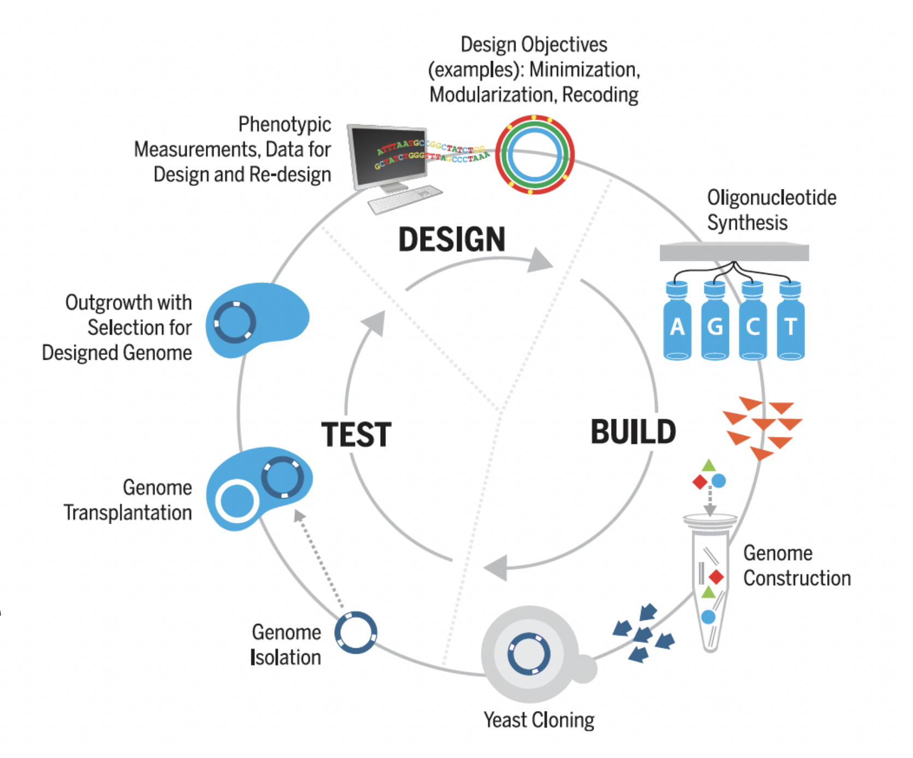
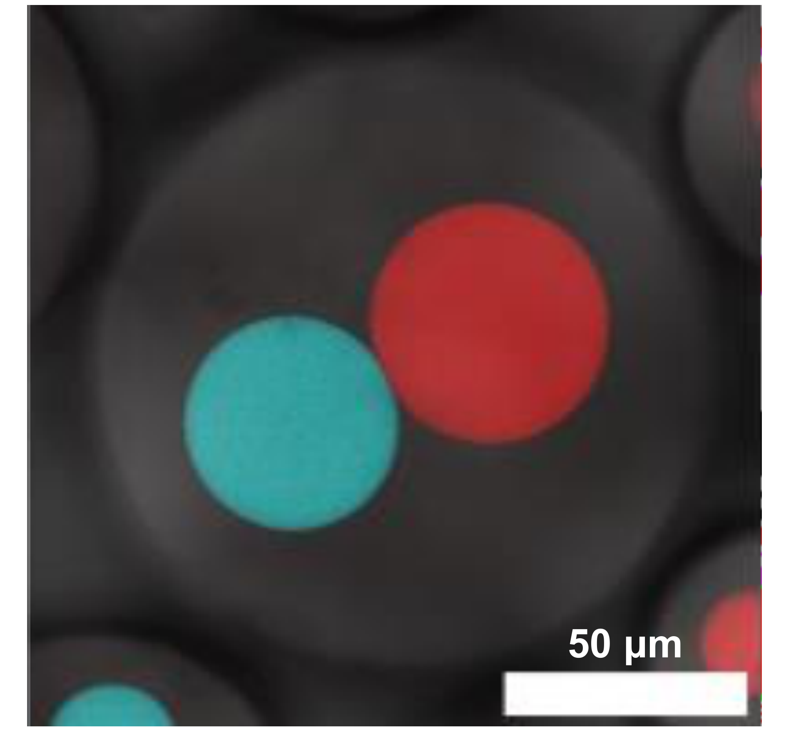

# Cell-free systems and synthetic cells

## Overview

Cell-free systems move transcription and translation into an engineered reaction mixture. In-vitro transcription enables mRNA production, while genome minimisation and bottom-up compartment construction explore complementary routes to simpler cellular systems.

*Assumed throughout:* gene expression, enzyme catalysis and membrane structure.

## Section 53: Cell-free TXTL — extracts and PURE

### Intuition

A cell is both a production plant and a system that maintains the plant. Cell-free expression keeps the production equipment while handing maintenance to the engineer: buffers control the environment, and added substrates support biosynthesis. A toxic product can therefore be made without requiring a host to keep growing, provided it does not inhibit the extracted machinery itself.

*Analogy:* operating machinery removed from a factory. The limit is that molecular machines continually degrade and share reagents; taking away the factory also removes repair, compartmentalisation and much of metabolic regulation.

### Derivation

The mechanism runs from DNA to mRNA to polypeptide, then folding. Each stage requires something different, so supplying DNA alone cannot sustain expression.

**Transcription.** RNA polymerase recognises a compatible promoter and uses nucleoside triphosphates (NTPs) to extend RNA. Magnesium supports catalysis. The promoter and polymerase must match; a bacterial extract can use endogenous polymerase, or a supplied polymerase such as T7 with its own promoter.

**Translation.** Aminoacyl-tRNA synthetases use ATP to attach each amino acid to its matching transfer RNA (tRNA). The ribosome recognises codon–anticodon pairs and transfers the growing peptide to the incoming aminoacyl-tRNA. Initiation, elongation, release and recycling factors coordinate the cycle; GTP supports delivery and translocation. Energy comes from activated substrates and nucleotide hydrolysis, rather than from the peptide bond spontaneously forming between free amino acids.

**Maintaining activity.** Added amino acids and NTPs supply material; energy substrates and regeneration enzymes replenish usable nucleotide triphosphates. Salt, magnesium, pH and sometimes crowding agents support the machinery. Reagent depletion, inhibitory by-products and degradation eventually stop a closed batch.

Adding more DNA can initially increase the demand for transcription and translation without increasing the amount of polymerase, ribosomes or usable energy. Beyond the regime of unsaturated machinery, templates compete for shared resources, and expression from one construct can reduce output from another. The absence of a living host removes growth requirements, but it does not make template concentration an independent linear control of protein yield.

**Extract route.** Grow source cells, disrupt them, and clarify the lysate to remove intact cells and coarse debris while retaining ribosomes and soluble factors. Endogenous nucleic-acid activity is reduced by preparation-dependent treatments; clarification alone does not guarantee removal of all cellular DNA or mRNA. Add the chosen template and supplement the reaction. Bacterial, yeast, wheat-germ and rabbit-reticulocyte preparations differ in translation and processing capabilities.

**PURE route.** Protein synthesis Using Recombinant Elements combines individually purified synthetases, translation factors and energy-regeneration enzymes with ribosomes, tRNAs and small molecules. A representative formulation contains 36 non-ribosomal proteins; the exact set depends on the formulation. For TXTL from DNA, include a compatible RNA polymerase. Purified components give control over omissions and concentrations; they do not mean that every component, including the ribosome, is a single recombinant protein.

### Motivation and explanation

| Choice | What is gained | What must be managed |
|---|---|---|
| Crude extract | Inherited cofactors, enzymes and metabolic capacity; comparatively economical preparation | Batch variation, background reactions, nucleases and proteases |
| PURE | Defined composition and targeted removal or replacement of factors | Many separate purification steps, cost and limited auxiliary functions |

Extracts often offer higher practical protein yields than a basic PURE mixture, but yield depends on the protein, formulation and operating mode. Membrane proteins need an appropriate membrane mimic or lipid compartment; folding and post-translational processing may need extra machinery.

Changing DNA avoids a new host-engineering cycle for each product. It also supports automation, linear templates and, in suitable preparations, freeze-dried storage. Linear DNA may need protection against nucleases. Cell-free production removes growth and harvest from the expression stage, but source-cell cultivation and disruption are still needed to prepare extracts. Purification must still separate product from enzymes, nucleic acids and other impurities. Product-specific quality and safety requirements remain, and oxygen transfer can still matter when energy regeneration uses respiration.

#### Reassigning a stop codon in a defined mixture

To insert a non-canonical amino acid at a chosen stop codon, a defined PURE mixture can omit its recognising release factor and supply a suppressor tRNA charged with the desired amino acid. The tRNA can then support elongation where termination would otherwise occur.

Removing a release factor alone provides neither the unusual amino acid nor a correctly charged tRNA. The other elongation factors must remain functional, and the product needs a separate effective termination route. Extracts are harder to control because endogenous release factors and competing reactions remain. The defined mixture makes a specific molecular competition experimentally adjustable.

### Link to other topics

Cell-free systems reuse the transcription and translation mechanisms of gene regulation while exposing resource competition directly to experimental control. Their preparation uses cell disruption and clarification, whereas their products still need downstream purification.

### Summary

Extracts preserve biochemical breadth; PURE trades that breadth for control. The same separation of machinery from living cells also allows RNA to be manufactured without translating it into protein.

## Section 54: Manufacturing mRNA by in vitro transcription

### Intuition

Manufacture the instruction rather than the antigen: a recipient cell later translates the delivered mRNA into protein. The production problem therefore shifts from folding and purifying an antigen to controlling RNA sequence, integrity, end chemistry and impurities.

*Analogy:* printing an instruction sheet with protective covers and a delivery envelope. The limit is that a cap and poly(A) tail actively recruit cellular proteins; they are more than packaging, and RNA impurities can change how the immune system responds.

### Derivation

**Template and polymerisation.** Prepare DNA containing a promoter recognised by the selected polymerase, followed by the RNA sequence. A linear template provides a defined run-off endpoint; a plasmid can be linearised or the required region amplified. T7 RNA polymerase uses ATP, CTP, GTP and UTP as building blocks, with magnesium as a catalytic cofactor. A buffer controls pH, and polyamines such as spermidine can support transcription under suitable conditions.

The RNA's terminal hydroxyl attacks the incoming NTP's phosphate, forming a phosphodiester bond and releasing pyrophosphate. Repeated template-directed addition produces RNA while leaving the DNA available for further transcription. This mixture needs no ribosomes or amino acids because it does not make protein.

**End structures.** The message comprises a cap, untranslated regions (UTRs), a coding sequence and a poly(A) tail. The UTRs affect stability and translation. The 5′ cap contains a methylated guanosine joined through an unusual 5′–5′ triphosphate linkage; it supports translation initiation and resistance to degradation. The tail recruits poly(A)-binding proteins and supports stability and translation.

Two capping routes are possible. Post-transcriptional capping treats the RNA with capping enzymes: removal of the terminal phosphate, addition of guanosine and methylation build the cap, with additional methylation where required. Co-transcriptional capping introduces a suitable cap analogue during initiation. The latter can remove the separate capping reactor, but requires compatible template and reaction design. The poly(A) tail can be encoded in the template or added afterwards by template-independent poly(A) polymerase.

**Purification and formulation.** Remove residual DNA, enzymes, unused NTPs and aberrant RNA, including truncated or double-stranded species. DNA digestion reduces the template to smaller fragments that subsequent operations can remove. Tangential-flow filtration concentrates or exchanges buffer where its membrane retains the RNA and passes smaller solutes. Chromatography adds selectivity: ion exchange exploits charge, size exclusion exploits hydrodynamic size, and oligo(dT) affinity captures a poly(A) tail through base pairing. Tail capture alone does not prove that an RNA has the correct cap or intact coding region.

Each operation recognises a particular property. A poly(A)-binding step can retain a truncated molecule that still has its tail, while a size-based step may not distinguish correctly capped from uncapped full-length RNA. Product quality therefore requires several compatible tests and separations, rather than one measurement of RNA mass. In the yield balance below, the capped fraction and subsequent recoveries refer to the same intact target population; unrelated assay fractions cannot simply be multiplied.

Finally, formulate the purified message for delivery, for example in lipid nanoparticles. Their job includes RNA protection and cytoplasmic delivery; producing pure RNA alone does not accomplish either.

### Motivation and explanation

The architecture makes IVT adaptable: change the coding sequence while retaining much of the manufacturing platform. However, a new sequence can change secondary structure, reaction behaviour and impurity formation, so the recipe is not automatically transferable without optimisation.

Double-stranded RNA and uncapped or damaged transcripts can alter innate sensing and reduce useful translation. Total RNA mass is therefore not the same as acceptable product mass. A selective separation train is needed even though no cells are present in the IVT reactor.

The process below includes proposed enzyme-recycling loops. These require a separation that recovers active enzyme without unacceptable product carryover. Ordinary ultrafiltration may retain both enzyme and long RNA; the presence of a filtration step does not by itself establish selective recycling. The diagram is a conceptual process, rather than a universal manufacturing recipe.

#### Following acceptable product through the process

In this conceptual diagram VCC denotes vaccinia capping enzyme and the methyl donor supports cap methylation. Selective enzyme recycling needs its own separation evidence; a filtration arrow alone does not establish that long RNA and enzyme can be separated.

Let $m_0$ be intact target RNA mass, $f_c$ its correctly capped fraction, $y_p$ recovery of that fraction in purification and $y_f$ its recovery in formulation. Neglect cap mass increase and additional degradation. Successive balances give $m_c=m_0f_c$, $m_p=m_cy_p$ and $m_f=m_py_f$, hence

$$m_f=m_0f_cy_py_f.\tag{125}$$

For illustrative $m_0=100\,\mathrm{mg}$, $f_c=0.90$, $y_p=0.80$ and $y_f=0.95$, acceptable final mass is $68.4\,\mathrm{mg}$. All recovery factors are dimensionless and refer to the target population entering the relevant step. Total RNA mass alone can overstate acceptable yield if incorrect caps or damaged transcripts remain.

### Link to other topics

IVT reuses DNA assembly and transcription, but stops before the translation stage of TXTL. Its purification applies the filtration, chromatography and nucleic-acid recognition mechanisms already used elsewhere in bioprocessing.

### Summary

mRNA manufacture couples template-directed synthesis to end processing, selective purification and delivery. Removing cells simplifies the reaction environment while leaving product quality and separation as central engineering problems.

## Section 55: Top-down synthetic biology — minimal cells

### Intuition

A bacterium carries genes for both routine operation and coping with changing conditions. Supplying a stable, nutrient-rich environment can make some functions dispensable: the medium replaces tasks that the cell would otherwise perform itself.

*Analogy:* stripping a vehicle to essentials for one controlled track. The limit is that genes form interacting networks, so removing two individually dispensable parts can eliminate a shared function. A reduced cell also continues to maintain and reproduce its machinery rather than merely running once.

### Derivation

There is no universal gene-count equation for life. The minimal set is inferred by a design–build–test loop that asks whether a reduced genome supports a specified phenotype.

**Define the test.** Specify growth conditions and the criterion for success. Viability, robust population growth and regular division are different endpoints. Mycoplasma already have reduced genomes and depend strongly on nutrients supplied by their surroundings. Host association can relax selection for some biosynthetic functions; it does not remove all environmental challenges or adaptation.

**Perturb genes.** Transposon insertion disrupts genes. Mutants recovered after growth show that a disruption is tolerable under those conditions; failure to recover insertions suggests essentiality, subject to insertion biases and experimental limitations. Comparing mutant abundance over passages also exposes fitness defects that a single survival test can miss. Bioinformatics identifies conserved machinery and suggests functions, but prediction alone cannot establish dispensability.

**Distinguish growth requirements.** Essential genes cannot be removed while retaining the tested viability. Quasi-essential genes permit some survival when disrupted but are needed for sufficiently robust growth. Non-essential genes can be removed under the specified conditions. These categories change with environment and with the remaining genome. Two alternative pathways can each be dispensable alone, yet deleting both is lethal: single-gene tests do not prove that all tolerated deletions can be combined.

Restoring a deleted gene and recovering growth links the failure to that deletion more strongly than observing failed growth alone. Changing the medium supplies a complementary test: rescue by adding a metabolite can reveal that the deleted function was needed to make or obtain that nutrient under the original conditions. Neither result establishes a universal minimal genome. Essentiality is a property of the genome together with its environment and the phenotype being tested.

**Build and test the combined design.** Design reduced genome segments, synthesise DNA, assemble and clone the genome, and transplant it into a recipient cell. Its existing cytoplasm supplies the initial machinery that lets the transplanted genome take control. Test outgrowth and phenotype, then restore or revise deleted regions if the design fails. Segment-level tests help locate incompatible deletions before final assembly.

JCVI-syn1.0, a synthetic genome based on Mycoplasma mycoides, provided the starting point; its faster growth made iterative testing more practical than using the much slower M. genitalium. Genome minimisation yielded JCVI-syn3.0 after repeated redesign and retention of quasi-essential functions. Chemically synthesising the genome does not change the top-down logic: its organisation is derived from a natural cell, and the experiment relies on an existing recipient cytoplasm.

### Motivation and explanation

The retained functions must form a sustainable loop. Expression machinery produces proteins and functional RNAs; replication and maintenance preserve genetic information; cytosolic metabolism supplies usable substrates and energy; the membrane retains components and mediates exchange with the nutrient-rich medium. Simplifying biosynthesis can increase dependence on transport, so a small genome does not make the membrane unimportant.

A minimal cell exposes gaps in knowledge because genes can be necessary without their precise biological roles being known. It also offers a simpler chassis for experiments. Simplicity is not automatically industrial performance: slow growth, poor robustness and irregular morphology can offset the reduced genetic complexity.

#### Minimal survival does not mean complete understanding

The original JCVI-syn3.0 characterisation counted 438 protein-coding and 35 RNA genes, giving 473 total. Of these, 149 lacked a specific biological function assignment at the time. With $f_u$ denoting that historical fraction,

$$f_u=\frac{149}{473}\approx0.315=31.5\%.\tag{126}$$

The denominator includes RNA genes. A broad classification may still be possible without a specific mechanism, so a chart's wholly unassigned category need not equal this fraction. These are historical annotation counts, rather than a claim that all those functions remain unknown.

The comparison shows that sustained replication can coexist with irregular, heterogeneous cell shapes. Survival of a reduced genome therefore does not establish normal division or industrial robustness. The image supports a phenotype comparison; no new quantitative growth estimate is inferred from its curves.

### Link to other topics

Minimal-cell construction extends oligonucleotide synthesis and genome assembly from making DNA to testing whether a whole genome sustains a phenotype. It also shows why regulation, transport and metabolic redundancy affect the consequences of gene deletion.

### Summary

A minimal genome is an experimentally tested set for a particular environment and growth criterion. Bottom-up synthetic cells take the complementary route: assemble selected cellular functions from components rather than reducing an inherited living system.

## Section 56: Bottom-up synthetic cells

### Intuition

Confinement puts a biochemical programme in a defined location. It can retain expensive machinery, separate incompatible reactions and establish an inside and outside. But the same barrier that prevents machinery escaping can prevent fresh substrates entering.

*Analogy:* a miniature chemical plant with a wall, machinery and control system. The limit is that each part may be assembled rather than self-produced, and molecular fluctuations, membrane mechanics and osmotic effects become important at this scale.

### Derivation

**Structure.** Lipid vesicles enclose aqueous reaction mixtures with a bilayer. Polymer membranes can offer different mechanical stability and permeability; protein or particle assemblies provide other boundaries. Giant unilamellar vesicles are commonly about $1$–$100\,\mu\mathrm{m}$ across, large unilamellar vesicles about $0.1$–$1\,\mu\mathrm{m}$, and small ones below about $0.1\,\mu\mathrm{m}$. These are approximate size categories; unilamellar means one bilayer. Internal compartments can organise distinct pathways as synthetic organelles.

**Machinery and information.** Encapsulated TXTL converts a DNA programme into functional proteins. Enzymes catalyse transformations; pores mediate exchange; receptors and regulatory circuits connect inputs to outputs. Synthetic nucleic-acid structures or nanomaterials can supplement biological components. A minimal sensing chain is external input, molecular recognition, changed internal reaction or gene expression, and an observable output. Each connection must be physically implemented; a compartment alone has no sensing programme.

**Exchange constraint.** Consider a spherical vesicle of fixed radius $R$ and volume $V$, with surface area $A$. Let $t$ denote elapsed time, $c_i$ and $c_o$ internal and external substrate concentrations, $\mathcal P$ its effective membrane permeability, and $q$ the positive volumetric consumption rate inside. Assume a well-mixed interior, a large external reservoir holding $c_o$ constant, passive linear transport, and a thin membrane with transport resistance included in $\mathcal P$.

The inward flux per area is $J=\mathcal P(c_o-c_i)$. Multiplying by area gives the entry rate; multiplying consumption by volume gives the removal rate. Conservation therefore gives

$$V\frac{dc_i}{dt}=A\mathcal P(c_o-c_i)-Vq. \tag{127}$$

Divide by the fixed volume. For a sphere, $A=4\pi R^2$ and $V=4\pi R^3/3$, so cancelling $4\pi R^2$ gives $A/V=3/R$. Thus

$$\frac{dc_i}{dt}=\frac{3\mathcal P}{R}(c_o-c_i)-q. \tag{128}$$

For constant $q$, set the accumulation to zero and rearrange: $(3\mathcal P/R)(c_o-c_i^*)=q$, then $c_o-c_i^*=Rq/(3\mathcal P)$. Hence

$$c_i^*=c_o-\frac{Rq}{3\mathcal P}. \tag{129}$$

The star denotes the steady concentration. A negative result means the assumed consumption cannot be sustained; it is not a physically negative concentration. With no consumption, the coefficient of concentration relaxation in equation (128) is $3\mathcal P/R$, giving an exchange time scale $\tau=R/(3\mathcal P)$. Since permeability has units of length per time, $\tau$ has units of time. A completely impermeable membrane supplies no substrate through this mechanism.

The largest passive entry rate in this model occurs when the internal substrate concentration approaches zero, giving a maximum supply per internal volume of $3\mathcal P c_o/R$. If the assumed demand exceeds that supply, the steady-state construction fails because consumption cannot remain constant after substrate runs out. A concentration-dependent reaction law then reduces consumption as depletion develops. This connects the mathematical feasibility check directly to the missing biochemical mechanism.

### Motivation and explanation

Pores can admit small nutrients while retaining ribosomes and other large components, allowing an encapsulated TXTL reaction to last longer. Expression of a pore can itself improve supply, linking gene expression to boundary function. Oxygen requirements and osmotic balance still need attention; increased internal solute concentration can draw in water and rupture a vesicle.

Membrane-less compartments use selective partitioning instead of a bilayer. Liquid–liquid phase separation enriches compatible proteins or nucleic acids in a dense phase while excluding others. Molecules still exchange with the surroundings, and enrichment need not improve catalysis if substrates are excluded or enzymes become inactive. Hydrogels and cross-linked networks are other membrane-less architectures, but are not necessarily liquid condensates. Neither greater robustness nor faster dynamics is universal across these materials.

#### Transport scaling and evidence for cellular function

For a spherical compartment with fixed permeability and exterior concentration, the volume-to-area ratio is proportional to radius. Doubling radius therefore doubles the exchange time and the depletion required to support the same volumetric substrate demand. A steady concentration predicted below zero would signal that constant consumption is impossible; concentration-dependent consumption must replace that approximation.

This image illustrates spatial organisation within an enclosing boundary. It does not alone establish selective transport, replication or autonomous metabolism. Those require separate observations of substrate entry, product formation and boundary integrity over time.

### Link to other topics

Synthetic cells combine cell-free expression, membrane transport and regulatory circuits in a confined setting. Membrane-less organelles connect their design to phase separation and programmable nucleic-acid materials.

### Summary

Bottom-up construction tests which combinations of parts are sufficient for a chosen function. It supports studies of confined expression, signalling and membrane mechanics, and offers candidate platforms for delivery, manufacturing and remediation; these proposed applications require function-specific validation.

## Conclusion

Removing cellular complexity makes individual functions easier to control, but rebuilding autonomy requires their integration. The next unit develops synthetic biomolecular condensates.
