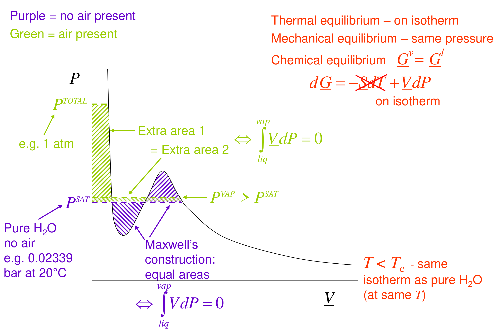

# Fugacity

## Overview

Fugacity is the chemical potential expressed as a corrected pressure. The part starts from the simplest real case: a liquid under an inert gas has a vapour pressure slightly above its saturated value, the Poynting correction (Section 06). Generalising that idea defines fugacity for any phase and mixture, with phase equilibrium becoming equality of fugacities (Section 07). Integrating the departure of the molar volume from ideal-gas behaviour gives the fugacity coefficient $\phi = f/P$ from any PVT data or equation of state (Section 08), applied to steam at 400 °C at 20 and 500 bar (Section 09).

*Assumed throughout:* the chemical potential and its ideal-gas and ideal-mixture forms (Sections 01–05); $d\underline{G} = -\underline{S}\,dT + \underline{V}\,dP$.

## Section 06: The Poynting correction (vapour pressure under an inert gas)

*Notation:* an underline denotes a molar property of a pure substance (e.g. $\underline{V}^{l}$, the molar volume of the pure liquid); superscripts $l$ and $v$ label the liquid and vapour phases.

### Intuition

Pressing on a liquid does work on it. Each mole of liquid that is squeezed from $P^{\mathrm{SAT}}$ up to $P$ gains Gibbs energy $\int \underline{V}^{l}\,dP$. A higher Gibbs energy means a greater tendency to escape into another phase. So the liquid "pushes" more molecules into the gas, and the gas must hold slightly more water vapour before the two phases balance again.

*The inert gas works like a piston that the vapour can pass through.* It presses on the liquid surface and raises the liquid's pressure, but it does not stop water molecules leaving. The analogy breaks down in two ways. A real gas also interacts with the water molecules in the vapour, and it can dissolve in the liquid. Both effects are ignored below and discussed at the end.

### Derivation

**System.** Pure liquid water at total pressure $P$ (e.g. 1 atm), in contact with a gas phase made of air plus water vapour. $P^{\mathrm{VAP}}$ denotes the partial pressure of water in that gas, which is the vapour pressure we want.

**Assumptions.**
1. Constant $T$ throughout (thermal equilibrium).
2. The air is insoluble in the liquid, so the liquid stays pure water.
3. The air does not change the liquid's equation of state. The liquid simply feels the total pressure $P$ (mechanical equilibrium at a flat interface).
4. The gas phase is an ideal-gas mixture, which is reasonable because $P^{\mathrm{VAP}}$ is small.
5. The liquid is incompressible: $\underline{V}^{l}$ is constant.

**Step 1: reference state.** With no air present, liquid and vapour coexist at $P^{\mathrm{SAT}}(T)$:

$$\underline{G}^{l}(T,P^{\mathrm{SAT}}) = \underline{G}^{v}(T,P^{\mathrm{SAT}}) \tag{28}$$

*Reason:* this is the definition of the saturation pressure. Equation (28) is the anchor that both phases are measured from.

**Step 2: raise the liquid to $P$.** At constant $T$, $d\underline{G}^{l} = \underline{V}^{l}\,dP$. Integrating from $P^{\mathrm{SAT}}$ to $P$ with $\underline{V}^{l}$ constant gives

$$\underline{G}^{l}(T,P) = \underline{G}^{l}(T,P^{\mathrm{SAT}}) + \underline{V}^{l}\,(P-P^{\mathrm{SAT}}) \tag{29}$$

*Reason:* the liquid is pure (assumption 2), so its chemical potential is its molar Gibbs energy, evaluated at the pressure it actually feels (assumption 3).

**Step 3: chemical potential of water in the gas.** In an ideal-gas mixture each component behaves as if it were alone at its own partial pressure. Water's chemical potential therefore depends only on $P^{\mathrm{VAP}}$, not on how much air is present. For a pure ideal gas at constant $T$, $d\underline{G} = (RT/P)\,dP$. Integrating from $P^{\mathrm{SAT}}$ to $P^{\mathrm{VAP}}$ gives

$$\mu^{v}(T,P^{\mathrm{VAP}}) = \underline{G}^{v}(T,P^{\mathrm{SAT}}) + RT\ln\frac{P^{\mathrm{VAP}}}{P^{\mathrm{SAT}}} \tag{30}$$

*Reason:* assumption 4. The vapour at $P^{\mathrm{SAT}}$ is treated as an ideal gas too, so the same reference state as in (28) can be used.

**Step 4: equate chemical potentials.** At equilibrium $\underline{G}^{l}(T,P) = \mu^{v}(T,P^{\mathrm{VAP}})$. Substitute (29) and (30), then cancel the two reference terms using (28):

Imagine adding more insoluble gas while keeping temperature fixed and liquid present. The liquid feels the higher *total* pressure, so its chemical potential rises. In the ideal gas mixture, however, water responds to its own *partial* pressure. Equilibrium requires that partial pressure to rise just enough to match the liquid-side increase. The water mole fraction can nevertheless fall, because the total gas pressure is increasing much more strongly.

Thus a higher equilibrium water partial pressure does not mean a larger fraction of water in the gas. The Poynting factor answers the former question. To obtain the fraction, divide the resulting $P^{\mathrm{VAP}}$ by the specified total pressure.

$$\underline{V}^{l}\,(P-P^{\mathrm{SAT}}) = RT\ln\frac{P^{\mathrm{VAP}}}{P^{\mathrm{SAT}}} \tag{31}$$

**Step 5: solve for the vapour pressure.**

$$\boxed{P^{\mathrm{VAP}} = P^{\mathrm{SAT}}\exp\!\left[\frac{\underline{V}^{l}\,(P-P^{\mathrm{SAT}})}{RT}\right]} \tag{32}$$

The exponential is the **Poynting correction** (or Poynting factor). Without assumption 5 the exponent is $\frac{1}{RT}\int_{P^{\mathrm{SAT}}}^{P}\underline{V}^{l}\,dP$.

**Graphical form.** Both sides of (31) are areas $\int\underline{V}\,dP$ under the same isotherm. With no air, Maxwell's equal-area construction fixes $P^{\mathrm{SAT}}$: the net $\int_{\text{liq}}^{\text{vap}}\underline{V}\,dP = 0$. With air present, the liquid branch is pushed up to $P^{\mathrm{TOTAL}}$. This adds a tall, thin area on the liquid side ("extra area 1", $\underline{V}^{l}\Delta P$), which must be balanced by a short, wide area on the vapour side ("extra area 2", $RT\ln(P^{\mathrm{VAP}}/P^{\mathrm{SAT}})$). The vapour line therefore sits slightly above $P^{\mathrm{SAT}}$.

### Motivation and explanation

**Why the correction is small.** Rewrite the exponent as $(P-P^{\mathrm{SAT}})/(RT/\underline{V}^{l})$. The quantity $RT/\underline{V}^{l}$ is a characteristic pressure: the pressure an ideal gas would have at the liquid's density. For water at 20 °C it is about 1350 bar. The correction is significant only when the applied pressure is a sizeable fraction of this. *Physically:* compressing a dense liquid needs very little work per mole, while changing the vapour's chemical potential by the same amount needs a large relative change in its pressure. The liquid's $\underline{V}\,dP$ is small, so the vapour has to move only a little to match it.

**Limiting cases.**
- $P \to P^{\mathrm{SAT}}$ (no inert gas): the factor tends to 1 and $P^{\mathrm{VAP}} = P^{\mathrm{SAT}}$, as it should.
- Small exponent: $P^{\mathrm{VAP}}/P^{\mathrm{SAT}} \approx 1 + \underline{V}^{l}(P-P^{\mathrm{SAT}})/RT$, which is linear in the applied pressure.
- $\underline{V}^{l}\to 0$ (perfectly dense phase): no correction. The effect exists only because the condensed phase has a finite volume to do work on.

**When it fails.** Equation (32) captures only the effect of pressure on the *liquid*. In a real system two other effects compete:
1. *Vapour–gas interactions.* The water vapour is not an ideal mixture with air. This is corrected by fugacity coefficients: in general the enhancement is $(\phi^{\mathrm{SAT}}/\phi)\exp\!\big[\int\underline{V}^{l}dP/RT\big]$, where $\phi$ is water's fugacity coefficient in the gas. For water in air at 20 °C and about 1 atm, the measured enhancement factor is about 1.004, several times larger than the Poynting factor of 1.0007. At ordinary pressures, gas-phase non-ideality matters more than the Poynting term.
2. *Gas solubility.* If the "inert" gas dissolves (CO₂ in water, for example), the liquid is no longer pure. The water mole fraction falls, which *lowers* its vapour pressure (Raoult-type behaviour). This can cancel or reverse the Poynting rise.

At high pressure, the incompressibility assumption also weakens, and the ideal-gas mixture assumption fails for the vapour.

### Worked example

**Problem.** Water at 20 °C has $P^{\mathrm{SAT}} = 0.02339$ bar and liquid specific volume $1.002\times10^{-3}$ m³ kg⁻¹. Find its vapour pressure under air at 1, 10 and 100 atm total pressure. At what total pressure does the correction reach 1 %?

**Molar volume.** $\underline{V}^{l} = 1.002\times10^{-3}\ \mathrm{m^3\,kg^{-1}} \times 0.018015\ \mathrm{kg\,mol^{-1}} = 1.805\times10^{-5}\ \mathrm{m^3\,mol^{-1}}$.

**Apply (32)** with $RT = 8.314\times293.15$ J mol⁻¹:

| Total pressure | Exponent $\underline{V}^{l}(P-P^{\mathrm{SAT}})/RT$ | $P^{\mathrm{VAP}}/P^{\mathrm{SAT}}$ | $P^{\mathrm{VAP}}$ (bar) |
|---|---|---|---|
| 1 atm | $7.33\times10^{-4}$ | 1.0007 | 0.02341 |
| 10 atm | $7.49\times10^{-3}$ | 1.0075 | 0.02357 |
| 100 atm | $7.50\times10^{-2}$ | 1.078 | 0.02521 |

**1 % threshold.** Setting the factor to 1.01 in (32) gives $P - P^{\mathrm{SAT}} = RT\ln(1.01)/\underline{V}^{l}$, so $P \approx 13.5$ bar.

**Interpretation.** For water in a beaker in the lab, the steam-table value is correct to better than 0.1 % as far as the Poynting effect goes. The larger real-world correction at 1 atm comes from vapour-phase non-ideality, as explained above. In high-pressure equipment (e.g. 100 bar), the vapour content of the gas is about 8 % higher than $P^{\mathrm{SAT}}$ would suggest, and at such pressures the non-ideal gas terms must be added as well.

### Link to other topics

The same balance (extra pressure on a condensed phase raises its escaping tendency) gives the Kelvin equation for small droplets, where the extra pressure comes from surface tension rather than an inert gas. It also generalises: the quantity $P^{\mathrm{SAT}}\exp[\underline{V}^{l}(P-P^{\mathrm{SAT}})/RT]$ is the liquid's fugacity, which appears in every vapour–liquid equilibrium calculation with activity coefficients.

### Summary

A liquid under an insoluble gas has a vapour pressure slightly above its saturated value, because the gas compresses the liquid and raises its molar Gibbs energy by $\underline{V}^{l}(P-P^{\mathrm{SAT}})$. The vapour must match this by a rise of $RT\ln(P^{\mathrm{VAP}}/P^{\mathrm{SAT}})$. The vapour pressure obtained this way is effectively the partial pressure of an ideal gas that would be in equilibrium with the liquid.

## Section 07: Fugacity, definition and meaning

*Notation:* $\underline{G}_i$ is the molar Gibbs energy of pure $i$. $\mu_i$ is the chemical potential of $i$ in a mixture. $P^{\circ}$ is a reference pressure (e.g. 1 bar). $\underline{G}_i^{\circ}(T,P^{\circ})$ is the molar Gibbs energy of pure $i$ **as an ideal gas** at $T$ and $P^{\circ}$. $f_i$ is the fugacity of pure $i$, and $\bar{f}_i$ is the fugacity of $i$ in a mixture. Many textbooks write $\hat{f}_i$ for the mixture fugacity. The overbar here does **not** mean a partial molar property: fugacity is not one (see below).

### Intuition

The word comes from the Latin *fugere*, to flee: fugacity is a substance's **escaping tendency**. Think of the partial pressure that a component "would like" to exert. The previous note found that a compressed liquid behaves, as far as its vapour is concerned, as if it had a pressure $P^{\mathrm{SAT}}\exp[\underline{V}^{l}(P-P^{\mathrm{SAT}})/RT]$. That is not a pressure anyone can measure on a gauge, but it is the partial pressure an ideal gas would need in order to sit in equilibrium with the liquid. That quantity is the liquid's fugacity.

*Analogy: fugacity is to mass transfer what temperature is to heat transfer.* Heat flows from high $T$ to low $T$ and stops when the temperatures are equal. A component moves from the phase where its fugacity is high to where it is low, and stops when the fugacities are equal. The analogy breaks down in two places. Each component has its own fugacity, and two components can move in opposite directions at the same time. And fugacities can only be compared at the same temperature.

There is no new thermodynamics here. Fugacity is a change of variable, $\mu \leftrightarrow RT\ln f$, chosen because it behaves better than $\mu$: $\mu_i \to -\infty$ as $P\to 0$ or $x_i\to 0$, whereas $\bar f_i \to 0$.

### Derivation

**Step 1: definition for a pure substance.** At fixed $T$, define $f_i$ by

$$\underline{G}_i(T,P) = \underline{G}_i^{\circ}(T,P^{\circ}) + RT\ln\frac{f_i}{P^{\circ}} \tag{33}$$

*Reason:* this has exactly the ideal-gas form, but with the real molar Gibbs energy on the left. All the non-ideality is pushed into $f_i$. The reference state is always the hypothetical pure ideal gas at $(T,P^{\circ})$, whatever the actual phase of $i$.

**Step 2: ideal-gas check.** For an ideal gas, $\underline{G}_i = \underline{G}_i^{\circ} + RT\ln(P/P^{\circ})$. Comparing with (33):

$$f_i^{\mathrm{IG}} = P \tag{34}$$

Every real gas becomes ideal as $P\to 0$, so $f_i/P \to 1$ in that limit. Many textbooks take this limit, together with (35), as the definition. The two definitions are equivalent.

**Step 3: pressure dependence.** At constant $T$, $d\underline{G}_i = \underline{V}_i\,dP$. Differentiate (33), noting that the reference term is fixed:

$$RT\,d\ln f_i = \underline{V}_i\,dP \qquad (\text{constant } T) \tag{35}$$

*Reason:* this is the working equation for computing $f_i$ from volumetric data or an equation of state. Integrating it is the subject of Section 08. For an ideal gas, $\underline{V}_i = RT/P$ and (35) gives $d\ln f_i = d\ln P$, which is consistent with (34).

**Step 4: equilibrium criterion, pure substance.** Two phases $\alpha$, $\beta$ of pure $i$ at the same $T$ are in equilibrium when $\underline{G}_i^{\alpha} = \underline{G}_i^{\beta}$. Write both using (33). They share the same reference term (same $T$, same ideal-gas state), so

$$f_i^{\alpha} = f_i^{\beta} \tag{36}$$

**Step 5: liquid fugacity.** A saturated liquid is in equilibrium with its saturated vapour. If that vapour is an ideal gas, (36) and (34) give

$$f_i^{l,\mathrm{sat}} = P_i^{\mathrm{SAT}} \tag{37}$$

Integrating (35) for an incompressible liquid from $P_i^{\mathrm{SAT}}$ to $P$ then gives the compressed-liquid fugacity. This is the Poynting result in fugacity language:

$$f_i^{l}(T,P) = P_i^{\mathrm{SAT}}\exp\!\left[\frac{\underline{V}_i^{l}\,(P-P_i^{\mathrm{SAT}})}{RT}\right] \tag{38}$$

**Step 6: component in a mixture.** Define $\bar f_i$ in the same way, using the chemical potential:

$$\mu_i = \mu_i^{\circ} + RT\ln\frac{\bar f_i}{P^{\circ}}, \qquad \mu_i^{\circ} = \underline{G}_i^{\circ}(T,P^{\circ}) \tag{39}$$

*Reason:* the reference is still the *pure* ideal gas, so $\mu_i^{\circ}$ is the same quantity as in (33). As in Step 4, equal chemical potentials in two phases then mean

$$\bar f_i^{\alpha} = \bar f_i^{\beta} \quad \text{for every component } i \tag{40}$$

**Step 7: limiting cases in a mixture.**

*Ideal-gas mixture.* Here $\mu_i = \underline{G}_i^{\circ} + RT\ln(y_iP/P^{\circ})$, where $y_i$ is the vapour mole fraction. Comparing with (39):

$$\bar f_i^{\mathrm{IG}} = y_i P \tag{41}$$

So the fugacity is the partial pressure, as the definition intends.

*Ideal mixture.* Here $\mu_i = \underline{G}_i + RT\ln x_i$, where $\underline{G}_i$ is pure $i$ at the same $T$, $P$ and phase. Subtract (33) from (39); the reference terms cancel:

$$RT\ln\frac{\bar f_i}{f_i} = RT\ln x_i \;\;\Rightarrow\;\; \bar f_i = x_i f_i \tag{42}$$

This is the **Lewis–Randall rule**: in an ideal mixture, each component's fugacity is its mole fraction times its pure-component fugacity at the same $T$ and $P$. With (37), it becomes Raoult's law for an ideal liquid in contact with an ideal-gas vapour.

**Step 8: fugacity is not a partial molar quantity.** The molar Gibbs energy of a mixture is $\underline{G} = \sum_i x_i\mu_i$. Using (39):

$$\underline{G} = \sum_i x_i\,\mu_i^{\circ} + RT\sum_i x_i\ln\frac{\bar f_i}{P^{\circ}} \tag{43}$$

The mole-fraction-weighted sum acts on $\ln\bar f_i$, not on $\bar f_i$. So $\sum_i x_i\bar f_i$ is not "the fugacity of the mixture", and has no thermodynamic meaning in this course.

### Motivation and explanation

**Why this form.** Equation (33) inverts to $f_i = P^{\circ}\exp[(\underline{G}_i - \underline{G}_i^{\circ})/RT]$. Fugacity is therefore the exponential of the Gibbs energy measured from the ideal-gas state. A difference of $RT\ln 2$ in Gibbs energy is a factor of 2 in fugacity. This is why fugacity always has units of pressure and is always positive, while $\mu$ has no absolute zero.

**Why it is useful.**
1. *Equilibrium becomes simple.* Equations (36) and (40) replace "equal chemical potentials" with "equal corrected pressures". For a gas mixture in contact with a liquid, the left side is close to $y_iP$ and the right side close to $x_iP_i^{\mathrm{SAT}}$. The non-idealities then appear as correction factors: a fugacity coefficient for the gas (Section 08) and an activity coefficient for the liquid (a later note).
2. *Good behaviour at the limits.* As $x_i\to 0$, $\mu_i\to-\infty$, but $\bar f_i\to 0$ smoothly. This matters for dilute solutes and trace components.

**Sanity checks.**
- Ideal gas: $f = P$.
- Ideal-gas mixture: $\bar f_i = y_iP$.
- Pure component in an ideal mixture ($x_i = 1$): $\bar f_i = f_i$.
- Saturated liquid with an ideal-gas vapour: $f = P^{\mathrm{SAT}}$.

**Where the simple forms fail.** Equations (37), (38), (41) and (42) each rest on an ideality assumption. Real gases at high pressure have $f\neq P$, so (37) becomes $f^{l,\mathrm{sat}} = \phi^{\mathrm{sat}}P^{\mathrm{SAT}}$, where $\phi$ is a fugacity coefficient. Real liquid mixtures break (42), which is where activity coefficients come in. The definitions (33) and (39), and the criteria (36) and (40), are exact and never fail.

### Worked example

**Problem.** A glass of water stands in room air at 20 °C and 1 atm, at 60 % relative humidity. Use fugacities to decide whether water evaporates or condenses, find the driving force, and find the humidity at which the water and air would be in equilibrium. Data: $P^{\mathrm{SAT}} = 0.02339$ bar, $\underline{V}^{l} = 1.805\times10^{-5}$ m³ mol⁻¹. Treat the air–water vapour as an ideal-gas mixture and air as insoluble.

**Liquid fugacity.** From (38) at $P = 1.01325$ bar: $f^{l} = 0.023407$ bar, the Poynting factor of 1.0007 from the previous note.

**Vapour fugacity.** Relative humidity is $p_w/P^{\mathrm{SAT}}$, and by (41) $\bar f_w^{v} = p_w$. So $\bar f_w^{v} = 0.6\times0.02339 = 0.014034$ bar.

**Direction.** $f^{l} > \bar f_w^{v}$, so water leaves the liquid: it evaporates.

To see why a pressure-like ratio gives the driving force, write (39) for water in each phase and subtract. The identical ideal-gas reference cancels, leaving $\mu^{l}-\mu^{v}=RT\ln(f^{l}/\bar f_w^{v})$. A ratio above unity gives evaporation, a ratio below unity gives condensation, and unity gives no net transfer. The absolute size of either fugacity is less informative than this comparison.

The humidity example therefore establishes the direction and thermodynamic incentive for transfer. It does not give an evaporation rate: that also needs transport through the gas next to the surface and the heat needed to sustain evaporation. Equal fugacities describe the endpoint, not how quickly it is reached.

**Driving force.** The chemical-potential difference is $\mu^{l}-\mu^{v} = RT\ln(f^{l}/\bar f_w^{v}) \approx 1247$ J mol⁻¹. This is positive, so water moves from liquid to vapour.

**Equilibrium.** Equation (40) requires $\bar f_w^{v} = f^{l}$, i.e. $p_w = 0.023407$ bar. That is a relative humidity of 100.07 %, or a water mole fraction in the air of $y_w = 0.0231$. Even air at exactly 100 % RH (measured against $P^{\mathrm{SAT}}$) is very slightly unsaturated with respect to liquid under 1 atm of air: the driving force is only 1.8 J mol⁻¹, and it comes entirely from the Poynting factor.

### Link to other topics

Equation (40) is the starting point for vapour–liquid equilibrium. In later sections it becomes $y_i\bar\phi_iP = x_i\gamma_if_i$, with a fugacity coefficient correcting the vapour and an activity coefficient correcting the liquid. Reaction equilibrium uses the same idea: the equilibrium constant is written in terms of fugacity ratios (activities) rather than partial pressures.

### Summary

Fugacity is the molar Gibbs energy (or chemical potential) expressed as a corrected pressure, measured from the ideal-gas state. It equals pressure for an ideal gas, partial pressure for an ideal-gas mixture, and $x_if_i$ in an ideal mixture. In every case, phase equilibrium means equal fugacities of each component.

## Section 08: Fugacity from volumetric data and the fugacity coefficient

*Notation:* $\phi_i = f_i/P$ is the fugacity coefficient of pure $i$. $\bar\phi_i = \bar f_i/P_i$ is the fugacity coefficient of $i$ in a mixture, where $P_i = y_iP$ is its partial pressure. $\underline{V}_i$ is the molar volume of pure $i$. $\bar V_i$ is the partial molar volume of $i$ in a mixture.

### Intuition

The obvious route is to start where the substance is surely ideal ($P = 0$) and integrate $\underline{V}\,dP$ up to the pressure of interest. At $P\to 0$, though, $\underline{V}\to\infty$ and $\ln f\to-\infty$, so the integral is infinite. That infinity is not caused by non-ideality: an ideal gas has it too. It is just the logarithmic dependence of $\underline{G}$ on $P$ for any gas.

So subtract what an ideal gas would do over the same path. The infinite parts cancel, and only the (finite) **gap** between the real isotherm and the ideal-gas isotherm is left. *This is like measuring the height of a building from its own ground floor rather than from the centre of the Earth.* The reference (the ideal gas) is chosen so that the large shared part drops out. The analogy breaks down because here the shared part is not just large but infinite, so the subtraction is needed for the integral to exist at all, not merely convenient.

### Derivation

**Step 1: the direct route fails at zero pressure.** For pure $i$ at constant $T$, integrate $RT\,d\ln f_i = \underline{V}_i\,dP$ from a finite lower pressure $P_0>0$:

$$RT\ln\frac{f_i(P)}{f_i(P_0)} = \int_{P_0}^P \underline{V}_i\,dP \qquad (P_0>0) \tag{44}$$

As $P_0\to0$, the gas approaches ideal behaviour and $f_i(P_0)\to0$: both sides of (44) diverge. Equation (44) is valid for $P_0>0$, but setting $P_0=0$ would leave an undefined logarithm. Subtract the ideal-gas differential before taking that limit.

**Step 2: write the same equation for an ideal gas.** For an ideal gas $\underline{V}^{\mathrm{IG}} = RT/P$ and $f^{\mathrm{IG}} = P$, so along the same isotherm

$$RT\,d\ln P = \frac{RT}{P}\,dP \tag{45}$$

**Step 3: subtract (45) from the differential form of (44) and integrate from 0 to $P$.**

$$RT\,d\ln\frac{f_i}{P} = \left(\underline{V}_i - \frac{RT}{P}\right)dP \;\;\Rightarrow\;\; RT\ln\frac{f_i}{P}\bigg|_P - RT\ln\frac{f_i}{P}\bigg|_{0} = \int_0^P\left(\underline{V}_i - \frac{RT}{P}\right)dP$$

*Reason:* at the lower limit the real gas is ideal, so $f_i/P\to 1$ and that term vanishes. Both divergences have cancelled.

**Step 4: define the fugacity coefficient.**

$$\phi_i \equiv \frac{f_i}{P}, \qquad RT\ln\phi_i = \int_0^P\left(\underline{V}_i - \frac{RT}{P}\right)dP \qquad (\text{constant } T) \tag{46}$$

The integrand stays finite as $P\to 0$. In the low-pressure limit it tends to the second virial coefficient $B$ (Step 6).

**Step 5: compressibility-factor form.** Write $\underline{V}_i = Z_iRT/P$. Then $\underline{V}_i - RT/P = (Z_i - 1)RT/P$, and (46) becomes

$$\ln\phi_i = \int_0^P\frac{Z_i - 1}{P}\,dP \tag{47}$$

This is the form used with EOS and generalised $Z$ charts.

**Step 6: virial gas.** Use the pressure-explicit virial equation, $Z = 1 + B'P + C'P^2 + \dots$, where $B' = B/RT$ and $C' = (C - B^2)/(RT)^2$. These follow from matching it term by term with the volume form $Z = 1 + B/\underline{V} + C/\underline{V}^2$. Then $(Z-1)/P = B' + C'P$, and (47) integrates at once:

$$\ln\phi = B'P + \tfrac{1}{2}C'P^2 \;\approx\; \frac{BP}{RT} \quad (\text{low } P) \tag{48}$$

**Step 7: physical meaning, the residual Gibbs energy.** Write the definition of fugacity for the real fluid and for an ideal gas at the *same* $T$ and $P$, then subtract. The reference terms cancel:

$$\underline{G}_i(T,P) - \underline{G}_i^{\mathrm{IG}}(T,P) = RT\ln\frac{f_i}{P} = RT\ln\phi_i \tag{49}$$

So $RT\ln\phi_i$ is the **residual Gibbs energy**: how much lower (or higher) the molar Gibbs energy of the real fluid is than that of an ideal gas at the same conditions.

**Step 8: component in a mixture.** Define $\bar\phi_i = \bar f_i/(y_iP)$. At constant $T$ and composition, $(\partial\mu_i/\partial P)_{T,n} = \bar V_i$, while for the same mixture as an ideal gas $(\partial\mu_i^{\mathrm{IG}}/\partial P)_{T,n} = RT/P$. Subtract the two and integrate from $P = 0$, where every mixture is an ideal-gas mixture and $\bar\phi_i = 1$:

$$RT\ln\bar\phi_i = \int_0^P\left(\bar V_i - \frac{RT}{P}\right)dP \qquad (\text{constant } T,\ \text{composition}) \tag{50}$$

This has the same structure as (46), with the partial molar volume in place of the pure molar volume. It needs a mixture EOS (with mixing rules), because $\bar V_i$ depends on composition.

### Motivation and explanation

**What $\phi$ measures.** By (49), $\phi$ is the residual Gibbs energy expressed as a factor on pressure. Its sign relative to 1 reflects the accumulated volume departure along the isotherm, not just the volume at the final pressure.
- $\phi < 1$: the integrated volume departure is negative. Attractions often dominate over much of the path, lowering the Gibbs energy and escaping tendency. This is typical of gases at modest pressures below their Boyle temperature, and of vapours.
- $\phi > 1$: the integrated volume departure is positive, often because repulsions dominate much of the path. Locally, the slope $d\ln\phi/dP=(\underline{V}-RT/P)/(RT)$ tells whether the volume is above or below the ideal-gas value.

One way to read (47) is to build the correction in small pressure increments. Wherever $Z<1$, the next increment lowers $\ln\phi$; wherever $Z>1$, it raises it. Repulsion can make $Z$ exceed unity near the final pressure while the negative area accumulated earlier still leaves $\phi<1$. Conversely, $Z=1$ at one pressure makes only the local slope vanish; it does not force $\phi=1$.

This is why the nitrogen example integrates the virial expansion rather than simply setting $\phi=Z$. Each pressure power acquires its own integration factor, so adding a term changes the accumulated Gibbs-energy correction differently from the local EOS volume.

In the figure, the integral (46) is the thin hatched area between the real isotherm and the ideal-gas isotherm. It is finite because the two curves converge as $P\to 0$, whereas the area under the real isotherm alone is unbounded.

**Limiting cases.**
- Ideal gas: $\underline{V} = RT/P$, so the integrand is zero and $\phi = 1$.
- Low pressure: $\phi \approx 1 + BP/RT$, linear in $P$ with slope set by the second virial coefficient, which is negative below the Boyle temperature.
- $P\to 0$: $\phi\to 1$ for every substance and every mixture. This is what makes the ideal-gas reference work.

**Below the critical temperature.** If $T < T_c$, the integration path from $P = 0$ reaches the saturation pressure, where the substance condenses. To get a *liquid* fugacity:
1. integrate (46) through the vapour from 0 to $P^{\mathrm{SAT}}$, giving $\phi^{\mathrm{sat}}$;
2. cross the phase boundary, where $\underline{G}$ (and hence $f$) does not change, because liquid and vapour are in equilibrium;
3. continue up the liquid branch with the Poynting factor.

The result is $f^{l} = \phi^{\mathrm{sat}}P^{\mathrm{SAT}}\exp[\underline{V}^{l}(P-P^{\mathrm{SAT}})/RT]$. This reduces to the earlier form when the saturated vapour is ideal ($\phi^{\mathrm{sat}} = 1$). Integrating straight through the van der Waals loop would be wrong, because the loop is not a physical path.

**When the formulas fail.** Equations (46), (47) and (50) are exact. The approximations come only from the PVT information used:
- the truncated virial form (48) is good to moderate density but fails near the critical point and in liquids;
- tabulated data must reach low enough pressure for the integrand to be extrapolated to $P = 0$.

### Worked example

**Problem.** Estimate the fugacity coefficient and fugacity of nitrogen at 0 °C and 100 atm from virial coefficients, and compare with the accepted value $\phi = 0.9703$. Data, interpolated linearly to 273.15 K from recommended values at 260 K and 280 K: $B = -10.30$ cm³ mol⁻¹ and $C = 1430$ cm⁶ mol⁻².

**Second virial coefficient only.** From (48), $\ln\phi \approx BP/RT$. With $P = 1.01325\times10^{7}$ Pa and $RT = 2271$ J mol⁻¹:

$$\ln\phi = -0.0460,\qquad \phi = 0.955,\qquad f = 95.5\ \text{atm}$$

**Including the third virial coefficient.** With $B' = B/RT$ and $C' = (C - B^2)/(RT)^2$:

$$\ln\phi = B'P + \tfrac12 C'P^2 = -0.0328,\qquad \phi = 0.968,\qquad f = 96.8\ \text{atm}$$

**Comparison.** The accepted value is $\phi = 0.9703$, i.e. $f = 97.03$ atm. The $B$-only estimate overstates the non-ideality: it predicts a 4.5 % reduction against the true 3 %. Adding $C$ brings it within 0.3 %. *Physically:* at 100 atm nitrogen is dense enough that three-body (and repulsive) contributions, carried by the positive $C$, partly cancel the two-body attraction carried by the negative $B$. The real gas is "less attractive" than the low-pressure slope suggests. The sign of $\phi - 1$ matches $B < 0$: at 0 °C nitrogen is below its Boyle temperature, so attractions win and $\phi < 1$.

### Link to other topics

Equation (46) is the gas-phase counterpart of the liquid-phase activity coefficient that comes later. Both are correction factors on an ideal reference, and together they give the general vapour–liquid equilibrium relation $y_i\bar\phi_iP = x_i\gamma_if_i^{l}$. The residual-property idea in (49) is the same one used for departure enthalpies and entropies in process simulators.

### Summary

Integrating $\underline{V}\,dP$ from zero pressure diverges, but integrating the departure $\underline{V} - RT/P$ does not. The result is the fugacity coefficient, $RT\ln\phi = \int_0^P(\underline{V} - RT/P)\,dP$, which is the residual Gibbs energy expressed as a factor on pressure. It needs only PVT data.

## Section 09: Worked example, fugacity of steam at 400 °C

### Intuition

At 400 °C water is above its critical temperature (373.9 °C). So the isotherm from $P = 0$ upward never crosses a phase boundary, and a single integral covers the whole path. This is pure water, not water under an inert gas, so the Poynting correction plays no part.

At 20 bar the molecules are far apart, and the attractions between them make only a small dent in the Gibbs energy. At 500 bar the fluid is compressed to liquid-like density, where hydrogen-bonding attractions are strong. Each molecule is held much more tightly than in an ideal gas, so its escaping tendency is far below what the pressure alone suggests.

### Derivation

**Method.**
1. Tabulate $\underline{V}$ at 673.15 K over $0 \le P \le P_{\mathrm{final}}$.
2. Form the integrand $\underline{V} - RT/P$.
3. Extrapolate it to $P = 0$. It tends to the second virial coefficient $B$, not to zero, because $\underline{V} = RT/P + B + O(P)$.
4. Integrate numerically (trapezoidal rule), then $\phi = \exp(I/RT)$ and $f = \phi P$, where $I$ is the integral.

**Why the integrand is delicate.** At low $P$, $\underline{V}$ and $RT/P$ are both large and nearly equal, and the integrand is their small difference. Volumes given to four significant figures leave the difference uncertain by several percent. For example, at 2 bar, $\underline{V} = 27.89\times10^{-3}$ m³ mol⁻¹ known to $\pm0.005\times10^{-3}$, while the difference itself is only about $0.08\times10^{-3}$. Errors from step size and from rounding dominate the result. They are not physics.

**Peng–Robinson route.** Substituting the PR equation into the $Z$-form integral, changing variable from $P$ to $\underline{V}$ and integrating analytically gives a standard closed form. The algebra is long and is not reproduced here:

$$\ln\phi = Z - 1 - \ln(Z - B^{*}) - \frac{A^{*}}{2\sqrt{2}\,B^{*}}\ln\frac{Z + (1+\sqrt2)B^{*}}{Z + (1-\sqrt2)B^{*}} \tag{51}$$

with
$$A^{*} = \frac{a\alpha P}{(RT)^2}, \qquad B^{*} = \frac{bP}{RT}, \qquad a = 0.45724\frac{R^2T_c^2}{P_c}, \qquad b = 0.07780\frac{RT_c}{P_c},$$
$$\alpha = \left[1+\kappa\left(1-\sqrt{T/T_c}\right)\right]^2, \qquad \kappa = 0.37464 + 1.54226\,\omega - 0.26992\,\omega^2.$$

Here $Z$ is the largest real root of the PR cubic, $A^{*}$ and $B^{*}$ are the dimensionless PR parameters (not the virial $B$), and $\omega$ is the acentric factor. The idea is the same as Section 08: the attraction term ($a$) lowers $\phi$ through the last term, and the repulsion term ($b$) raises it through $-\ln(Z - B^{*})$. Evaluating the integral numerically with PR volumes gives the same $\phi$ as (51) to four figures, which confirms the formula.

**Water constants.** $T_c = 647.096$ K, $P_c = 220.64$ bar. The acentric factor follows from its definition, $\omega = -\log_{10}(P^{\mathrm{SAT}}/P_c) - 1$ at $T/T_c = 0.7$. Water's saturation pressure there (452.97 K) is 9.986 bar, giving $\omega = 0.344$. Then $\kappa = 0.873$ and $\alpha(673.15\ \mathrm{K}) = 0.965$.

### Worked example

**(a) 400 °C, 20 bar, from steam-table volumes.** Units: $10^{-3}$ m³ mol⁻¹.

| $P$ (bar) | 0 | 2 | 4 | 6 | 8 | 10 | 12 | 14 | 16 | 18 | 20 |
|---|---|---|---|---|---|---|---|---|---|---|---|
| $\underline{V}$ | ∞ | 27.89 | 13.91 | 9.247 | 6.917 | 5.519 | 4.586 | 3.920 | 3.421 | 3.032 | 2.722 |
| $\underline{V} - RT/P$ | → $B$ | −0.09 | −0.08 | −0.081 | −0.079 | −0.078 | −0.078 | −0.078 | −0.077 | −0.077 | −0.076 |

The integrand is almost constant, as the virial picture predicts ($\underline{V} - RT/P \approx B$ at low density). Applying the trapezoidal rule with 2 bar steps:
- taking the integrand as 0 at $P = 0$ gives $I = -151$ J mol⁻¹;
- taking its physical limit, $B \approx -0.078\times10^{-3}$ m³ mol⁻¹, gives $I = -159$ J mol⁻¹.

With $RT = 5597$ J mol⁻¹, these give $\phi = 0.973$ and $0.972$. So **$f \approx 19.4$–$19.5$ bar**.

| Method, 20 bar | $\phi$ | $f$ (bar) |
|---|---|---|
| Steam-table trapezoid | 0.973 | 19.5 |
| IAPWS-95 reference equation (integrated finely) | 0.974 | 19.5 |
| Peng–Robinson, eq. (51) | 0.970 | 19.4 |

All three agree within 0.4 %. At 20 bar, steam at 400 °C is close to ideal: its Gibbs energy is only about 150 J mol⁻¹ below the ideal-gas value.

**(b) 400 °C, 500 bar.** The same method needs volumes up to 500 bar. Values below are from the IAPWS-95 formulation, in $10^{-3}$ m³ mol⁻¹:

| $P$ (bar) | 50 | 100 | 150 | 200 | 250 | 300 | 350 | 400 | 450 | 500 |
|---|---|---|---|---|---|---|---|---|---|---|
| $\underline{V}$ | 1.042 | 0.476 | 0.282 | 0.179 | 0.108 | 0.0504 | 0.0379 | 0.0344 | 0.0325 | 0.0312 |
| $\underline{V} - RT/P$ | −0.077 | −0.083 | −0.091 | −0.101 | −0.116 | −0.136 | −0.122 | −0.106 | −0.092 | −0.081 |

The integrand is no longer constant. It dips sharply between 250 and 350 bar, where the volume collapses from gas-like to liquid-like values (the dense, near-critical region). The integral is dominated by this region.
- Trapezoidal rule with 50 bar steps, using the printed volumes and $B\approx-0.078\times10^{-3}$ m³ mol⁻¹ at zero pressure: $I \approx -5018$ J mol⁻¹, so $\phi \approx 0.408$.
- Integrating finely (0.125 bar steps): $I = -5004$ J mol⁻¹, so $\phi = 0.409$, $f = 204.5$ bar. This matches the Gibbs-energy difference computed directly from IAPWS-95, $\phi = 0.4091$.

The sharp volume change in this table is a continuous crossover along a supercritical isotherm, not a liquid–vapour phase transition. There is no saturation plateau or latent-heat jump to insert into the integration. The numerical task is to resolve a rapidly varying but continuous volume departure.

The comparison of $Z$ and $\phi$ then tests two different things: $Z$ tests the volume at the final state, while $\phi$ tests an area accumulated over all lower pressures. A local density error can occupy a small part of that area, or be offset by errors elsewhere. Agreement in fugacity therefore supports an equilibrium calculation without establishing equal accuracy for density-dependent equipment sizing.

| Method, 500 bar | $\phi$ | $f$ (bar) | $Z$ |
|---|---|---|---|
| Coarse trapezoid (50 bar steps) | 0.408 | 204 | — |
| IAPWS-95 (fine integration) | 0.409 | 204.5 | 0.279 |
| Peng–Robinson, eq. (51) | 0.421 | 210.5 | 0.375 |

### Motivation and explanation

**Physical reading.** At 500 bar, $RT\ln\phi \approx -5.0$ kJ mol⁻¹. Strong attractions in the dense fluid lower the molar Gibbs energy by about 5 kJ mol⁻¹ below the ideal-gas value. As a result, the fluid's tendency to escape (into a vapour, a solvent, or a reaction) corresponds to an ideal gas at only about 205 bar, not 500. Any phase- or reaction-equilibrium calculation that used $P$ in place of $f$ would be off by a factor of about 2.4.

**Why PR gets $\phi$ right but $Z$ wrong.** At 500 bar PR overestimates the molar volume by about a third ($Z = 0.375$ against 0.279). Yet it is within 3 % on $\phi$. Two reasons:
- $\phi$ is an *integral* over the whole path from $P = 0$, much of which lies in the gas-like region where PR is accurate.
- PR's $\alpha(T)$ is fitted to vapour pressures through $\omega$, and vapour pressures are equal-fugacity conditions. So the EOS is effectively tuned to give fugacities (Gibbs energies) right, not liquid densities.

That is why process simulators use cubic EOS for phase equilibria but often switch to other correlations for liquid densities.

**Numerical lessons.**
1. The integrand tends to the virial coefficient $B$, not zero, at $P = 0$.
2. Differencing four-figure volumes at low pressure gives a noisy integrand.
3. Where the integrand has a sharp feature, step size matters. Here, the 50 bar trapezoid from the printed table gives $\phi \approx 0.408$, about 0.3 % below the fine reference value. Its close agreement does not remove the need to check convergence on a finer grid.

### Link to other topics

Fugacities of compressed fluids like this enter supercritical extraction and high-pressure reactor equilibria, such as the equilibrium constant for steam reforming written in fugacities. The same PR expression, with mixing rules, gives the vapour-phase fugacity coefficients used in vapour–liquid equilibrium at high pressure.

### Summary

At 400 °C and 20 bar, steam's fugacity is 19.5 bar, close to ideal. At 500 bar it is about 205 bar, so $\phi \approx 0.41$, because the fluid is compressed to liquid-like density, where attractions are strong. A cubic EOS reproduces this to within a few percent. Evaluating the integral from tables needs care at both ends: the low-pressure limit, and any steep region. This completes fugacity for pure fluids.

## Conclusion

Fugacity turns "equal chemical potentials" into "equal corrected pressures". For a pure fluid it follows from volumetric data through $RT\ln\phi = \int_0^P(\underline{V} - RT/P)\,dP$; for a compressed liquid it is the saturation fugacity times the Poynting factor. Gas-phase non-ideality is now in hand. The next part treats the non-ideality of liquid mixtures, through the activity coefficient.
