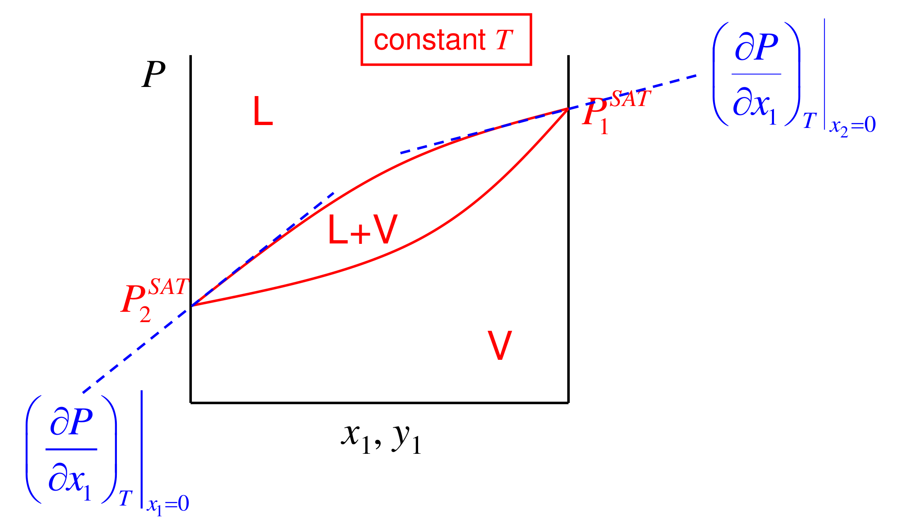

# Measuring activity coefficients and freezing-point depression

## Overview

Model constants come from experiments that measure a fugacity. Ebulliometry gives infinite-dilution activity coefficients from boiling pressures alone, through Gibbs–Duhem; dynamic and static stills give data over the whole composition range (Section 14). Freezing-point depression gives the solvent's activity even for involatile mixtures, and in the dilute limit reduces to the cryoscopic law $\Delta T = K_fm$ (Section 15). Applied to both components of ethylene glycol–water it builds the freezing curves and eutectic, and real data reveal a negative deviation from ideality (Section 16).

*Assumed throughout:* activity coefficients and modified Raoult's law (Sections 10–13); two-constant Margules (Section 12); $(\partial\underline{G}/\partial T)_P = -\underline{S}$.

## Section 14: Measuring activity coefficients

### Intuition

A model with $k$ constants needs, in principle, only $k$ good data points. The most informative points are at the two ends of the composition range: there each component is infinitely dilute, its $\gamma$ is furthest from 1, and the two values $\gamma_1^{\infty}$ and $\gamma_2^{\infty}$ pin down a two-constant model directly.

Ebulliometry exploits a neat feature of the dilute limit. Add a trace of component 1 to boiling pure component 2 at fixed $T$, and the pressure changes in proportion to how "eager to escape" component 1 is, i.e. to $\gamma_1^{\infty}$. Gibbs–Duhem guarantees that the solvent's own $\gamma$ does not change to first order, so the pressure slope reflects the solute alone.

### Derivation

**Step 1: total pressure of a binary.** Sum modified Raoult's law over both components ($y_1 + y_2 = 1$):

$$P = x_1\gamma_1P_1^{\mathrm{SAT}} + x_2\gamma_2P_2^{\mathrm{SAT}} \tag{74}$$

**Step 2: differentiate at constant $T$.** The $P_i^{\mathrm{SAT}}$ are fixed, and only the composition (and hence the $\gamma_i$) varies:

$$dP = \sum_i \gamma_iP_i^{\mathrm{SAT}}\left(dx_i + x_i\,\frac{d\gamma_i}{\gamma_i}\right)$$

**Step 3: binary, with $dx_2 = -dx_1$.**

$$dP = \gamma_1P_1^{\mathrm{SAT}}\left(dx_1 + x_1\,d\ln\gamma_1\right) + \gamma_2P_2^{\mathrm{SAT}}\left(x_2\,d\ln\gamma_2 - dx_1\right)$$

**Step 4: eliminate $d\ln\gamma_1$ with Gibbs–Duhem.** Substitute $x_1\,d\ln\gamma_1 = -x_2\,d\ln\gamma_2$:

$$dP = \left(\gamma_1P_1^{\mathrm{SAT}} - \gamma_2P_2^{\mathrm{SAT}}\right)\left(dx_1 - x_2\,d\ln\gamma_2\right) \tag{75}$$

**Step 5: the limit $x_1\to 0$.**
- Pure 2: $\gamma_2 = 1$ and $\gamma_1 = \gamma_1^{\infty}$.
- Gibbs–Duhem gives $x_2\,d\ln\gamma_2 = -x_1\,d\ln\gamma_1 \to 0$, so the solvent's $\gamma$ is flat there.

Dividing (75) by $dx_1$:

$$\left(\frac{\partial P}{\partial x_1}\right)_T\bigg|_{x_1=0} = \gamma_1^{\infty}P_1^{\mathrm{SAT}} - P_2^{\mathrm{SAT}} \;\;\Rightarrow\;\; \gamma_1^{\infty} = \frac{P_2^{\mathrm{SAT}} + \left(\partial P/\partial x_1\right)_T\big|_{x_1=0}}{P_1^{\mathrm{SAT}}} \tag{76}$$

The same argument at the other end ($x_2\to 0$) gives $\gamma_2^{\infty}$. Experimentally, the slope is estimated as $\Delta P/\Delta x_1$ after adding a weighed small amount of 1. The liquid composition is known from the amounts added, and no vapour analysis is needed.

**Step 6: fixing the model.** With $\gamma_1^{\infty}$ and $\gamma_2^{\infty}$ measured, the two-constant Margules constants follow from Section 12:

$$A = \frac{RT}{2}\left(\ln\gamma_1^{\infty} + \ln\gamma_2^{\infty}\right), \qquad B = \frac{RT}{2}\left(\ln\gamma_2^{\infty} - \ln\gamma_1^{\infty}\right) \tag{77}$$

The van Laar model can be fixed from the same pair.

**Other routes.**
- *Dynamic still:* boil, separate the liquid and vapour at equilibrium, analyse both, and get each $\gamma_i = y_iP/(x_iP_i^{\mathrm{SAT}})$ directly. This gives many points over $T$ and $x$, but analysing both phases is laborious.
- *Static still:* measure only $P$ against $x$ at fixed $T$ in a sealed, degassed cell. The data are fitted to (74) with a model for both $\gamma$'s. The measurements are easier and more accurate, but the fit is non-linear because both $\gamma$'s appear in one equation. Historically this has been the most important method.
- *Freezing point and osmotic pressure* give the solvent's activity when vapour pressures are too low to measure (next section and later).
- *Azeotropes* give both $\gamma$'s at one composition without any composition analysis (later).

### Motivation and explanation

**Why measuring a dilute slope requires precision.** In ebulliometry the initial pressure slope is $\gamma_1^\infty P_1^{\mathrm{SAT}}-P_2^{\mathrm{SAT}}$: adding solute contributes its vapour and simultaneously displaces solvent. The measured slope can be small because these two contributions nearly cancel.
A finite composition addition measures a chord rather than the desired tangent. Making the addition smaller reduces curvature bias, but the measured pressure change also shrinks. With fixed absolute pressure uncertainty $\delta P$, the corresponding uncertainty in the inferred dilute coefficient scales as $\delta\gamma_1^\infty\approx\delta P/(\Delta x_1P_1^{\mathrm{SAT}})$. Thus shrinking the addition amplifies noise. Agreement between two end-limit fits does not remove this sensitivity; both curvature and measurement resolution must be assessed.

**Why Gibbs–Duhem is the key step.** Without it, the slope (75) would depend on how both $\gamma$'s change, and one measurement could not separate them. Near pure 2, the solvent's activity coefficient is stationary, so all the change in $P$ comes from adding a component with escaping tendency $\gamma_1^{\infty}P_1^{\mathrm{SAT}}$ while diluting one with $P_2^{\mathrm{SAT}}$.

**Sign of the slope.** By (76), the slope is positive if $\gamma_1^{\infty}P_1^{\mathrm{SAT}} > P_2^{\mathrm{SAT}}$. So adding a trace of a less volatile solute can still *raise* the pressure, if its activity coefficient is large enough.

**Assumptions and limits.**
- Ideal-gas vapour and negligible Poynting factors (modified Raoult's law).
- Constant $T$.
- A truly limiting slope. Finite additions measure a chord, not a tangent, and the error grows with $\Delta x$.
- Pressure differences are small, so the method needs very good pressure (or, in constant-pressure ebulliometers, temperature) resolution.

### Link to other topics

Infinite-dilution activity coefficients are the most useful single numbers for separation design. They set the relative volatility of trace components at column ends, and they are the input to predictive group-contribution methods. Freezing-point depression, the next route, uses the same equal-chemical-potential logic but with a solid phase in place of the vapour.

### Summary

Activity coefficients come from experiments that measure a fugacity. Ebulliometry is the most elegant: by Gibbs–Duhem, the limiting slope of pressure against composition at fixed $T$ gives $\gamma^{\infty}$ directly via (76), without analysing any phase, and the two limiting values fix a two-constant model. Dynamic and static stills give data over the whole composition range.

## Section 15: Freezing-point depression

*Notation:* component 1 is the solvent that freezes out (e.g. water); component 2 is the solute that stays in the liquid. $T_f$ is the freezing point of pure 1 at the system pressure. $\Delta\underline{H}_1^{\mathrm{fus}}$, $\Delta\underline{S}_1^{\mathrm{fus}}$ and $\Delta\underline{G}_1^{\mathrm{fus}}$ are the molar changes on melting pure 1 (liquid minus solid).

### Intuition

Dissolving a solute lowers the solvent's chemical potential in the liquid, through the $RT\ln x_1$ mixing term (and $\gamma_1$). The pure solid is unaffected, because the solute does not enter it. The liquid is therefore stabilised relative to the solid, and the temperature must fall further before the solid's $\underline{G}$ drops below the liquid's.

*Physically:* the liquid has an entropic advantage (mixing) that the solid cannot share, so the solid can only win once the temperature has fallen enough for its lower enthalpy to dominate.

### Derivation

**Step 1: equilibrium condition.** With pure solid 1 in contact with the liquid mixture at $(T, P)$:

$$\mu_1^{S} = \mu_1^{L} \tag{78}$$

**Step 2: the two sides.** The solid is pure, so $\mu_1^S = \underline{G}_1^S(T,P)$. The liquid side is (Section 10):

$$\mu_1^L = \underline{G}_1^L(T,P) + RT\ln(\gamma_1x_1)$$

where $\underline{G}_1^L$ is *pure liquid* 1 at the same $T$, $P$. Below $T_f$ this is a supercooled liquid: a well-defined hypothetical state.

**Step 3: combine.** Write $\underline{G}_1^S = \underline{G}_1^L - \Delta\underline{G}_1^{\mathrm{fus}}$ and substitute into (78):

$$RT\ln(\gamma_1x_1) = -\Delta\underline{G}_1^{\mathrm{fus}}(T) \tag{79}$$

The pressure dependence of $\Delta\underline{G}^{\mathrm{fus}}$ is dropped, because condensed-phase volumes are small (Section 06).

**Step 4: temperature dependence of $\Delta\underline{G}^{\mathrm{fus}}$.** At $T_f$ the pure solid and liquid coexist, so $\Delta\underline{G}_1^{\mathrm{fus}}(T_f) = 0$ and $\Delta\underline{S}_1^{\mathrm{fus}} = \Delta\underline{H}_1^{\mathrm{fus}}/T_f$. From $(\partial\Delta\underline{G}/\partial T)_P = -\Delta\underline{S}$, with $\Delta\underline{S}^{\mathrm{fus}}$ taken as constant between $T$ and $T_f$:

$$\Delta\underline{G}_1^{\mathrm{fus}}(T) = -\Delta\underline{S}_1^{\mathrm{fus}}(T - T_f) = \frac{\Delta\underline{H}_1^{\mathrm{fus}}}{T_f}(T_f - T) \tag{80}$$

**Step 5: the freezing-point equation.** Substitute (80) into (79) and divide by $RT$:

$$\boxed{\ln(\gamma_1x_1) = \frac{\Delta\underline{H}_1^{\mathrm{fus}}}{R}\left(\frac{1}{T_f} - \frac{1}{T}\right)} \tag{81}$$

Since $\Delta\underline{H}^{\mathrm{fus}} > 0$ and $\gamma_1x_1 < 1$ for an ideal or near-ideal mixture, $T < T_f$: the freezing point is depressed.

**Step 6: small depression.** Let $\Delta T = T_f - T \ll T_f$. Then $1/T_f - 1/T = -\Delta T/(TT_f) \approx -\Delta T/T_f^2$:

$$\ln(\gamma_1x_1) \approx -\frac{\Delta\underline{H}_1^{\mathrm{fus}}}{RT_f^2}\,\Delta T \tag{82}$$

**Step 7: dilute ideal limit.** For dilute solute, $\gamma_1\to 1$ (Gibbs–Duhem, Section 11) and $-\ln x_1 = -\ln(1-x_2)\approx x_2$. With molality $m$ (mol solute per kg solvent) and solvent molar mass $M_1$, $x_2\approx M_1m$. Hence

Two separate simplifications produce the straight-line cryoscopic law. A small temperature shift linearises the pure-solvent solid–liquid free-energy difference. A dilute solution then linearises $-\ln x_1$ in the solute amount. Gibbs–Duhem makes the solvent's activity-coefficient correction higher order near the pure-solvent endpoint, which is why the leading result counts particles rather than their chemistry.

The worked comparison changes neither the pure-solvent data nor the ideality assumption: it changes these linearisations. Its discrepancy therefore isolates approximation error, rather than demonstrating a non-ideal solute. At larger depression, retaining the reciprocal-temperature and logarithmic forms is the first improvement; a heat-capacity correction addresses a different approximation in the pure-solvent reference.

$$\Delta T \approx \frac{RT_f^2M_1}{\Delta\underline{H}_1^{\mathrm{fus}}}\,m = K_f\,m \tag{83}$$

### Motivation and explanation

**Particle counting and the range of the dilute law.** Water's pure-solvent data give $K_f=RT_f^2M_1/\Delta\underline H^{\mathrm{fus}}\approx1.860\ \mathrm{K\,kg\,mol^{-1}}$. The linear law counts independently dissolved particles, so complete dissociation of NaCl doubles the nominal solute molality. This is an ideal particle-counting approximation; concentrated electrolytes require solvent activity rather than an assumed integer particle factor.
For one mole of non-electrolyte per kilogram of water, $x_1=1/(1+0.018015)$. Substituting this into the unlinearised constant-fusion-enthalpy relation gives a freezing depression of about 1.83 K, versus 1.86 K from the dilute law. The difference reflects both linearisations: replacing $-\ln x_1$ by solute mole fraction and replacing the reciprocal-temperature change by $\Delta T/T_f^2$.

**A colligative property.** Equation (83) contains nothing about the solute's identity, only how many solute particles there are. If the solute dissociates (NaCl gives Na⁺ and Cl⁻), $x_2$ counts the particles, roughly doubling the effect. In concentrated solutions the solute affects the result only through $\gamma_1$, which is exactly why (81) can be used to *measure* $\gamma_1$.

**Measuring activity coefficients.** Measure $T$ at known $x_1$. Then (81) gives $\gamma_1x_1$, hence $\gamma_1$, with no vapour-pressure measurement. This is essential for involatile mixtures (salts, polymers, sugars). Gibbs–Duhem then gives the solute's $\gamma_2$.

**What is assumed, and when it fails.**
1. *Only pure solid 1 freezes out.* This fails for solid solutions, and for hydrates or water of crystallisation.
2. Negligible $\Delta\underline{C}_P$ between liquid and solid, so both $\Delta\underline{S}^{\mathrm{fus}}$ and $\Delta\underline{H}^{\mathrm{fus}}$ can be treated as constant. Over tens of kelvin, the heat-capacity difference between liquid and solid changes $\Delta\underline{H}^{\mathrm{fus}}$ noticeably (see the next section).
3. Small $\Delta T$ for (82)–(83). Large depressions, e.g. alloys such as solders, need (81).
4. *Pressure effects neglected.* This is fine at ordinary pressures.

### Link to other topics

The same derivation, with the vapour in place of the solid, gives boiling-point elevation. With a semipermeable membrane in place of the phase boundary, it gives osmotic pressure. All three are colligative properties and all three measure solvent activity. Equation (81) applied to each component in turn gives the full solid–liquid phase diagram, with its eutectic, in the next section.

### Summary

Freezing equilibrium between a pure solid and a liquid mixture gives $\ln(\gamma_1x_1) = (\Delta\underline{H}_1^{\mathrm{fus}}/R)(1/T_f - 1/T)$. In the dilute limit this becomes the cryoscopic law $\Delta T = K_fm$, with $K_f = RT_f^2M_1/\Delta\underline{H}^{\mathrm{fus}}$ (1.86 K kg mol⁻¹ for water). In concentrated mixtures it is a way to measure the solvent's activity coefficient.

## Section 16: ethylene glycol–water freezing and the eutectic

*Components:* water (1), ethylene glycol (2).

### Intuition

Start from pure water and add glycol: the ice-freezing temperature falls. Start from pure glycol and add water: the glycol-freezing temperature falls too. The two curves run downward towards each other and must meet. At the meeting point (the eutectic) the liquid is in equilibrium with *both* solids at once.

Cool any liquid mixture and one solid crystallises first, depending on which side of the eutectic composition the liquid lies. The remaining liquid moves along that freezing curve towards the eutectic. At the eutectic the rest freezes together as a fine intergrowth of the two pure solids: the "eutectic solid". On a molecular scale each solid phase is still pure.

### Derivation

**Step 1: water (ice) freezing curve.** Pure ice is in equilibrium with the liquid:

$$\ln(\gamma_1x_1) = \frac{\Delta\underline{H}_1^{\mathrm{fus}}}{R}\left(\frac{1}{T_{f,1}} - \frac{1}{T}\right) \tag{84}$$

**Step 2: glycol freezing curve.** Pure solid glycol is in equilibrium with the liquid:

$$\ln(\gamma_2x_2) = \frac{\Delta\underline{H}_2^{\mathrm{fus}}}{R}\left(\frac{1}{T_{f,2}} - \frac{1}{T}\right) \tag{85}$$

**Step 3: eutectic.** Both conditions hold at once, with $x_1 + x_2 = 1$. For an ideal mixture ($\gamma_i = 1$), invert each equation for $x_i(T)$ and require

$$x_1(T_e) + x_2(T_e) = 1 \tag{86}$$

then solve for $T_e$ numerically.

**Step 4: activity coefficient from a measured freezing point.** If the measured freezing temperature on the ice branch is $T$ at known $x_1$, (84) gives

$$\gamma_1 = \frac{1}{x_1}\exp\!\left[\frac{\Delta\underline{H}_1^{\mathrm{fus}}}{R}\left(\frac{1}{T_{f,1}} - \frac{1}{T}\right)\right] \tag{87}$$

**Step 5: heat-capacity correction for large depressions.** If $\Delta\underline{C}_P = \underline{C}_P^{L} - \underline{C}_P^{S}$ is constant, integrating $d\Delta\underline{H} = \Delta\underline{C}_P\,dT$ and $d\Delta\underline{S} = (\Delta\underline{C}_P/T)\,dT$ from $T_f$ gives
$$\Delta\underline{H}(T) = \Delta\underline{H}^{\mathrm{fus}} + \Delta\underline{C}_P(T - T_f), \qquad \Delta\underline{S}(T) = \frac{\Delta\underline{H}^{\mathrm{fus}}}{T_f} + \Delta\underline{C}_P\ln\frac{T}{T_f},$$
and

$$\ln(\gamma_1x_1) = -\frac{\Delta\underline{H}(T) - T\,\Delta\underline{S}(T)}{RT} \tag{88}$$

This reduces to (84) when $\Delta\underline{C}_P = 0$.

### Motivation and explanation

**Thermal data and the ideal reference diagram.** With water $T_{f,1}=273.15\ \mathrm K$ and $\Delta\underline H_1^{\mathrm{fus}}=6009\ \mathrm{J\,mol^{-1}}$, and glycol $T_{f,2}=260.25\ \mathrm K$ and $\Delta\underline H_2^{\mathrm{fus}}=9958\ \mathrm{J\,mol^{-1}}$, solving the two ideal branch conditions gives $T_e\approx222.2\ \mathrm K$ at $x_1\approx0.545$. Molar masses 18.015 and $62.07\ \mathrm{g\,mol^{-1}}$ convert this to about 74 wt % glycol. These are ideal-model values, rather than positions read from the qualitative schematic.
For 60 wt % glycol, the constant-enthalpy ideal ice branch gives about $-33\ ^\circ\mathrm C$; adding the water heat-capacity difference gives about $-37\ ^\circ\mathrm C$. The ideal glycol branch is lower, near $-66\ ^\circ\mathrm C$, so ice appears first. Comparing these predictions with a reported first-freezing temperature near $-45\ ^\circ\mathrm C$ distinguishes thermal-data corrections from mixture-activity corrections.

**Following the liquid during freezing.** For a fixed overall glycol–water composition, cooling encounters the *higher* of the two candidate pure-solid freezing branches first. Once ice forms, it removes water without glycol. The closed sample's overall composition stays fixed while its remaining liquid becomes glycol-richer and follows the ice branch towards the eutectic. A vertical cooling path for the whole sample is therefore not a constant-composition path for its liquid.
The eutectic is the intersection where one liquid composition satisfies both pure-solid equilibrium conditions. A measured first-freezing temperature on the water-rich side constrains water activity on the ice branch; it does not locate the real eutectic.
For the reported 60 wt % glycol mixture freezing near $-45\ ^\circ\mathrm C$, the water mole fraction is about 0.697. Inverting the ice equilibrium at 228.15 K gives $\gamma_1\approx0.85$ with constant fusion enthalpy, or about 0.92 with $\Delta\underline C_P=37.25\ \mathrm{J\,mol^{-1}\,K^{-1}}$. Both imply additional water stabilisation beyond ideal mixing, consistent with hydrogen bonding. The shift between the inferred coefficients shows that a large freezing depression also tests the pure-component thermal approximation: apparent mixture non-ideality cannot be separated reliably from inaccurate thermal data.

**Why a eutectic exists.** Each pure solid excludes the other component, so mixing always stabilises the liquid relative to either solid. Both freezing curves therefore slope downward from the pure-component melting points, and they must intersect. Below $T_e$ no liquid can exist at any composition.

**What is assumed.**
- Pure solids only. Some systems form compounds or hydrates (water of crystallisation), which add extra branches and peaks to the diagram.
- Equilibrium. Glycol–water mixtures readily supercool and can form glasses at low temperature, so real cooling may not follow the diagram.

**Engineering consequence.** The lowest protection is reached near the eutectic composition, not with pure glycol. More glycol beyond that point *raises* the freezing temperature again, because the liquid then sits on the glycol branch. Practical antifreeze mixtures stay on the water-rich side.

### Link to other topics

The same two-branch construction gives the phase diagrams of alloys, such as tin–lead solders, and of pharmaceutical co-crystals. Non-ideal $\gamma$'s from an activity-coefficient model can be inserted directly into (84)–(85) to predict the curves, and the models that would do that are surveyed in the next unit.

### Summary

Applying the freezing-point equation to each component gives two freezing curves that meet at a eutectic. For ideal glycol–water this is about −51 °C at 74 wt % glycol. The real 60 wt % mixture freezes about 10 K below the ideal prediction, revealing a negative deviation ($\gamma_{\mathrm{water}} \approx 0.85$–$0.92$) caused by hydrogen bonding.

## Conclusion

Activity coefficients are inferred from measurements of something in equilibrium with the mixture: boiling pressures, vapour compositions or freezing temperatures. Freezing-point depression is both a measurement method and a design tool, giving freezing curves, eutectics and the cryoscopic constant. The next part surveys the activity-coefficient models these measurements are fitted to.
