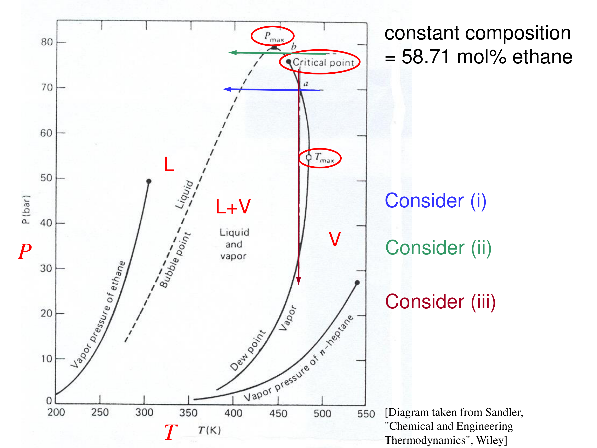

# High-pressure vapour–liquid equilibrium

## Overview

Near critical points the liquid and vapour must be described by one equation of state so that their fugacities merge continuously. A binary then has a critical locus joining the pure critical points, constant-$T$ lenses close at mixture critical points, and constant-composition diagrams become closed bubble–dew loops (Section 32). On such loops the critical point, the maximum two-phase pressure and the maximum two-phase temperature differ, which allows retrograde behaviour: cooling can evaporate liquid and decompression can condense it (Section 33).

*Assumed throughout:* equal fugacities and fugacity coefficients from an equation of state (Sections 07–09); the binary VLE surface (Section 25).

## Section 32: Vapour–liquid equilibrium near critical points

### Intuition

A pure substance's vapour-pressure curve ends at its critical point. Beyond it there is only one fluid phase. The simple binary systems considered here have a *line* of critical points (the critical locus) joining the two pure-component critical points in $P$–$T$–composition space. More complex binaries can have disconnected critical branches and additional liquid–liquid equilibria.

Between the two pure critical temperatures, the lighter component cannot be liquid on its own. A mixture rich enough in the heavier component can still split into liquid and vapour, but only up to some maximum pressure. At that pressure the liquid and vapour compositions merge at a mixture critical point. A two-phase lens that used to stretch across the whole composition range is now cut off before it reaches the light-component axis.

The γ–φ approach treats the two phases with *different* models, an activity-coefficient model for the liquid and an EOS for the vapour. Two different models cannot both converge on the same fluid at the critical point. One EOS for both phases makes the liquid and vapour fugacities meet smoothly there.

### Derivation

**Step 1: the equilibrium condition with one EOS.** Write both phases with fugacity coefficients from the same mixture EOS:

$$y_i\,\bar\phi_i^{\,v}(T,P,\mathbf{y}) = x_i\,\bar\phi_i^{\,l}(T,P,\mathbf{x}) \tag{146}$$

$\bar\phi_i$ is computed from the general integral of Section 08, with the partial molar volume from the EOS, e.g. Peng–Robinson with mixing rules for $a$ and $b$. On a given isotherm the cubic has two relevant roots: the small one is used for the liquid, the large one for the vapour.

**Step 2: what happens at a mixture critical point.** Along a coexistence path towards the critical point, the phase compositions and densities both converge: $\mathbf{x}\to\mathbf{y}$ and $\underline{V}^{l}\to\underline{V}^{v}$. The tie line shrinks to zero. For a cubic EOS, the liquid and vapour roots then coalesce. Equal fugacities alone do not locate a critical point, because (146) also has a trivial equal-composition, equal-root solution at every homogeneous state; a critical calculation additionally checks loss of stability.

A single homogeneous fluid always has the same fugacity as an identical copy of itself. That is why assigning both calculation phases the same composition and EOS root solves the equality equations without demonstrating coexistence. A meaningful two-phase calculation must first find distinct states and then test their stability and material balances.

Approaching a genuine critical point from coexistence removes those distinctions continuously: the composition gap and density gap both disappear. An azeotrope removes only the composition gap. This is why a zero-width tie line on a composition plot needs density or stability information before it can be interpreted as criticality.

**Step 3: dimension of the critical locus.** A binary fluid has three intensive state variables, $T$, $P$ and composition. At a critical point the Gibbs-energy curvature in one fluctuation direction vanishes, and the third derivative in that direction also vanishes (with a stabilising higher-order term). These two independent conditions leave one degree of freedom, so critical states generically form a line. On a simple branch, fixing $T$ determines the critical pressure and composition. Composition equality alone is insufficient: at an azeotrope $\mathbf{x}=\mathbf{y}$ while the liquid and vapour densities remain different.

### Motivation and explanation

**A missing pure-component endpoint does not forbid a liquid mixture.** Above ethane's critical temperature but below propene's, no pure-ethane saturation endpoint exists. A mixture can nevertheless retain a liquid with enough propene present. The two-phase lens then closes at a mixture critical point instead of reaching the ethane axis. Raising temperature confines the liquid-containing region further towards the less volatile component. This is why pure-component critical temperatures alone do not decide whether a multicomponent feed is liquid: composition and the mixture critical locus also matter.

**Constant-$T$ diagrams for ethane (1)–propene (2).** Pure critical temperatures are ethane 305.3 K and propene 364.2 K.
- At 261 K, below both, the lens spans the whole composition range: from propene's vapour pressure (4.0 bar) to ethane's (17.6 bar).
- At 311 K, above ethane's $T_c$, pure ethane cannot be liquid. The lens starts at propene's vapour pressure (15.7 bar) and closes at a **mixture critical point** at about 49 bar and $x_{\mathrm{C_2H_6}}\approx 0.93$, never reaching the ethane axis.
- At 344.3 K the lens is short and closes at much lower ethane content.

**Constant-composition diagrams.** Slicing the 3D surface at fixed overall composition gives, for each composition, a closed loop: bubble curve on one side, dew curve on the other, meeting at that composition's critical point on the critical locus. These diagrams have **no tie lines**, because the coexisting phases have different compositions and lie on other loops.

**Why the critical locus can rise above both pure critical pressures.** For ethane–propene the locus bulges to about 51 bar, above both pure $P_c$ values (48.7 and 45.5 bar). The mixture has to be squeezed harder than either pure component before its liquid and vapour merge. In more asymmetric mixtures (ethane–heptane, next section) the bulge is much larger.

**Limits.** Cubic EOS work well for hydrocarbons and light inorganic gases (N₂, CO₂, H₂S). They work poorly for strongly polar or hydrogen-bonding liquids, for which activity-coefficient models remain necessary at low pressure. Very close to a critical point, all classical EOS miss the true (non-analytic) critical behaviour, but this rarely matters in design.

### Link to other topics

Process simulators use EOS-based VLE (Peng–Robinson, Soave–Redlich–Kwong) for gas processing and refinery light ends, and γ–φ models for polar chemicals. Choosing between them is one of the first decisions in setting up a flowsheet. Section 33 explores the counter-intuitive behaviour inside the two-phase region near the critical locus: retrograde condensation and evaporation.

### Summary

Near critical points, liquid and vapour must be described by one equation of state, so that their fugacities converge as the phases merge. For a binary, the pure critical points are joined by a critical locus. Between the pure critical temperatures, constant-$T$ lenses close at mixture critical points, and constant-composition diagrams become closed bubble–dew loops without tie lines.

## Section 33: Retrograde condensation and evaporation

### Intuition

For a pure substance, the critical point is the top of the vapour-pressure curve, so it is both the highest temperature and the highest pressure at which two phases coexist. For a mixture, the envelope is a loop whose bubble and dew branches meet at the critical point. That meeting point is generally *not* at the top or the right-hand edge of the loop. The loop bulges beyond it: upward on the bubble side, rightward on the dew side.

Near those bulges, the lines of constant liquid fraction ("quality lines") all converge on the critical point. A path that runs past the critical point therefore crosses those lines in an unusual order. The amount of liquid first rises, then falls, as you move in what is normally the "less liquid" direction.

*Analogy: walking around a hill rather than over it.* The quality lines fan out from the critical point like contours. If you pass beside the critical point, rather than through the middle of the envelope, you go up and back down the same contours. The analogy breaks down because the "height" (liquid fraction) is fixed by the lever rule on tie lines in other planes, not by a single surface.

### Derivation

The behaviour follows from the shape of the envelope, read from a measured or EOS-computed diagram. For ethane–heptane at 58.71 mol % ethane, the values below are read from the graph and are therefore approximate:
- critical point ≈ 76 bar, ≈ 460 K;
- cricondenbar $P_{\max}$ ≈ 79 bar, ≈ 445 K, on the bubble side of the critical point;
- cricondentherm $T_{\max}$ ≈ 485 K, ≈ 55 bar, on the dew side.

**Path (i): cool at ~70 bar from point a** (just on the dew side, right of the critical point). The vapour crosses the dew curve, liquid appears and grows, and the system leaves through the bubble curve as all liquid. Normal behaviour: vapour → vapour + liquid → liquid.

**Path (ii): cool at ~78 bar from point b** (between the critical point and the cricondenbar, on the bubble side). The fluid starts as liquid-like. Cooling crosses the bubble curve, so vapour appears, then the path leaves through the bubble curve again near $P_{\max}$ and the system is all liquid once more. **Retrograde evaporation:** liquid → liquid + vapour → liquid, on cooling.

**Path (iii): reduce pressure at ~473 K from point a** (between the critical temperature and the cricondentherm). Lowering the pressure crosses the upper part of the dew curve, so liquid condenses. Further reduction brings the path out through the lower dew curve, and the liquid re-evaporates. **Retrograde condensation:** vapour → vapour + liquid → vapour, on *decompression*.

The liquid fraction along (iii) rises from zero, peaks, and falls back to zero, all while the system is being decompressed.

During this fixed-composition decompression, the overall ratio of light to heavy material stays fixed, but the two phase compositions do not. Near the critical region, pressure changes both the relative fugacities and the densities strongly. The phase compositions and their lever-rule amounts move together, allowing a heavy-rich liquid to appear even while the total fluid expands. Further decompression eventually favours a single gas again.

The closed-envelope path is an equilibrium experiment on a fixed feed. Producing gas from a reservoir can also change the remaining overall composition, particularly when condensed liquid is trapped. The illustrated path explains why liquid first appears; following an actual producing reservoir thereafter requires updated material balances and a changing phase envelope.

### Motivation and explanation

**A pressure-depletion path and its process limitation.** Along an isotherm crossing both dew boundaries of a retrograde envelope, lowering pressure first creates liquid, then increases and eventually decreases its fraction, and finally removes the last liquid. These are equilibrium states at fixed overall composition. In a reservoir, condensed liquid can wet the rock and remain trapped while gas leaves. The flowing gas then loses heavy components, so its subsequent path no longer follows the original fixed-composition envelope. A reversible equilibrium sketch therefore explains the initial condensation, but does not guarantee recovery by later re-evaporation.

**Why it can happen at all.** The phase rule allows it. With $C = 2$ and $P = 2$, there are two degrees of freedom, so the dew curve at fixed composition need not be monotonic in $T$ or $P$. For a pure substance ($F = 1$) the coexistence curve is a single line ending at $T_c$, and no retrograde region exists.

**Where it happens.**
- Retrograde condensation: only between the critical temperature and the cricondentherm.
- Retrograde evaporation: only between the critical pressure and the cricondenbar.

The more asymmetric the mixture (light + heavy components), the larger these regions, which is why ethane–heptane shows them clearly.

**Engineering consequences.**
- *Gas-condensate reservoirs.* Reservoir fluid often sits at path (iii)-type conditions, above the dew curve as a single phase. As the reservoir is produced and its pressure falls, liquid condenses in the rock, where it is largely trapped. The heavy components are the most valuable part of the fluid. Reservoirs are therefore often kept above the dew pressure by re-injecting gas.
- *Pipelines and pressure let-down.* Lowering the pressure of a rich gas can drop out liquid unexpectedly, which causes slugging in pipelines. Gas is "conditioned" (heavy components removed) so that its cricondentherm lies below the lowest pipeline temperature.
- *Design.* Simulators must compute the full envelope with an EOS. Interpolating between pure-component behaviours misses these effects entirely.

**Limits.** The exact positions of the critical point, cricondenbar and cricondentherm are sensitive to composition and to the EOS mixing-rule parameters. Read-off values here are approximate.

### Link to other topics

Phase-envelope calculations underpin gas processing, enhanced oil recovery and supercritical-fluid extraction. Retrograde behaviour is one of the clearest demonstrations that mixture phase equilibria cannot be pieced together from pure-component diagrams. Section 34 returns to the liquid phase and to solutes that are not volatile at all: dissolved solids and ions.

### Summary

For a mixture, the critical point, the maximum two-phase pressure (cricondenbar) and the maximum two-phase temperature (cricondentherm) are different points on the envelope. Between them, cooling can evaporate liquid and decompression can condense it. These retrograde effects are allowed by the extra degree of freedom of a binary, are strongest in asymmetric mixtures, and matter in practice for gas-condensate reservoirs and gas pipelines.

## Conclusion

Mixture phase envelopes near critical points cannot be pieced together from pure-component behaviour: they need an equation of state for both phases, and they show retrograde effects that matter for gas-condensate reservoirs and gas pipelines. The next part returns to the liquid phase and to solutes that are not volatile at all: dissolved solids and ions.
