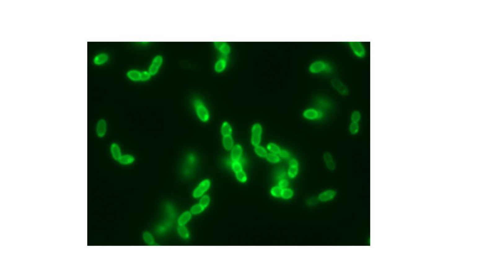
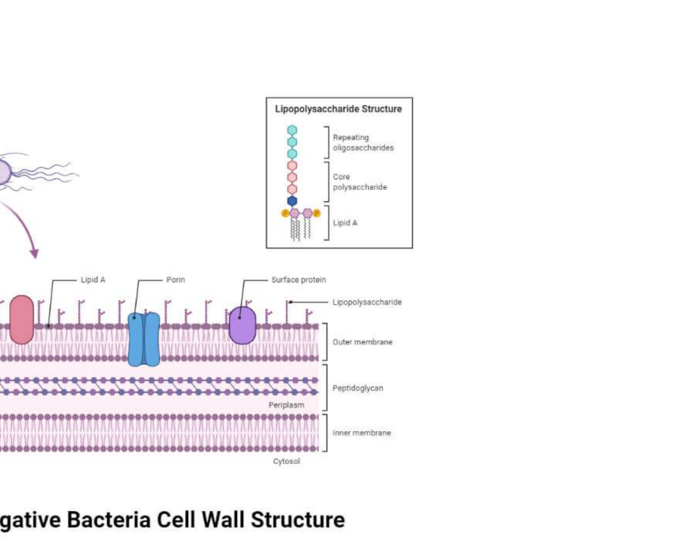
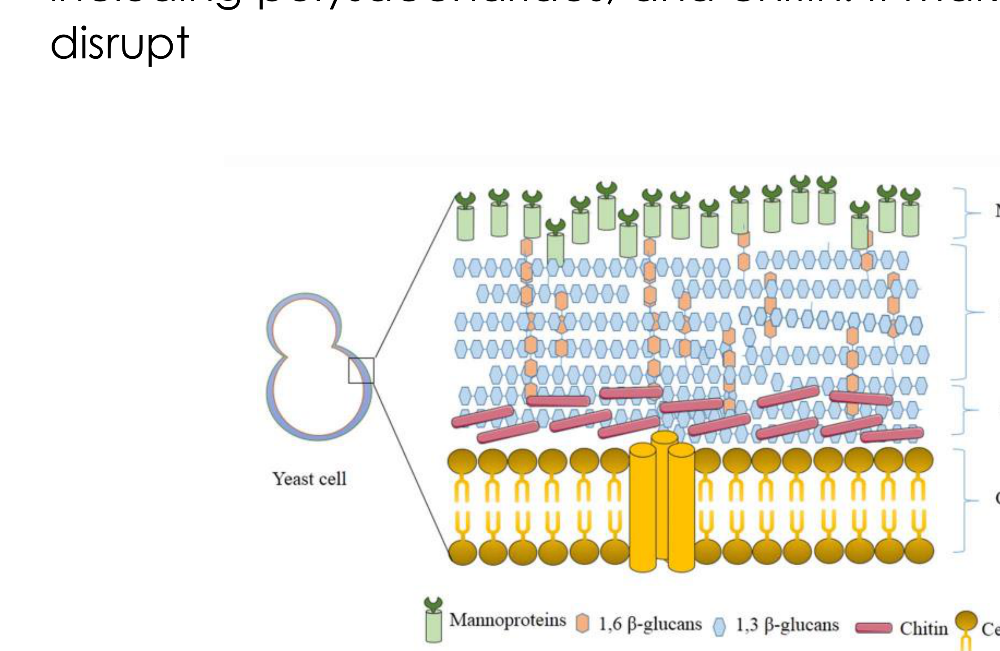
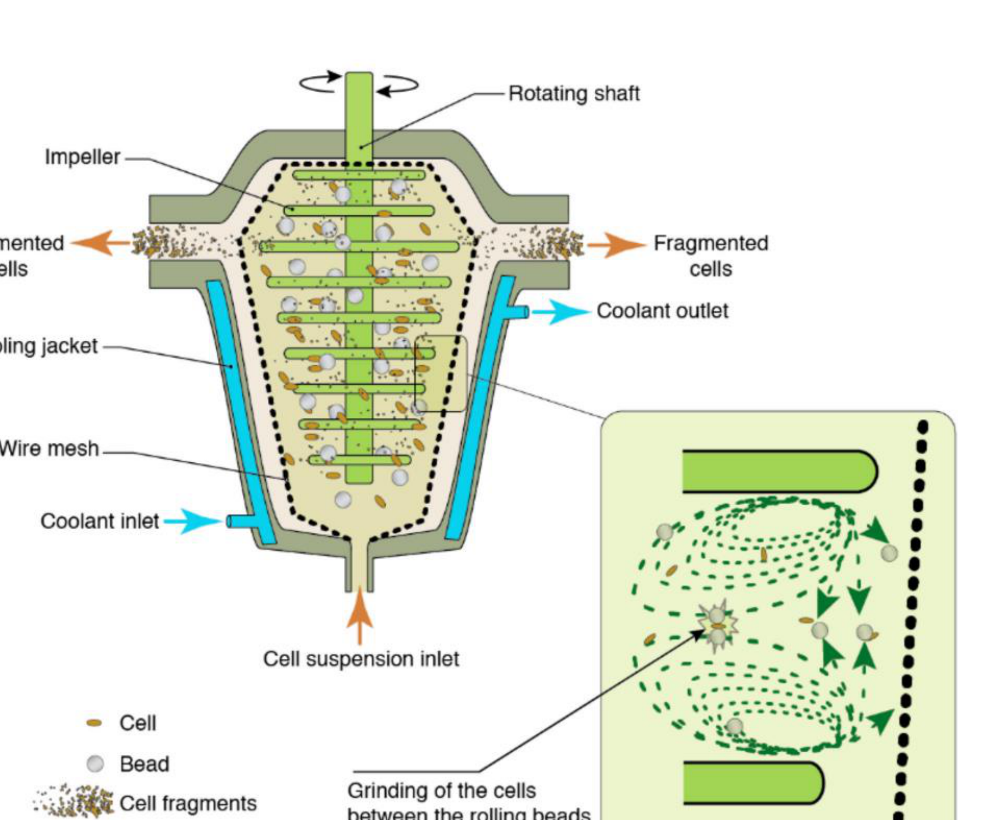
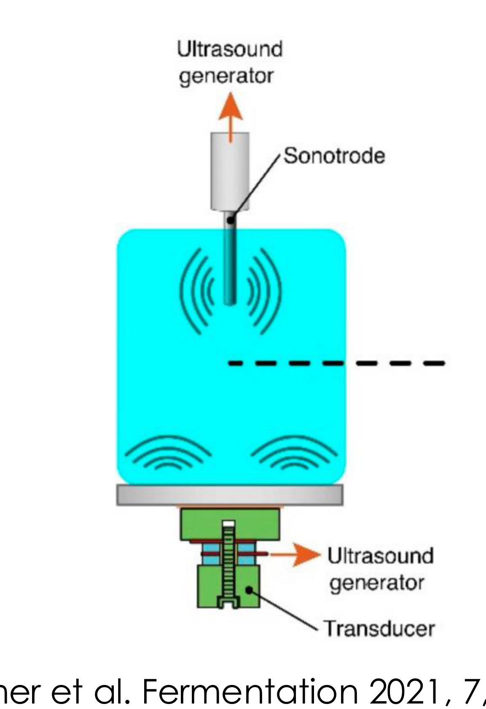
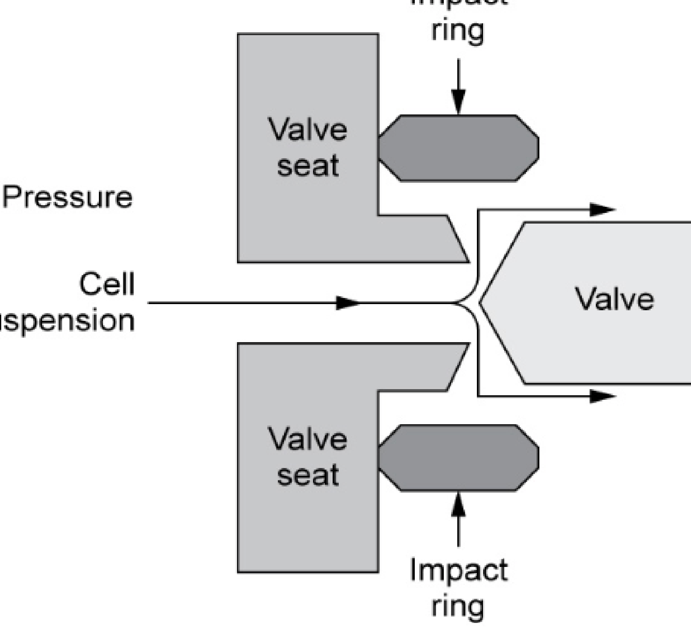
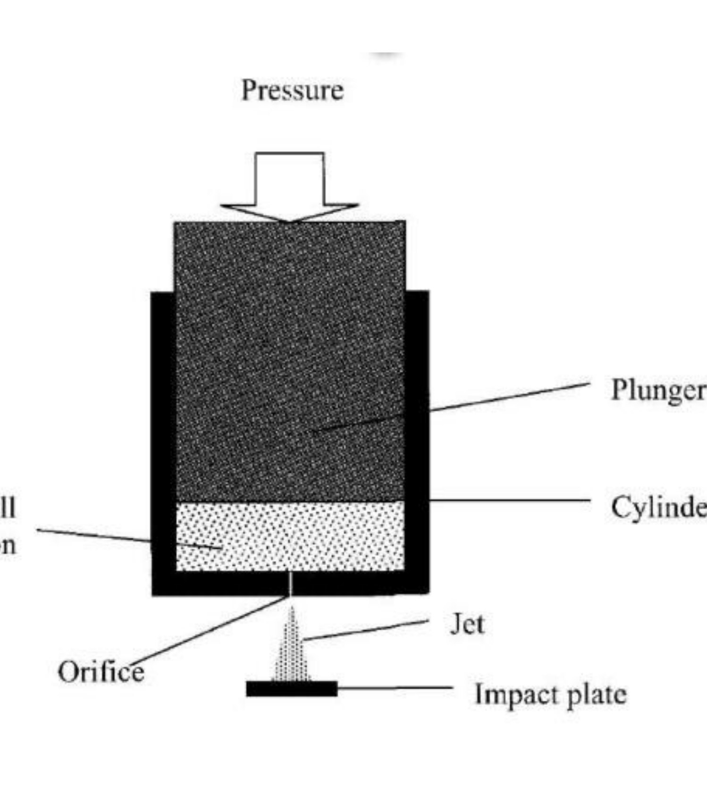
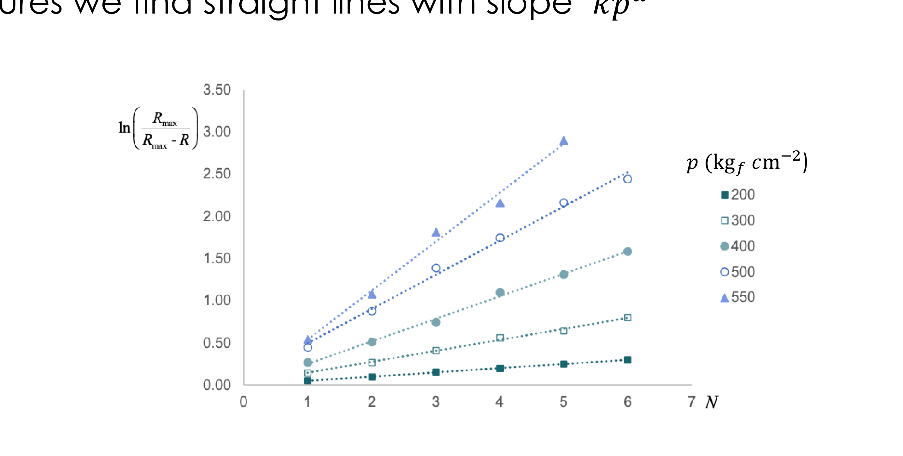
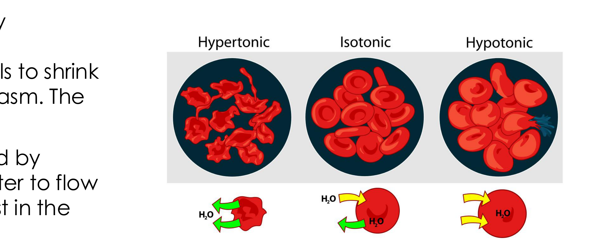
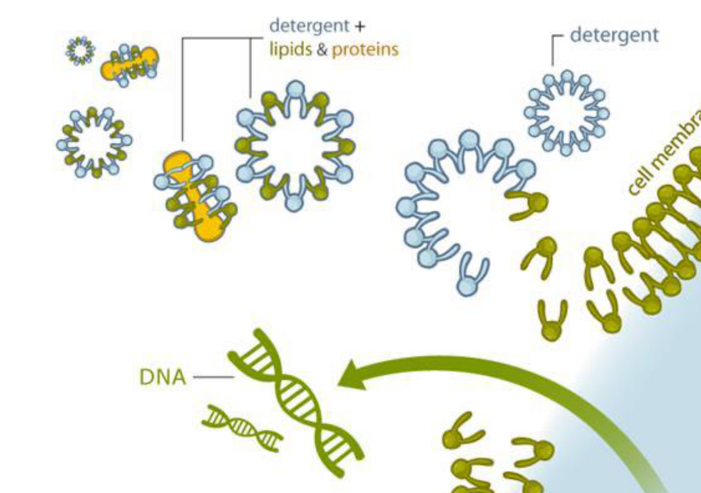

# Cell disruption

## Overview

Intracellular products require disruption before purification, but breaking cells also releases debris, nucleic acids and degradative enzymes. Mechanical and non-mechanical methods balance release against product damage; release kinetics and a homogeniser fit make that trade quantitative.

*Assumed throughout:* cell structure, material balances and first-order kinetics.

## Section 38: Why cells must be disrupted, and what resists it

### Intuition

Disruption is a deliberately destructive step in the middle of an otherwise careful process, and that is its difficulty. The wall must be broken thoroughly enough to release the product, but the product itself is a fragile molecule sitting in the same vessel — so every method that is good at breaking walls is also, to some degree, good at destroying what it releases.

Worse, breaking the cell releases *everything*: proteases, nucleic acids, lipids, and fragments of wall so small that they are harder to remove than the intact cells were. The step therefore makes the separation problem worse before it makes it better, which is why it is avoided wherever possible by secreting the product instead.

*Analogy:* opening a safe with explosives to recover a document inside. The analogy breaks down because a cell wall is not uniformly strong: it resists by being elastic and chemically crosslinked rather than merely hard, which is why chemical and enzymatic attack (Section 41) can succeed where force is clumsy.

### Mechanism

**Why products are intracellular.** Many products of interest — particularly recombinant proteins — are not secreted. They accumulate in the cytoplasm, sometimes as dense **inclusion bodies** at the poles of the cell. Such a product cannot be recovered without breaking the cell, so disruption must precede any isolation or purification.

#### What has to be broken

Microorganisms used in bioprocessing are surrounded by tough **cell walls**, and their construction differs by organism:

- **Gram-positive bacteria** (for example *Lactococcus lactis*) have a **thick peptidoglycan wall** — a crosslinked mesh of sugar chains and short peptides, mechanically strong.
- **Gram-negative bacteria** (for example *E. coli*) have a **thinner peptidoglycan wall**, but it is enveloped by an **outer membrane rich in lipopolysaccharide (LPS)**. The wall is weaker but there are more layers to cross, and the LPS matters downstream because it is an endotoxin that must be removed from any injectable product.

- **Yeast** (*Saccharomyces cerevisiae*) has a **thick, multi-layered wall** of polysaccharides — β-1,3 and β-1,6 glucans — together with mannoproteins and **chitin**. This makes yeast **very difficult to disrupt**, and it is the hardest of the common hosts.
- **Mammalian cells** have only a plasma membrane and **no cell wall at all**, so they are easily disrupted. The same fragility that makes them shear-sensitive in the bioreactor (Section 31) makes them trivial to break here.

#### Strategies

Four families of method, in two groups:

**Mechanical** (Section 39):
- bead mill, ultrasonication, French press, high-pressure homogeniser.

**Non-mechanical** (Section 41):
- *physical*: thermolysis, decompression, osmotic shock;
- *chemical*: detergents, solvents;
- *biological*: enzymatic digestion.

Three considerations govern the choice:
1. **Scale.** Some methods are only applicable at small or laboratory scale; others scale to production.
2. **Cell type.** Bacteria and yeast have tough walls and are **more difficult to disrupt by mechanical means only**; bacteria are also small, which makes them harder still. Mammalian cells need little.
3. **Product sensitivity.** Methods differ in how much heat and shear they impose.

**Why size matters mechanically.** A small cell is harder to break by shear because the stress a flow field imposes on a particle scales with its size. A large yeast cell or a mammalian cell presents a bigger target to the same velocity gradient than a 1 µm bacterium does. Bacteria are therefore doubly disadvantaged: tough walls *and* small size.

### Motivation and explanation

**Why disruption is avoided when possible.** Three costs follow from breaking cells:
- *Debris.* The fragments are far smaller than intact cells, so the cell-debris removal step that follows (by the same centrifugation or filtration of Sections 33–37) is harder than the original cell removal. Section 36's $u \propto D_p^2$ makes this quantitative — halving the fragment size quarters the settling velocity.
- *Released contaminants.* Proteases liberated from the cytoplasm begin degrading the product immediately, which is why disruption is usually done cold (the worked example in Section 40 operates at 5 °C) and why the subsequent steps must be fast.
- *Viscosity.* Released DNA raises the viscosity of the suspension substantially, which slows every downstream separation — again visible in Section 36, where $u \propto 1/\mu$.

The preferred alternative is to engineer the host to **secrete** the product, converting an intracellular recovery into a simple cell removal. Where that is not possible, inclusion bodies are sometimes an advantage: they are dense, so they can be recovered by centrifugation after disruption, though the protein must then be refolded.

**Why the wall resists.** Peptidoglycan is a covalently crosslinked network enclosing the whole cell, so it behaves as a single molecule under tension and must be *ruptured*, not merely deformed. It also bears the turgor pressure of the cytoplasm, which in bacteria is several atmospheres — the wall is a pressure vessel, and it is already pre-stressed.

### Wider pathway

Disruption sits between cell removal (Sections 33–37) and primary isolation (Sections 42–45). Its output — a homogenate of product, debris, proteases and nucleic acids — is the feed for everything that follows, and the completeness of disruption sets the ceiling on overall yield.

### Link to other topics

Choosing between mechanical and chemical disruption is the familiar comminution trade-off: force is cheap and indiscriminate, selective chemistry is expensive but gentle, and the right balance depends on how much the valuable component tolerates.

### Summary

Intracellular products require the cell to be broken, but disruption releases debris, proteases and DNA that make every subsequent separation harder. Difficulty is set by the host: yeast walls of glucan and chitin are the toughest, Gram-positive bacteria have thick peptidoglycan, Gram-negative bacteria are weaker but layered, and mammalian cells have no wall at all.

## Section 39: Mechanical cell disruption and release kinetics

### Intuition

Every mechanical method does the same thing: impose a stress on each cell large enough to rupture its wall. They differ only in how the stress is generated — grinding between beads, collapsing bubbles, or acceleration through a narrow gap.

The key to the kinetics is that **each cell is broken independently**. A pass through the equipment gives every intact cell the same probability of rupture, regardless of how many have already broken. The number of intact cells therefore falls by a constant *fraction* per pass, which is a first-order process. Release of product is the mirror image: it approaches its maximum exponentially.

This also explains why a single pass is never enough. A fixed fraction surviving each time means complete disruption requires, in principle, infinitely many passes — in practice, enough passes for the residue to be acceptable.

*Analogy:* radioactive decay, where each nucleus has a fixed probability of decaying per unit time independent of the others. The analogy breaks down because cells are not identical: a population has a distribution of wall strengths, so the weakest break first and the surviving population becomes progressively tougher, making the real decay slightly slower than exponential.

### Mechanism

All mechanical methods **produce substantial heat** that can damage the product, so all of them **need cooling**.

**Bead mill.** A chamber filled with beads — typically glass, 0.2–1.0 mm diameter — packed to up to 80 % of the free volume, with impellers rotating at 1500–2250 rpm. Cells at 30–60 % volume wet solids are ground between the rolling beads. Cooling is through a jacket. Scales to industrial use.

**Ultrasonication.** Ultrasonic vibrations at about 20 kHz are produced by an immersion probe. The high-energy pressure waves create **cavitation bubbles**, whose collapse disrupts the cells — the damage is done by the implosion, not by the sound itself. Bacteria are disrupted in 30–60 s, yeast in 2–10 minutes. It works well at small and laboratory scale but is **difficult to scale up**, because of the high energy demand and safety concerns about exposure to ultrasound.

**High-pressure homogeniser.** The standard industrial method.
- Cells are put under **high pressure, 1500–2500 bar**.
- The pressure is **suddenly released** by a valve opening, forcing the cells to flow at high speed through a small gap.
- The cells then collide with an **impact ring**, causing disruption.
- Semi-continuous, usable at laboratory and industrial scale.
- **Multiple passes** are usually required. This can be done with a multi-tank arrangement, feeding from one tank, homogenising and collecting into the other. Tough cells such as *L. lactis* (ovoid, Gram-positive) need several passes.

**French press.** A simpler version of the same principle, suitable for **laboratory scale only**. Pressure is applied and the cells forced through a small hole at high speed, hitting an impact plate. Its extraction efficiency is described by the **same equation** as the high-pressure homogeniser.

### Derivation

Notation: $R$ is the protein released (kg per kg biomass), $R_{\max}$ the maximum achievable release, $N$ the number of passes, $t$ processing time, $p$ the operating pressure.

**Step 1: first-order release.** Each pass ruptures a fixed fraction of the cells that remain intact. The *unreleased* protein $(R_{\max}-R)$ therefore decays by a constant factor per pass:
$$\frac{d(R_{\max}-R)}{dN} = -k'(R_{\max}-R) \tag{1}$$

**Step 2: integrate** from $R = 0$ at $N = 0$:
$$\ln\!\left(\frac{R_{\max}}{R_{\max}-R}\right) = k'N \tag{2}$$

For a **bead mill**, where the variable is processing time rather than discrete passes, the same argument in continuous time gives
$$\ln\!\left(\frac{R_{\max}}{R_{\max}-R}\right) = kt \tag{3}$$
with $k$ a constant depending on bead size, bead packing density, rotation speed and temperature.

**Step 3: the pressure dependence.** For a homogeniser, $k'$ is not a constant: raising the pressure increases the stress on each cell and so the fraction broken per pass. Empirically the dependence is a power law, $k' = kp^{\,a}$, giving
$$\boxed{\;\ln\!\left(\frac{R_{\max}}{R_{\max}-R}\right) = kNp^{\,a}\;}\tag{4}$$
where $k$ is a constant depending on cell type and temperature, $p$ the applied pressure, and $a$ an **exponent depending on cell toughness**, ranging from about 0.9 to 2.9.

**Rearranged for release:**
$$\frac{R}{R_{\max}} = 1 - e^{-kNp^{\,a}} \tag{5}$$

**Checks.** At $N = 0$, $R = 0$. As $N\to\infty$, $R\to R_{\max}$: complete release needs infinite passes, as the intuition predicted. Release is **linear in $N$ only at small $N$**, where $e^{-x}\approx 1-x$.

### Motivation and explanation

**Why $a$ measures toughness.** The exponent says how strongly disruption responds to pressure. A low $a$ near 0.9 means a cell breaks almost as readily at low pressure as at high — pressure buys little. A high $a$ near 2.9 means disruption is very sensitive to pressure, so a tough cell can be broken efficiently *provided* the pressure is high enough. Since $p$ enters as $p^a$ while $N$ enters linearly, **for $a>1$ raising the pressure is more effective than adding passes** — the central design conclusion, and the one Section 40 exploits.

**Why multiple passes rather than one hard pass.** Equation (4) suggests either route works, but there are limits: the equipment has a maximum rated pressure, and higher pressure means more heat, so the product suffers. Passes spread the same total energy over time with cooling between, which is gentler on the product.

**Where the model fails.**
- $R_{\max}$ is itself an assumption: some protein is never released, remaining bound to debris.
- A real population has a **distribution of wall strengths**, so the weakest cells break first and the survivors are tougher. Observed curves therefore fall slightly below the exponential at high $N$.
- Prolonged treatment degrades the released protein, so measured $R$ can *fall* at very high $N$ — the model has no term for this.
- $k$ depends on temperature, so a run without adequate cooling does not have a single $k$.

### Link to other topics

Equation (2) is identical in form to the Nernst equation for the number of stages in a cascade, or to the log-penetration law in sterilisation: a fixed fractional reduction per unit of effort gives a logarithm of the residual, and the quantity that scales linearly is $\ln$ of what is left.

### Summary

Mechanical methods all impose stress to rupture walls, and all generate heat that must be removed. Because each cell breaks independently with a fixed probability, release follows first-order kinetics, equation (4), with pressure entering as $p^{\,a}$ and $a$ between 0.9 and 2.9 depending on cell toughness.

## Section 40: Worked example — fitting and using homogeniser kinetics

### Intuition

The model has two unknowns multiplied together inside an exponential, which cannot be read off directly. The standard route is to linearise twice.

First, at **fixed pressure**, equation (4) is linear in $N$ through the origin, so the slope of $\ln[R_{\max}/(R_{\max}-R)]$ against $N$ gives the product $kp^{\,a}$ for that pressure. Doing this for each pressure gives one slope per pressure.

Second, taking logarithms of those slopes, $\ln(kp^{\,a}) = \ln k + a\ln p$, which is linear in $\ln p$. The gradient is $a$ and the intercept is $\ln k$.

Two straight-line fits, each extracting one constant. This is the general recipe whenever a power law sits inside an exponential.

### Worked example

**Problem.** A production strain of *E. coli* is disrupted at 5 °C in a Gaulin homogeniser between 200 and 550 kg$_f$ cm⁻². Percentage protein release $R/R_{\max}$ as a function of the number of passes is:

| Passes $N$ | 200 | 300 | 400 | 500 | 550 |
|---|---|---|---|---|---|
| 1 | 5.0 | 13.5 | 23.3 | 36.0 | 42.0 |
| 2 | 9.5 | 23.5 | 40.0 | 58.5 | 66.0 |
| 3 | 14.0 | 33.5 | 52.5 | 75.0 | 83.7 |
| 4 | 18.0 | 43.0 | 66.6 | 82.5 | 88.5 |
| 5 | 22.0 | 47.5 | 73.0 | 88.5 | 94.5 |
| 6 | 26.0 | 55.0 | 79.5 | 91.3 | — |

(% protein release; pressure in kg$_f$ cm⁻².)

**(a)** How many passes are required for 80 % release at 460 kg$_f$ cm⁻²?
**(b)** What pressure delivers 70 % recovery in only two passes?

All numbers below were computed in Python.

#### Step 1: convert the data

The table gives $R/R_{\max}$, but the model needs $\ln[R_{\max}/(R_{\max}-R)]$. Dividing numerator and denominator by $R_{\max}$:
$$\ln\!\left(\frac{R_{\max}}{R_{\max}-R}\right) = \ln\!\left(\frac{1}{1-R/R_{\max}}\right) \tag{6}$$

So 42.0 % becomes $\ln[1/(1-0.42)] = 0.54$.

#### Step 2: slope at each pressure

Plotting the converted data against $N$ for each pressure gives straight lines through the origin, confirming the first-order form. Their slopes are $kp^{\,a}$:

| $p$ (kg$_f$ cm⁻²) | 200 | 300 | 400 | 500 | 550 |
|---|---|---|---|---|---|
| slope $kp^{\,a}$ | 0.0500 | 0.1337 | 0.2633 | 0.4264 | 0.5691 |

#### Step 3: extract $a$ and $k$

Taking logarithms, $\ln(kp^{\,a}) = \ln k + a\ln p$. A straight-line fit of $\ln(\text{slope})$ against $\ln p$ gives
$$a = 2.37, \qquad k = 1.73\times10^{-7}\ (\mathrm{kg_f\,cm^{-2}})^{-a}$$
with $R^2 = 0.9994$ — the power law holds well across the range.

**Check.** Predicted release at $p = 550$, $N = 5$ is 93.8 % against 94.5 % measured; at $p = 200$, $N = 6$ it is 26.1 % against 26.0 %. The fit reproduces both ends of the data.

#### Step 4: (a) passes for 80 % at 460 kg$_f$ cm⁻²

Rearranging (4) of Section 39 for $N$:
$$N = \frac{1}{kp^{\,a}}\ln\!\left(\frac{1}{1-R/R_{\max}}\right) = \frac{1}{1.73\times10^{-7}\times460^{2.37}}\ln\!\left(\frac{1}{1-0.8}\right) = 4.4$$

Passes are whole numbers and 4.4 would fall short, so **$N = 5$**.

#### Step 5: (b) pressure for 70 % in two passes

Rearranging for $p$:
$$p = \left[\frac{1}{Nk}\ln\!\left(\frac{1}{1-R/R_{\max}}\right)\right]^{1/a} = \left[\frac{\ln(1/0.3)}{2\times1.73\times10^{-7}}\right]^{1/2.37} = 570\ \mathrm{kg_f\,cm^{-2}}$$

This is just above the 550 kg$_f$ cm⁻² at which data were taken, so it is a modest extrapolation and reasonable — but it would need checking against the machine's pressure rating.

### Motivation and explanation

**Why the two-stage fit is the right approach.** Fitting $k$ and $a$ simultaneously to all 29 data points by non-linear regression would also work, but the staged version is better practice: the first stage *tests* the model (do the lines pass through the origin and stay straight?) before the second stage extracts parameters. A curved line at one pressure would reveal a failure of first-order kinetics that a global fit would silently absorb into the parameters.

**What $a = 2.37$ means in design terms.** Since $a > 1$, pressure is a stronger lever than passes, as Section 39 predicted. Quantitatively, from (4):
- doubling $N$ doubles $\ln[R_{\max}/(R_{\max}-R)]$;
- doubling $p$ multiplies it by $2^{2.37} = 5.2$.

**Doubling the pressure is worth about five extra passes.** For *E. coli* at these conditions, a single high-pressure pass beats several gentler ones, which is why industrial homogenisers are built for 1500–2500 bar.

**The trade-off that the model does not contain.** Higher pressure means more energy dissipated as heat per pass, so more cooling duty and more risk of denaturing the product — and the equipment must be rated for it. Fewer passes means less total residence time with released proteases. The model gives the disruption; the choice between the two routes depends on product stability and capital cost, which it says nothing about.

**Limits of the extrapolation.** The fit covers 200–550 kg$_f$ cm⁻² and 1–6 passes. Part (b) extrapolates slightly in pressure, which is acceptable. Extrapolating to much higher pressure would not be: cavitation and temperature rise change the mechanism, and $R_{\max}$ itself may fall as the released protein is damaged.

### Link to other topics

The two-stage linearisation — hold one variable, fit the other, then fit the parameters of that fit — is the standard way to resolve a rate law of the form $r = kC_A^{\alpha}C_B^{\beta}$ from kinetic data, and the reasoning is identical: isolate one dependence at a time.

### Summary

Converting the data to $\ln[R_{\max}/(R_{\max}-R)]$ linearises the release law in $N$; the slopes then linearise in $\ln p$, giving $a = 2.37$ and $k = 1.73\times10^{-7}$ with $R^2 = 0.9994$. Five passes reach 80 % release at 460 kg$_f$ cm⁻², and 570 kg$_f$ cm⁻² reaches 70 % in two.

## Section 41: Non-mechanical cell disruption

### Intuition

A wall can be broken by overwhelming it, or by removing what holds it together. Mechanical methods do the first. The non-mechanical methods do the second, and they divide naturally by *which* component they attack:

- **Physical** methods make the cell break *itself*, by creating a pressure difference across the envelope that it cannot withstand — by boiling the cytoplasm, by expanding dissolved gas inside it, or by drawing water in osmotically.
- **Chemical** methods dissolve the lipid membrane, which is held together only by the hydrophobic effect and so is vulnerable to anything surface-active.
- **Biological** methods cut the covalent crosslinks of the wall enzymatically, which is the most selective attack of all because an enzyme recognises one specific bond.

The pattern across all three is **specificity bought at a price**. Each is gentler and more targeted than a homogeniser, and each introduces something that must later be removed — heat damage, added salt, detergent, solvent, or enzyme — or is simply too expensive at scale.

*Analogy:* opening a locked door by force, by removing its hinges, or with the correct key. The key is cleanest but must be obtained and accounted for afterwards. The analogy breaks down because a detergent does not unlock anything selectively — it dissolves the membrane wholesale, and it is "selective" only in the sense that it attacks lipid rather than protein.

### Mechanism

#### Physical methods

These include thermal, decompression and osmotic shock. They are generally **costly and difficult to scale up**, so they are used mostly at laboratory rather than production scale.

**Thermolysis.** Cells are disrupted by **heating** — cytoplasmic proteins can be extracted from *E. coli* by holding at 90 °C for 10 minutes. Alternatively, **freeze–thaw cycles** disrupt cells through the formation of **ice crystals** that puncture membranes and walls. Both are **energy intensive**, and heating obviously risks denaturing the product, so thermolysis suits only thermostable products.

**Decompression.** Cells are exposed to a **high-pressure gas**, which dissolves in the medium and distributes itself inside the cells. On **rapid decompression**, the gas within the cells expands and bursts them from the inside.

The mechanism is worth noting: the disruptive force is generated *inside* the cell, so the wall fails in tension from within rather than being crushed. This is gentler than homogenisation because there is no shear field acting on the released protein.

**Osmotic shock.** Cells are exposed to **hypertonic** or **hypotonic** conditions.
- *Hypertonic* conditions are obtained by adding salts at 1–3 M concentration, causing the cells to **shrink** rapidly as water leaves the cytoplasm.
- *Hypotonic* conditions are obtained by diluting into pure water, causing water to **flow into the cytoplasm**, so the cells swell and **burst**.

The two are often used in sequence — shrink, then swell — since the mechanical cycling weakens the envelope. The method is **not sufficiently efficient for production scale**, and the added salt must afterwards be removed, which adds cost.

#### Chemical methods

Non-physical methods disrupt cell walls and membranes by adding chemical substances (**solvents**, **detergents**) or biological agents (**enzymes**). Several can be combined to achieve the desired efficiency. The drawback compared with physical methods is the **cost of the substances used, and that they may need to be removed**.

**Detergents.** Detergents, or **surfactants**, solubilise the phospholipid cell membrane through **micellisation** and by solubilising membrane proteins. Typical detergents are **sodium dodecyl sulfate (SDS)** and **Triton X-100**. They may need to be removed for later processing stages, adding to cost. Commonly used at laboratory scale for RNA or DNA extraction.

**Solvents.** Alcohols, dimethyl sulfoxide, methyl ethyl ketone and toluene solubilise the lipid components of the membrane, disrupting it. Like detergents, they may need removal. Solvents **may cause denaturation** of target proteins, which is often undesirable. They are sometimes combined with alkaline compounds to hydrolyse the cell wall as well as the membrane.

#### Biological methods

**Enzymes** digest cell walls. Those used include **lysozyme, cellulase, protease, chitinase and pectinase**.

The defining feature is **specificity**: different enzymes digest different parts of the wall, matched to the organism's chemistry (Section 38).
- **Lysozyme** hydrolyses the **peptidoglycan** layer in bacteria.
- **Chitinase** targets the **chitin** in yeast cell walls.
- **Pectinase** is used for plant cell walls.

Enzymes can be **combined with detergents**. For Gram-negative bacteria, lysozyme treatment follows detergent treatment, which is used to remove the outer membrane and expose the peptidoglycan layer underneath — a direct consequence of the layered architecture in Section 38: the detergent handles the lipid outer membrane, the enzyme handles the peptidoglycan.

Enzymes are **costly**, which limits their application in production-scale processes.

### Motivation and explanation

**Why these methods do not scale.** Each has a specific obstacle:
- *Thermolysis and freeze–thaw* are energy intensive, and the energy scales with the volume processed.
- *Decompression* requires a pressure vessel large enough for the batch, and the gas must be compressed.
- *Osmotic shock* needs molar quantities of salt per batch, then needs it all removed.
- *Detergents and solvents* are consumables, and removal is a further separation step.
- *Enzymes* are the most expensive reagents of all.

Mechanical methods, by contrast, use equipment rather than consumables: a homogeniser's cost is capital plus electricity, and it does not scale with batch volume in the same punishing way. **This is the fundamental reason production-scale disruption is mechanical** despite being cruder.

**Where non-mechanical methods win.** Three cases:
1. *Fragile products* that cannot survive shear or heat.
2. *Selective release* — mild osmotic shock can release periplasmic contents from Gram-negative bacteria without breaking the inner membrane, so the product comes out with far fewer contaminants. This is a real purification advantage, not just a gentler disruption.
3. *Small scale*, where consumable cost is irrelevant and convenience dominates.

**Combinations are normal.** The methods are not exclusive. A common industrial compromise is a mild chemical or enzymatic pre-treatment to weaken the wall, followed by fewer homogeniser passes — reducing both reagent cost and the heat and shear load.

### Link to other topics

The choice between a capital-intensive mechanical route and a consumable-intensive chemical one is a standard operating-cost comparison: equipment cost is largely independent of throughput once installed, while reagent cost scales linearly with it, so the crossover sits at a particular production volume.

### Summary

Non-mechanical disruption works by making the cell burst itself (thermolysis, decompression, osmotic shock), dissolving its membrane (detergents, solvents), or cutting its wall enzymatically — the last being the most selective, with lysozyme, chitinase and pectinase matched to the organism's wall chemistry. All are gentler than homogenisation and all introduce a consumable that scales with batch size, which is why production remains mechanical and these methods belong to the laboratory.

## Conclusion

Disruption recovery must be assessed alongside the damage and contaminants introduced by the release operation. The next unit develops primary isolation.
