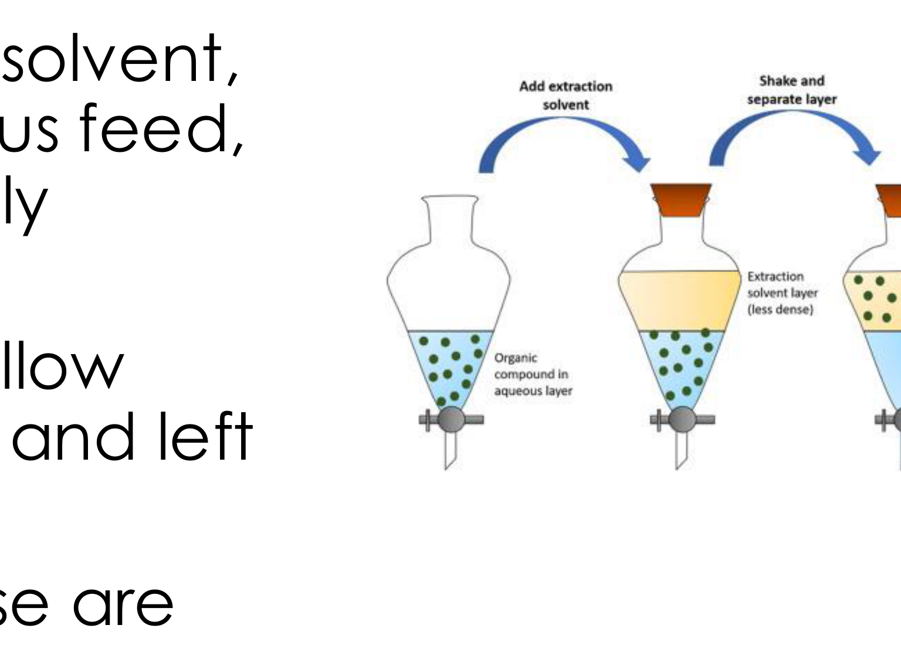
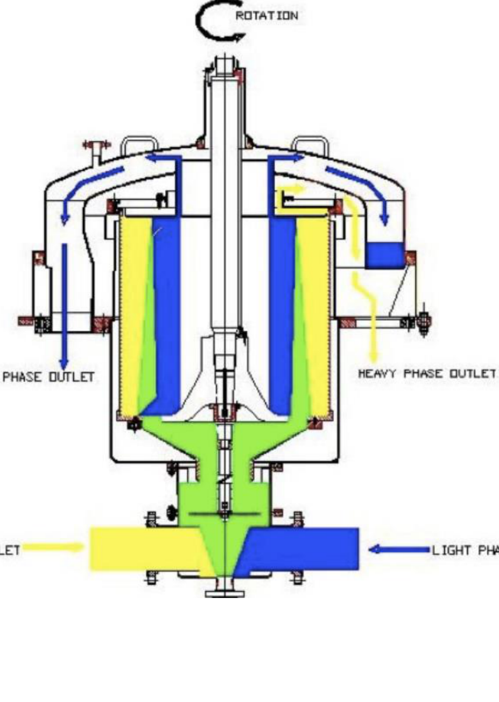
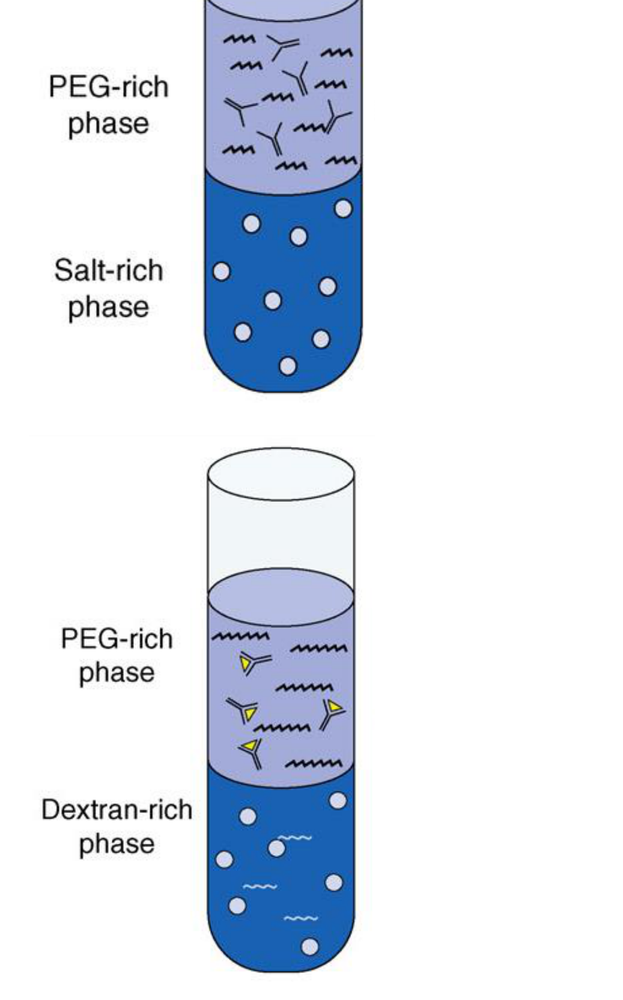
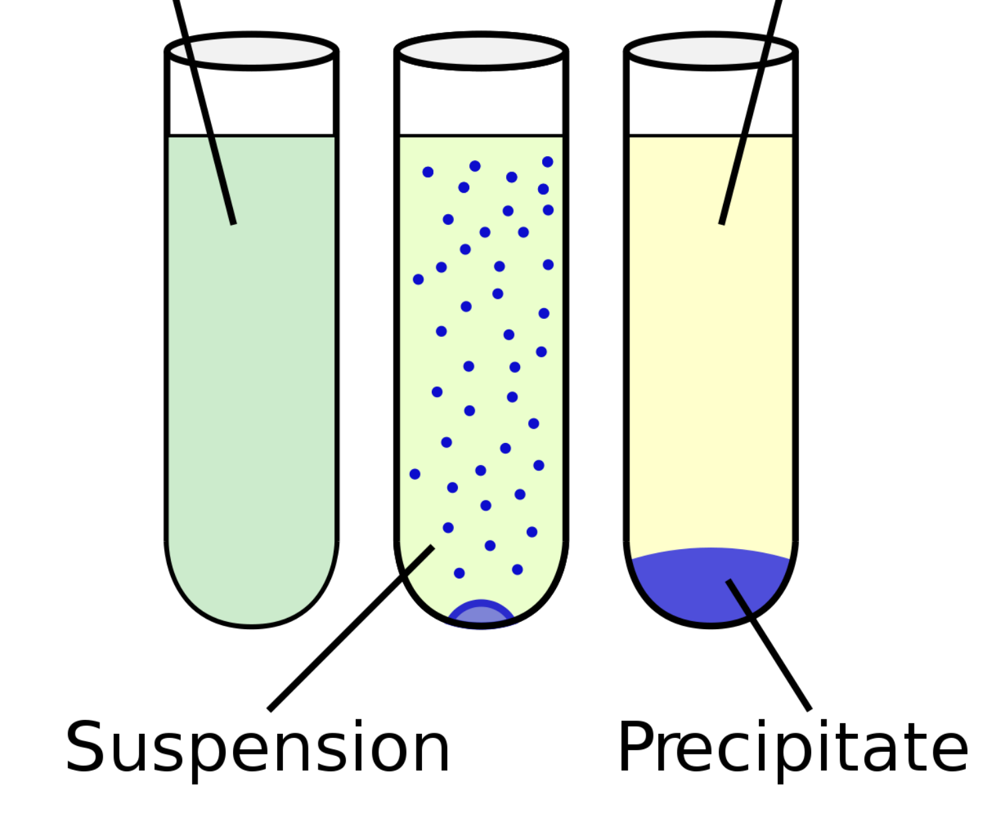
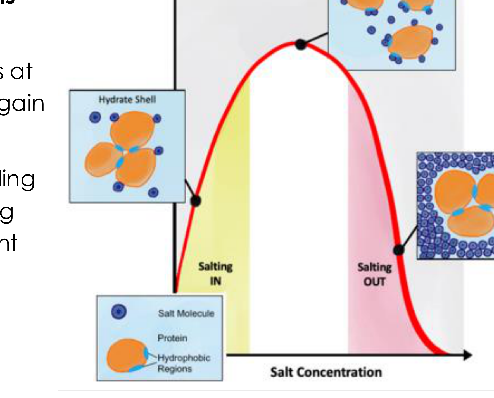
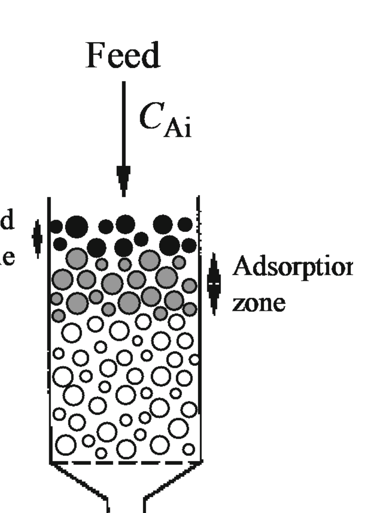
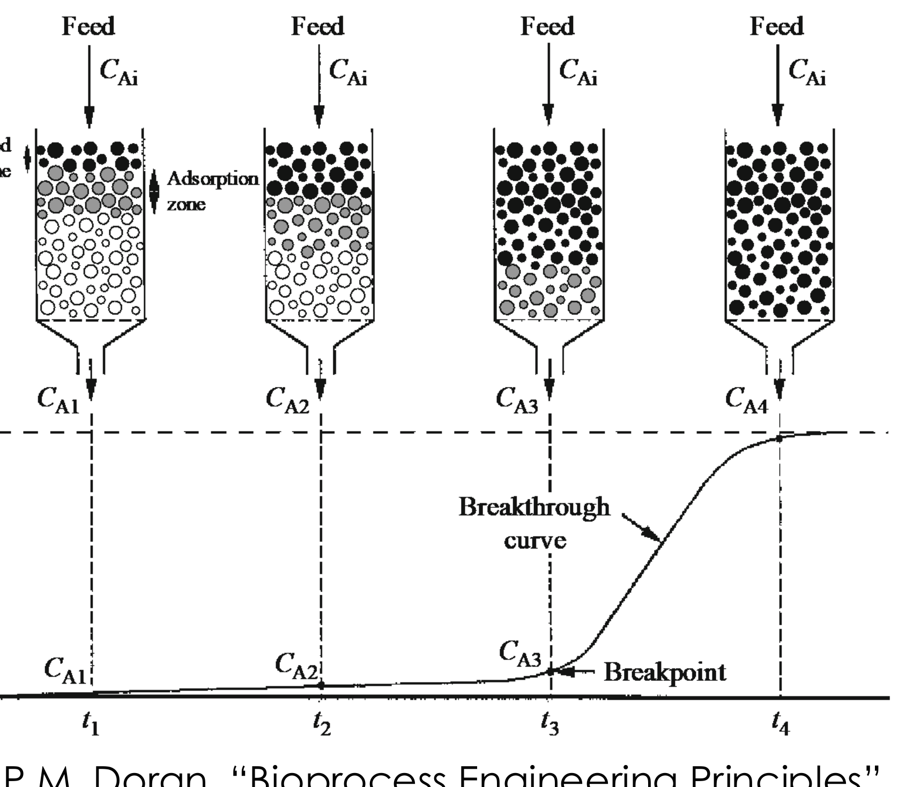
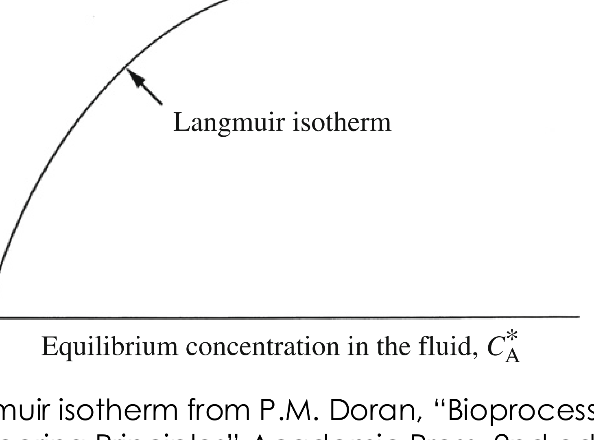
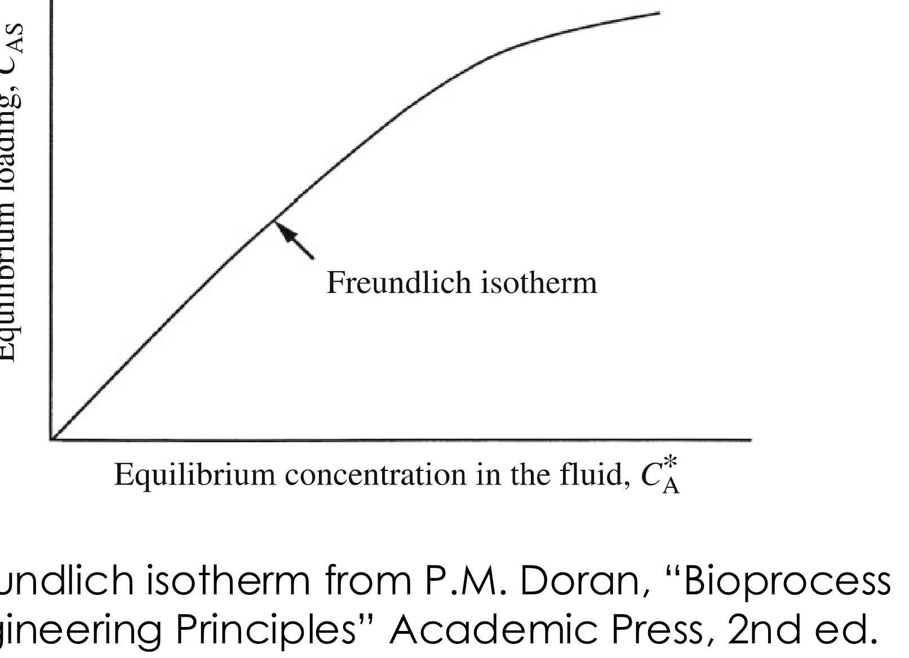

# Primary isolation

## Overview

Primary isolation separates a product from the clarified broth using partitioning, precipitation or adsorption. Equilibrium relations and material balances connect the molecular mechanism to recovery, product concentration and the cost of pursuing very high yield.

*Assumed throughout:* phase equilibria, protein structure and material balances.

## Section 42: Primary isolation by solvent and aqueous two-phase extraction

### Intuition

After cell removal and disruption, the feed is either a liquor with the organisms removed or a cell homogenate. The target — a protein, peptide or small molecule such as an antibiotic — sits in solution alongside a great many unwanted components.

Extraction exploits the fact that different molecules distribute differently between two immiscible liquids. Shake the feed with a second liquid in which the product is much more soluble than the impurities are, let the phases separate, and the product moves across while most contaminants stay behind.

The limitation is that one equilibration can never be complete. The product distributes according to a fixed ratio, so some always remains in the original phase. The design question is therefore not "does it partition?" but "**how much do I recover, and at what phase ratio?**" — which the derivation below answers.

*Analogy:* washing a stain with a solvent in which it dissolves better than water does. The analogy breaks down in the way that matters for proteins: an organic solvent that dissolves a protein well usually also denatures it, which is exactly why the aqueous variant exists.

### Mechanism

#### Solvent extraction

- The aqueous feed contains a target organic compound A.
- It is mixed with an **organic solvent, immiscible with the aqueous feed**, within which A preferentially partitions.
- The system is agitated to allow transfer of A to the solvent, then left to settle.
- The two phases are separated, and A is recovered from the solvent, for example by evaporation.

The solvent is chosen so that **A partitions strongly within it, but undesirable compounds in the feed (such as cell debris) do not**. Selectivity comes entirely from that choice.

Penicillin is the standard example: extracted from aqueous broths using butyl or amyl acetate.

**At plant scale** the operation is continuous rather than batch. A **countercurrent centrifuge** is used: the heavy phase (typically the feed) is mixed with the light phase (typically the solvent) by agitators at the bottom, enabling transfer of the target compound from one phase to the other, and a centrifuge then separates and recovers the two phases. Countercurrent contact gives many equilibrium stages in one unit, so the recovery is far better than a single equilibration.

#### Aqueous two-phase extraction

Similar in principle to solvent extraction, but the liquid–liquid phase separation is between **two aqueous phases** rather than organic phases. Both phases are mostly water, so a protein is not exposed to an organic solvent at any point.

- Phase separation is induced by adding solutes such as **polymers of different chemistry**, and salts.
- Solutions containing **polyethylene glycol (PEG) and salts** separate into salt-rich and PEG-rich phases (PEG on top).
- Solutions of **PEG and dextran** separate into PEG-rich and dextran-rich phases (dextran-rich at the bottom).
- Target compounds partition into one or the other phase depending on their physical and chemical characteristics.
- The degree of partitioning can be **finely tuned** by changing the system composition — adding salts, changing the polymer molecular weight.
- It is **easily scalable**.

It is often used in pharmaceutical processing, for example for monoclonal antibodies, growth factors and hormones.

### Derivation

Notation: $C_{A,u}$ and $C_{A,l}$ are the equilibrium concentrations of A in the upper and lower phase; $V_u$, $V_l$ the phase volumes; $V_0 = V_u + V_l$ the total volume; $C_{A,0}$ the average concentration of A in the system.

**Step 1: the partition coefficient.** At equilibrium, A distributes between the phases in a fixed ratio:
$$K = \frac{C_{A,u}}{C_{A,l}} \tag{1}$$
This applies both to aqueous–solvent and to aqueous–aqueous systems. $K$ is set by the relative affinity of A for the two phases — in thermodynamic terms, by the ratio of its activity coefficients.

**Step 2: define the yield.** The yield in the upper phase is the fraction of all A that ends up there:
$$Y_{A,u} = \frac{V_uC_{A,u}}{V_0C_{A,0}} = \frac{V_uC_{A,u}}{V_uC_{A,u}+V_lC_{A,l}} \tag{2}$$
using a mass balance on A, since all of it is in one phase or the other.

**Step 3: eliminate $C_{A,l}$** using (1), writing $C_{A,l} = C_{A,u}/K$:
$$Y_{A,u} = \frac{V_uC_{A,u}}{V_uC_{A,u}+V_lC_{A,u}/K}$$
Cancelling $C_{A,u}$ throughout and dividing top and bottom by $V_l$:
$$\boxed{\;Y_{A,u} = \frac{\dfrac{V_u}{V_l}}{\dfrac{V_u}{V_l}+\dfrac{1}{K}}\;}\tag{3}$$

**The yield depends on only two quantities:** the **phase-volume ratio** $V_u/V_l$ and the **partition coefficient** $K$. The concentration drops out entirely.

**Checks.**
- $K\to\infty$ (A has no affinity for the lower phase): $Y\to1$, complete recovery.
- $V_u/V_l\to\infty$: $Y\to1$ — a large enough extracting phase recovers everything, whatever $K$.
- $V_u/V_l\to0$: $Y\to0$.

A similar expression can be written for the lower phase.

### Motivation and explanation

**What (3) says about design.** A very large or very small $K$ is desirable for good separation, but if $K$ is fixed by chemistry, the **phase volume ratio can still be tuned**. The yield can be increased simply by using more of the extracting phase.

But this is a trade with concentration. Recovering into a large upper phase gives high yield and a *dilute* product, and the downstream train must then handle that volume (Section 32: every unit is sized for the flow reaching it). Recovering into a small phase concentrates the product but leaves much of it behind. The worked example makes the size of this trade explicit.

**Why ATPE rather than solvent extraction for proteins.** An organic solvent denatures most proteins, so the classical method works only for robust small molecules such as antibiotics. Both phases in ATPE are aqueous, so the protein stays hydrated and folded throughout. The price is that the phase-forming agents — PEG, dextran, large quantities of salt — must themselves be removed later, and dextran in particular is expensive.

**Where extraction sits in the train.** It is a primary isolation method, so it is **not very selective**: it removes components with substantially different properties and is expected to take the product from roughly 1 % to 10 % purity (Section 32). Fine separation from similar impurities is left to chromatography.

### Worked example

*Enzyme recovery by aqueous two-phase extraction.* Computed in Python.

Aqueous two-phase extraction is used to recover α-amylase from solution. A PEG–dextran mixture is added and the solution separates into two phases: PEG-rich upper and dextran-rich lower. The partition coefficient is $K = C_{A,u}/C_{A,l} = 4.2$. Find the maximum possible enzyme recovery when the volume ratio of upper to lower phase is (a) 5.0 and (b) 0.5.

Using (3):

**(a)** $V_u/V_l = 5.0$:
$$Y_{A,u} = \frac{5.0}{5.0+1/4.2} = \frac{5.0}{5.238} = 0.95$$

**(b)** $V_u/V_l = 0.5$:
$$Y_{A,u} = \frac{0.5}{0.5+1/4.2} = \frac{0.5}{0.738} = 0.68$$

**Interpretation.** The yield is much higher in case (a), where the volume of the upper phase is in large excess compared with the lower phase. A tenfold change in phase ratio moves the recovery from 68 % to 95 %.

**The trade this hides.** In (a) the product is recovered into five volumes of upper phase; in (b) into half a volume. The enzyme in (a) is therefore ten times more dilute than in (b), despite 95 % recovery. Taking a basis of 1 unit of lower phase and unit feed concentration, the upper-phase concentration is $0.95/5 = 0.19$ in case (a) against $0.68/0.5 = 1.36$ in case (b) — a factor of 7 in favour of the smaller phase.

**This is the central tension of primary isolation:** recovery and concentration pull in opposite directions, and Section 32's purity table (concentration rising at every step) means a step that dilutes the product has to justify itself on purity alone.

### Link to other topics

Equation (1) is the distribution coefficient of liquid–liquid extraction, and from Equilibrium Thermodynamics it is the ratio of activity coefficients of the solute in the two phases. The countercurrent arrangement is the standard device for turning a modest single-stage separation factor into a high overall recovery.

### Summary

Extraction moves the product into a second liquid phase in which it preferentially partitions, with yield set by only $K$ and the phase-volume ratio, equation (3). Aqueous two-phase systems replace the organic solvent with a second aqueous phase, so proteins are not denatured, at the cost of phase-forming agents that must later be removed.

## Section 43: Precipitation by salting out and the Cohn equation

### Intuition

A protein stays dissolved because its surface interacts favourably with water: charged and polar groups are hydrated, and a **solvation shell** of ordered water surrounds the molecule. That shell also screens the protein's hydrophobic patches, keeping them from finding each other.

Anything that makes water less available to the protein destabilises this arrangement. Add enough salt and the ions, which hydrate strongly themselves, compete for the water. The solvation shell thins, hydrophobic regions become exposed, and proteins aggregate with one another instead — they precipitate.

That is the whole mechanism: **precipitation is caused not by the salt attacking the protein, but by the salt removing its water.**

*Analogy:* a crowd staying apart because each person holds an umbrella. Take the umbrellas away and people huddle together. The analogy breaks down because salt at *low* concentration has the opposite effect — it screens electrostatic repulsion and *increases* solubility, which is why the solubility curve has a maximum rather than falling monotonically.

### Mechanism

**The general principle.** Precipitation is induced by a **decrease in the solubility** of the compound on addition of **salts, solvents or polymers**, or in response to changes in **pH**. These additives, or changes in surface chemistry, make interactions with water less favourable, causing aggregation.

**Four methods** are used in bioprocessing, primarily to recover proteins:
- a) salting out (this note);
- b) isoelectric precipitation;
- c) polymer precipitation;
- d) organic solvent precipitation (Section 44).

Precipitation is often used for proteins, can **remove large amounts of water**, and the precipitate can be extracted by further filtration or centrifugation. However, only **partial purification** is achieved, since proteins of similar characteristics precipitate together — consistent with its role as a non-selective primary isolation step (Section 32).

#### Salting out

The solubility of molecules with hydrophobic regions — proteins in particular — depends on salt concentration in a non-monotonic way:
- **low at low salt concentration**;
- rising to a **peak at intermediate concentration**;
- **dropping again at high concentration**.

The rise is called **salting in**; the fall is **salting out**, and it is the regime used for protein precipitation.

**Why the fall happens.** Salting out depends on ions, particularly **anions**, interfering with the solvation of water:
- Water molecules form a **solvation shell** around proteins, which **prevents aggregation**.
- At higher salt concentration, anions bind more often to water, making it **less available to form the solvation shell** and thus prompting aggregation.
- **Solvation is also important for the secondary and tertiary structure of proteins**, so high salt may also cause protein **unfolding** — the main risk of the method.

**Not all salts are equal.** Different anions have different effectiveness at inducing salting out, ranked in the **Hofmeister series**, discovered by Franz Hofmeister:
$$\mathrm{F^-} \sim \mathrm{SO_4^{2-}} > \mathrm{HPO_4^{2-}} > \mathrm{CH_3COO^-} > \mathrm{Cl^-} > \mathrm{Br^-} > \mathrm{NO_3^-} > \mathrm{ClO_3^-} > \mathrm{I^-} > \mathrm{ClO_4^-} > \mathrm{SCN^-}$$
Ions on the left are most effective at precipitating; those on the right can even increase solubility. The origin of these differences is still a matter of research. Ammonium sulfate is the standard choice in practice, because sulfate sits near the strong end and the salt is cheap and highly soluble.

Different proteins salt out at different concentrations depending on their hydrophobicity, which is what makes the method partially selective: raising the salt in steps precipitates different fractions.

### Derivation

**The Cohn equation** describes the solubility $S$ of a protein in the salting-out regime:
$$\ln S = \beta_s - K_sC_s \tag{4}$$
where $C_s$ is the salt concentration, and $\beta_s$ and $K_s$ are constants that depend on the protein and the salt. $\beta_s$ is also a function of temperature and pH.

The form says that **$\ln S$ falls linearly with salt concentration** — solubility decays exponentially. With $K_s$ of order 2 M⁻¹, each additional 0.5 M of salt divides the solubility by about $e$, and about 1.1 M divides it by ten. This steepness is what makes the method practical with modest amounts of salt.

**Fitting the constants.** Two measurements of solubility at two salt concentrations suffice. Writing (4) at $(S_1,C_{s,1})$ and $(S_2,C_{s,2})$ and subtracting eliminates $\beta_s$:
$$\ln\frac{S_1}{S_2} = K_sC_{s,2}-K_sC_{s,1} \quad\Longrightarrow\quad K_s = \frac{\ln(S_1/S_2)}{C_{s,2}-C_{s,1}} \tag{5}$$
Then $\beta_s$ follows by substituting back into (4):
$$\beta_s = \ln S_1 + K_sC_{s,1} \tag{6}$$

Two equations in two unknowns, solved by elimination — the same structure as fitting any two-parameter law to two data points.

### Worked example

*Antibody recovery by salting out.* Computed in Python.

**Given.** A pure IgA monoclonal antibody has solubility 770 µg mL⁻¹ in 1.4 M (NH₄)₂SO₄ and 29 µg mL⁻¹ in 3.0 M (NH₄)₂SO₄. A solution containing 180 g of pure antibody is treated for protein recovery using 2.5 M (NH₄)₂SO₄ in a total volume of 1000 L. What percentage of the antibody would precipitate?

**Step 1: check the regime.** Solubility *decreases* with increasing salt, so both points lie in the salting-out regime and the Cohn equation applies.

**Step 2: extract the constants.** From (5):
$$K_s = \frac{\ln(770/29)}{3.0-1.4} = \frac{3.279}{1.6} = 2.05\ \mathrm{M^{-1}}$$
From (6):
$$\beta_s = \ln 770 + 2.05\times1.4 = 6.65+2.87 = 9.52$$

**Step 3: solubility at the operating condition,** $C_s = 2.5$ M:
$$\ln S = 9.52-2.05\times2.5 = 4.39 \quad\Longrightarrow\quad S = 81\ \mathrm{\mu g\,mL^{-1}}$$

**Step 4: compare with the feed concentration.** 180 g in 1000 L is
$$\frac{180\ \mathrm{g}}{1000\ \mathrm{L}} = 180\ \mathrm{mg\,L^{-1}} = 180\ \mathrm{\mu g\,mL^{-1}}$$
Everything above the solubility limit precipitates:
$$180-81 = 99\ \mathrm{\mu g\,mL^{-1}}, \qquad \frac{99}{180} = 55\%$$

**55 % is very poor separation.** Nearly half the product is left dissolved and lost to the supernatant.

**Step 5: what would 99 % recovery require?** Only 1 % may remain dissolved, so $S = 1.8$ µg mL⁻¹. Rearranging (4):
$$C_s = \frac{\beta_s-\ln S}{K_s} = \frac{9.52-0.588}{2.05} = 4.36\ \mathrm{M}$$

**Compare with the solubility of the salt itself.** Saturated ammonium sulfate is about 4.1 M at 25 °C. The required 4.36 M is **above saturation**, so 99 % recovery is **not achievable with this salt at all** — the salt would precipitate before the protein did.

Intermediate targets are reachable: 90 % needs 3.2 M and 95 % needs 3.6 M, both within range.

**What this example teaches.** The exponential form cuts both ways. Solubility falls steeply with salt, which is why the method works; but recovering the last few percent requires salt concentrations that rise without bound as $S\to0$, since $C_s\propto-\ln S$. **Salting out is excellent for bulk recovery and hopeless for completeness** — which is exactly the role of a primary isolation step.

### Link to other topics

The Cohn equation has the same form as a Setschenow relation for gas solubility in electrolyte solutions, and for the same physical reason: added salt reduces the water available to solvate the solute, so $\ln$(solubility) falls linearly with salt concentration.

### Summary

Salting out precipitates proteins by depriving them of their solvation shell, with effectiveness ranked by the Hofmeister series. The Cohn equation, $\ln S = \beta_s - K_sC_s$, is fitted from two solubility measurements and then predicts recovery.

## Section 44: Isoelectric, polymer- and solvent-induced precipitation

### Intuition

A dissolved protein is kept apart from its neighbours by two things: a **solvation shell** of water and **electrostatic repulsion** between like-charged molecules. Remove either and the proteins aggregate.

Salting out removes the water. The alternatives are:
- **Isoelectric** — remove the charge, so repulsion vanishes while the water remains.
- **Polymer** — crowd the solution so that water is excluded from the gaps between proteins, pushing them together.
- **Solvent** — replace water with a liquid that solvates the protein less well.

All four converge on the same end state, so the choice is governed by what the product tolerates and what must be removed afterwards.

*Analogy:* keeping magnets apart with both a repelling field and a layer of packing. You can remove the packing, switch off the field, or squeeze from outside. The analogy breaks down for the polymer case, where nothing is removed and nothing switched off — the aggregation is driven by the *entropy of the polymer*, not by a force between the proteins at all.

### Mechanism

#### Isoelectric precipitation

Proteins most often carry a **net electric charge**, or are **zwitterionic** (net charge zero, but parts of the protein positively or negatively charged).

- **Charge stabilises proteins against aggregation**, through Coulomb repulsion that counteracts hydrophobic interactions.
- **Charge is pH dependent**, through (de)protonation of charged amino acids. At low pH a protein is more likely to be positively charged; at high pH, negatively charged.
- The **isoelectric point (pI)** is the pH at which a given protein is **neutral**.

Since charge provides the repulsion, solubility has a **minimum at the pI**. The vicilin curve shows this sharply: solubility falls by about an order of magnitude within one pH unit either side of pH 5.

Different amino acids have different pI values, so a protein's pI depends on its composition; most lie **between 4 and 6**.

**Operation.** Precipitation is achieved by changing — typically reducing — the pH of the feed until the protein of interest reaches its minimum solubility and precipitates.

- **Advantage over salting out:** no de-salting step is required afterwards, so the downstream train is shorter.
- **Drawback:** as with salting out, reaching the isoelectric point **may lead to protein denaturation**, since removing charge also destabilises the folded state.

**An industrial example: removing proteins in sugar processing.** Sugar beets are washed, ground and filtered to leave a feed rich in sugar and various proteins. The aim is to precipitate the proteins and keep the sugar. A **gradient of pH** is established along a horizontal tank with stirrers, so that **in each compartment a different protein reaches its own pI and precipitates**. A protein-free sugar solution is finally produced. The process is used at the British Sugar plant in Bury St Edmunds.

This is the key idea made into equipment: because each protein has its own pI, a *spatial* pH gradient separates a mixture into fractions in one continuous unit.

#### Polymer-induced precipitation

Neutral polymers such as **PEG and dextran** cause precipitation by a principle similar to salting out: the polymers at high concentration **attract water molecules away from the solvation shell** of proteins, acting as "solvent sponges", leading to aggregation.

In addition, PEG causes aggregation of **large globular proteins** by inducing **depletion forces**, first explained by Asakura and Oosawa:
- The polymer coils are **excluded from the small gap between two adjacent large particles** (the proteins), because they do not fit.
- There is therefore a **larger osmotic pressure from the polymer outside the gap than inside it**.
- The imbalance produces a net **attractive force** pushing the proteins together.

This is a purely **entropic** effect — nothing binds to the protein. It depends on the size ratio between polymer coil and protein, which is why it works for large globular proteins and why polymer molecular weight is a design variable.

**Not to be confused with aqueous two-phase extraction** (Section 42), which also uses PEG and dextran but separates proteins *between* two liquid phases rather than precipitating them out of one.

#### Solvent-induced precipitation

The feed is mixed with a **miscible solvent**, for example ethanol or methanol.

**This is distinct from solvent extraction** (Section 42), which uses **immiscible** solvents to create a second liquid phase. Here the solvent dissolves fully and changes the properties of the single phase.

Mechanism:
- In sufficiently high molar fraction, the solvent **displaces the water molecules from the solvation shell** of the proteins, disrupting it and causing the proteins to aggregate — similar to what happens with salting out and polymer-induced precipitation.
- More precisely, ethanol or methanol **decreases the dielectric constant of water**, which strengthens the electrostatic attraction between proteins. (The full treatment is beyond this course.)

It is often used for primary isolation of **antibodies**.

### Motivation and explanation

**Comparing the four methods.**

| Method | What it removes | Removal needed afterwards | Main risk |
|---|---|---|---|
| Salting out | solvation shell | **yes**, de-salting | unfolding at high salt |
| Isoelectric | net charge | **no** | denaturation at pI |
| Polymer | water, plus depletion force | yes, polymer | mild; least denaturing |
| Solvent | water, lowers dielectric | yes, solvent | denaturation; needs cold |

The column that usually decides is the third. Isoelectric precipitation's great advantage is that **changing pH leaves nothing behind** — the pH is simply adjusted back — whereas every other method adds a component that the next unit must deal with.

**Why solvent precipitation is done cold.** Organic solvents denature proteins, and the rate of denaturation rises steeply with temperature. Industrial ethanol fractionation of blood plasma is run near 0 °C for exactly this reason. The same logic as the 5 °C homogenisation in Section 40: where the method itself threatens the product, temperature is the lever that buys tolerance.

**Why none of these is very selective.** All four exploit bulk physical properties — hydrophobicity, pI, size, solvation — that many proteins share. Two proteins of similar pI precipitate together. This is why precipitation sits in **primary isolation** (Section 32), taking purity from roughly 1 % to 10 %, with the real purification left to chromatography.

**Why precipitation is used at all, given that.** It removes **large amounts of water**, so it concentrates the product substantially while also purifying it a little. Compare extraction (Section 42), where improving recovery means diluting into a larger phase. Precipitation moves *both* concentration and purity in the right direction, which is why it so often follows extraction in a real train.

### Link to other topics

The depletion force is the same mechanism that flocculates colloids with free polymer, used deliberately in water treatment and arising as an unwanted instability in formulated products. In all cases the driving force is the entropy of the excluded species, not an interaction between the particles themselves.

### Summary

The three non-salt precipitation routes remove a different stabilising feature each: isoelectric precipitation removes charge at the pI, polymers remove water and add an entropic depletion attraction, and miscible solvents displace the solvation shell and lower the dielectric constant. Isoelectric precipitation is distinctive in leaving nothing to remove afterwards, and a spatial pH gradient can fractionate a protein mixture in one unit.

## Section 45: Primary isolation by adsorption

### Intuition

Extraction and precipitation (Sections 42–44) move the *product* into a new phase. Adsorption instead holds the product still on a solid while everything else is washed away, then releases it on demand.

That ordering is what makes it selective. Binding, washing and elution are three separate opportunities to discriminate: a molecule must bind in the first step, survive the wash in the second, and be released in the third. Methods based on a single equilibrium have only one.

The practical behaviour follows from the bed being finite. Feed entering a fresh column meets unsaturated adsorbent and is stripped completely, so the outlet is clean. As the top of the bed fills, the region doing the work — the **adsorption zone** — moves downwards. Once it reaches the bottom, unadsorbed product starts appearing in the effluent: **breakthrough**. The operation is therefore inherently cyclic, not steady.

*Analogy:* a sponge wiping a spill, saturating from one end. The analogy breaks down because the adsorbent is *selective* — it is a sponge that takes up one liquid and leaves others behind — and because it can be wrung out and reused.

### Mechanism

**Adsorption** is a surface process where components of a gas or liquid bind to solid surfaces via physical or chemical interactions (van der Waals, electrostatic). The compound that binds is the **adsorbate**; the material to which it binds is the **adsorbent**.

Adsorption is often used as a primary isolation method, particularly in **separation of proteins, amino acids, antibodies and enzymes**, and in **treatment of waste waters**.

The adsorbent is normally **porous particles** with very high surface area, packed in a column. Materials include **activated charcoal** and **resins** made from styrene, divinylbenzene or acrylamide polymers. Porosity is the point: the usable surface is almost entirely internal.

#### The four stages

1. **Binding** — the sample is contacted with the adsorbent, and the adsorbate binds.
2. **Washing** — the adsorbent is washed to remove unbound and weakly bound compounds.
3. **Elution** — the adsorbate is made to unbind so it can be recovered, normally by flowing a different solvent that **reverses the interactions that led to adsorption** in the first place.
4. **Regeneration** — the adsorbent is brought back to its original conditions so it can be re-used, for instance by replacing the elution solvent with the original binding solvent.

#### Breakthrough

An **adsorption zone** propagates downwards at a rate much slower than the liquid flow. In this zone, adsorption is occurring and the resin is not yet saturated. Above this zone the resin is saturated. Feed comes out from the other side of the column (the **effluent**) with a time-dependent concentration $C_A$.

- **At early times**, the adsorption zone has not yet reached the bottom of the column, and $C_A$ in the effluent is low.
- **At late times**, the adsorption and saturation zones reach the bottom of the column. The column becomes saturated and $C_A$ starts increasing.
- The point at which $C_A$ starts increasing is the **breakpoint**.
- The process is **usually terminated at this stage, to avoid wasting target compound in the effluent**.

The breakthrough curve is therefore the operating signature of the column, and the breakpoint — not full saturation — sets the cycle time.

#### Isotherms

An **adsorption isotherm** describes adsorption in terms of the **fraction of adsorbate bound to the adsorbent** as a function of the **bulk concentration of adsorbate**, at constant temperature.

**The Langmuir isotherm**, developed by Irving Langmuir (Nobel laureate in chemistry, 1932), is the simplest form:
$$C_{AS}^* = \frac{C_{ASm}K_AC_A^*}{1+K_AC_A^*} \tag{7}$$

where $C_{AS}^*$ is the equilibrium concentration of A bound onto the adsorbent (mass or moles of adsorbate per mass or volume of solid), $C_{ASm}$ is the maximum attainable value of $C_{AS}^*$ — the **saturation level**, so that $C_{AS}^*/C_{ASm}$ is the fraction of binding sites occupied — $C_A^*$ is the equilibrium concentration of A in the fluid phase, and $K_A$ is a constant.

**Limiting cases.**
- *Low concentration*, $K_AC_A^*\ll1$: $C_{AS}^*\to C_{ASm}K_AC_A^*$, linear in $C_A^*$. The surface is nearly empty, so uptake is proportional to what is offered.
- *High concentration*, $K_AC_A^*\gg1$: $C_{AS}^*\to C_{ASm}$, the plateau. Every site is occupied.

**The Langmuir isotherm is only valid if** adsorbed molecules form a **monolayer**, **all binding sites on the surface are equivalent**, and **interactions between adsorbed molecules are negligible**. These assumptions are **often not verified in real-life scenarios** — in complex adsorption media, binding sites are rarely all equivalent.

**The Freundlich isotherm** is an empirical alternative of particular interest in liquid/solid adsorption, which works well for isolation of antibiotics, hormones and steroids:
$$C_{AS}^* = K_fC_A^{*1/n} \tag{8}$$
with $n$ a constant where $n>1$, and $K_f$ a constant whose units depend on the units used for $C_{AS}^*$ and $C_A^*$.

**Note that different from the Langmuir isotherm, the Freundlich isotherm does not reach saturation.** Since $1/n<1$ the curve rises ever more slowly but without bound, which is physically impossible at very high concentration but a good description over the working range — and it accommodates a *distribution* of site energies rather than Langmuir's single type.

### Worked example

*Antibody recovery by adsorption.* Computed in Python.

**Given.** Cell-free fermentation liquor contains $C_A = 8\times10^{-5}$ mol L⁻¹ immunoglobulin G. It is proposed to recover at least **90 %** of this antibody by adsorption on synthetic, nonpolar resin. Experimental equilibrium data are correlated as
$$C_{AS}^* = 5.5\times10^{-5}\,C_A^{*0.35}$$
where $C_{AS}^*$ is in mol per cm³ of adsorbent and $C_A^*$ in mol L⁻¹. What volume of resin is required to treat $V = 2$ m³ of fermentation liquor?

This is a Freundlich isotherm with $1/n = 0.35$.

**Step 1: the resin volume needed.** Volume of resin = (total moles to adsorb) ÷ (moles adsorbed per unit volume of resin):
$$V_{\text{res}} = \frac{N_{AS}}{C_{AS}^*}$$

**Step 2: find $C_A^*$.** The correlation needs the *equilibrium* liquid concentration, which is what remains after adsorption. Recovering 90 % leaves 10 % in solution:
$$C_A^* = \tfrac{1}{10}C_A = 8\times10^{-6}\ \mathrm{mol\,L^{-1}}$$

**Step 3: evaluate the isotherm.**
$$C_{AS}^* = 5.5\times10^{-5}\times(8\times10^{-6})^{0.35} = 9.05\times10^{-7}\ \mathrm{mol\,cm^{-3}}$$

**Step 4: total moles adsorbed.**
$$N_{AS} = 0.9\,C_AV = 0.9\times8\times10^{-5}\ \mathrm{mol\,L^{-1}}\times2\ \mathrm{m^3}\times\frac{1000\ \mathrm{L}}{\mathrm{m^3}} = 0.144\ \mathrm{mol}$$

**Step 5: resin volume.**
$$V_{\text{res}} = \frac{0.144}{9.05\times10^{-7}} = 1.59\times10^{5}\ \mathrm{cm^3} = 0.159\ \mathrm{m^3}$$

**Sense check.** About 160 L of resin treats 2 m³ of liquor — a volume ratio of roughly 1:12, which is reasonable for a packed column.

**The cost of chasing recovery.** Repeating for higher targets, using the same isotherm:

| Recovery | $C_A^*$ (mol L⁻¹) | $C_{AS}^*$ (mol cm⁻³) | $V_{\text{res}}$ (m³) |
|---|---|---|---|
| 90 % | $8\times10^{-6}$ | $9.05\times10^{-7}$ | 0.159 |
| 95 % | $4\times10^{-6}$ | $7.10\times10^{-7}$ | 0.214 |
| 99 % | $8\times10^{-7}$ | $4.04\times10^{-7}$ | 0.392 |

Going from 90 % to 99 % recovery requires **2.5 times as much resin**, for 9 % more product. Two effects compound: more antibody must be adsorbed, *and* the lower equilibrium concentration means each cm³ of resin holds less. This is the same diminishing return seen in salting out (Section 43), and it recurs throughout downstream processing.

### Link to other topics

Equation (7) is formally identical to Michaelis–Menten kinetics and to Langmuir–Hinshelwood surface catalysis, because all three describe a fixed number of equivalent sites in equilibrium with a bulk concentration. The breakthrough curve is the same moving-front behaviour as a fixed-bed ion exchanger or a chromatographic column, which is the subject of Section 46.

### Summary

Adsorption binds the product to a solid and recovers it by elution, with binding, washing and elution each contributing selectivity — more than any other primary isolation method. The finite bed means operation is cyclic, terminated at the breakpoint when the adsorption zone reaches the outlet.

## Conclusion

Partitioning, solubility and binding equilibria set recovery, while material balances expose the concentration and capacity trade-offs. The next unit develops chromatography and final isolation.
