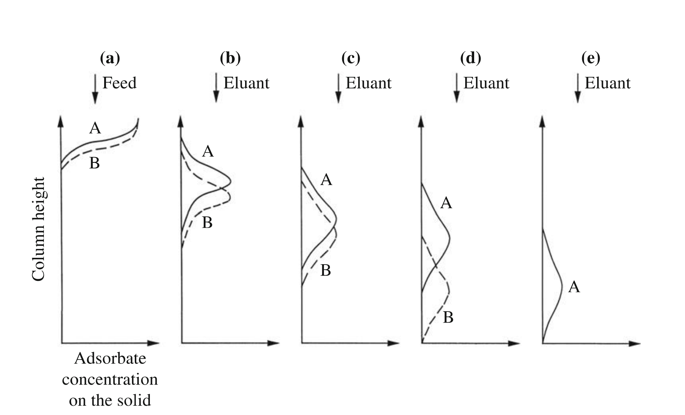
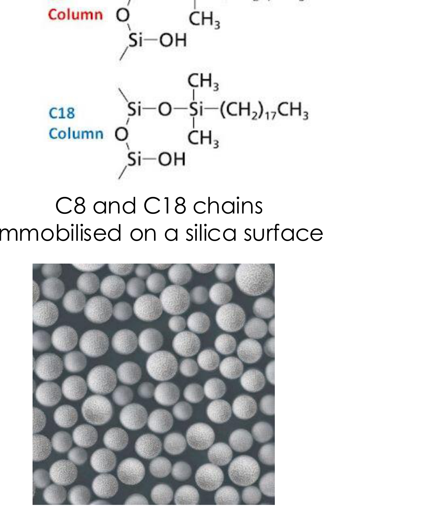
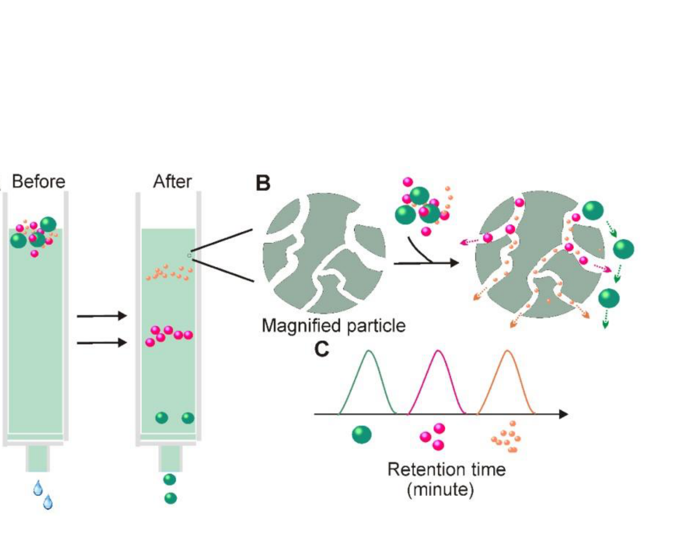
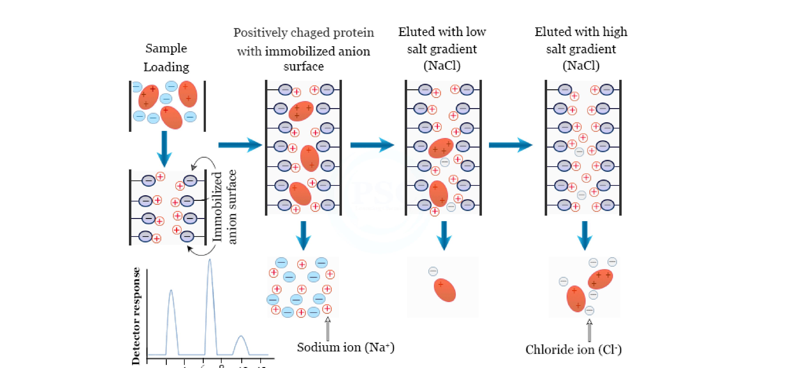
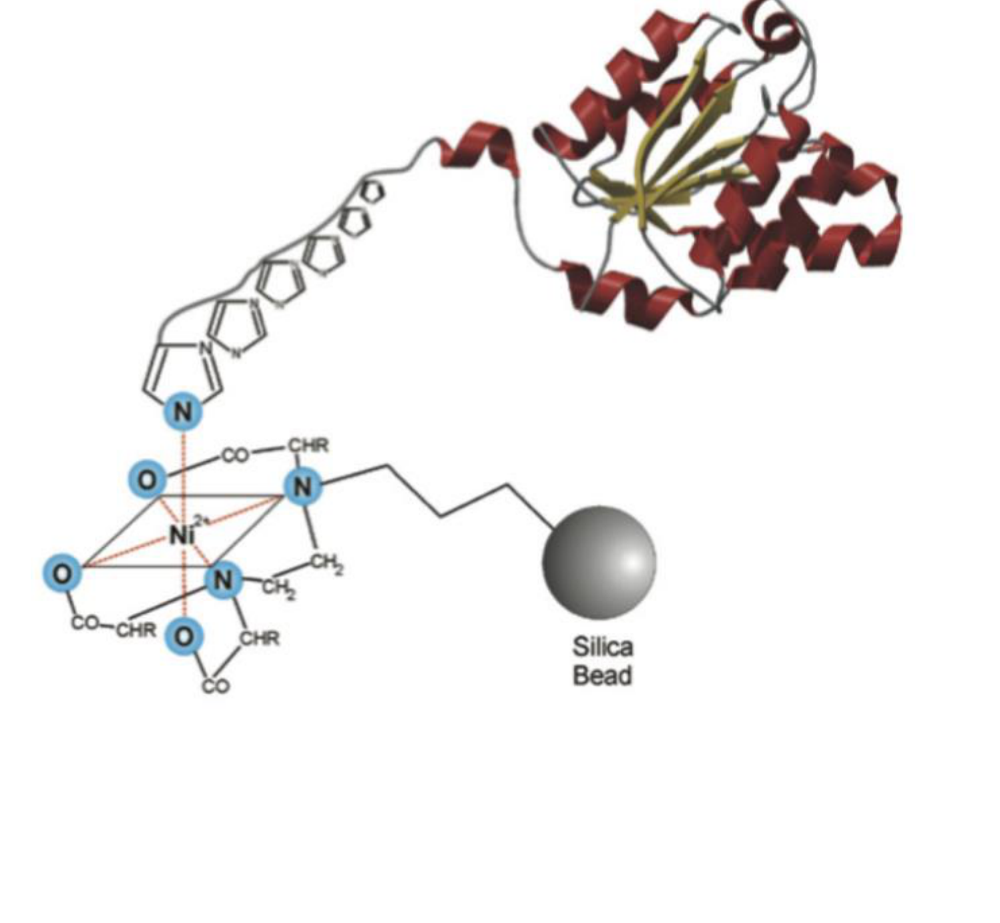
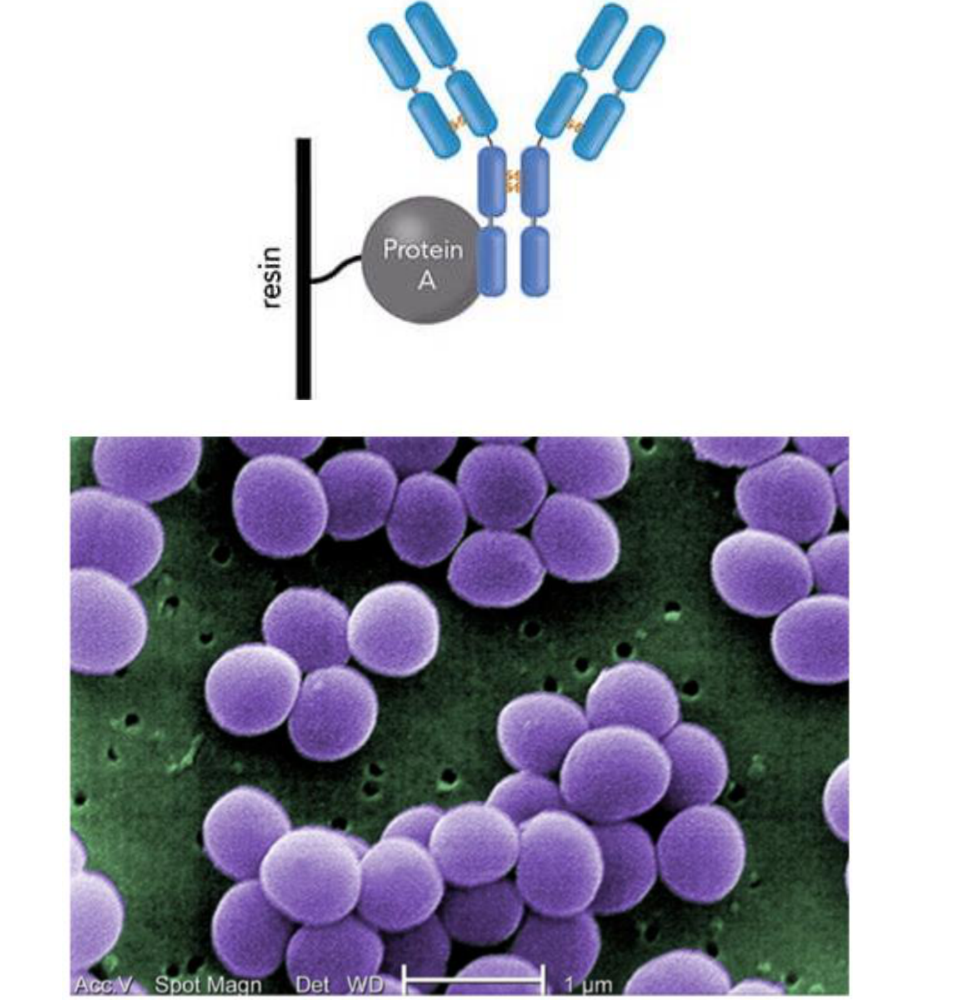

# Chromatography and final isolation

## Overview

Chromatography separates components through differences in binding or accessible pore volume. Retention measures describe differential migration, while final isolation converts a purified stream into the physical form needed for storage and use.

*Assumed throughout:* phase partitioning, adsorption and downstream-process stages.

## Section 46: Types of liquid chromatography

### Intuition

Section 45 bound the product to a solid and then released it. Chromatography does the same thing, but *continuously and repeatedly* as the sample travels down a column.

Each solute binds and unbinds many times on its way through. A solute that binds strongly spends more of its time stationary and so moves slowly; one that binds weakly moves quickly. After a long enough column, the difference in average speed separates components that differ only slightly in affinity.

That is the key to why chromatography achieves what a single equilibrium cannot: **a small difference in affinity, applied thousands of times in series, becomes a large difference in position.** Primary isolation methods (Sections 42–45) each give one equilibration and therefore one separation factor. A column gives the same factor repeatedly.

*Analogy:* two walkers of almost equal speed on a long road — indistinguishable over 10 m, far apart over 10 km. The analogy breaks down because the solutes do not move at steady speeds; they alternate between stopped and moving at the eluent's speed, and it is the *fraction of time stopped* that differs.

### Mechanism

**Differential migration.** Chromatography resolves mixtures into individual components by:

1. flowing a sample through a **column packed with resin**, using an **eluent**;
2. different components moving through the resin at **different rates**;
3. components emerging at different **elution times** on the other side, enabling separation.

The graph of concentration of the components in the effluent against elution time is the **chromatogram**. The resin is the **stationary phase**; the liquid carrying the solutes is the **mobile phase**.

The mobile phase can also be a gas, as in gas chromatography, but **liquid chromatography** is the form relevant to bioprocessing. It achieves high purity and is therefore used for enrichment of bioproducts in the pharmaceutical industry — antibodies, recombinant proteins and nucleic acids used as therapeutics.

#### The five types

Each differs only in **what physical property drives the differential migration**.

**1. Adsorption chromatography** — uses **non-specific adsorption** of compounds against the stationary phase. The phase is typically crystals or particles of **silica gel, alumina, diatomaceous earth** or **charcoal**. Biological molecules adsorb on these materials driven mainly by **electrostatic forces**, and the order of elution depends primarily on **molecular polarity**. The polarity of the eluent (mobile phase) is also important in determining the degree of separation.

*Note:* although the principle is the same, adsorption chromatography is **different from the fixed-bed adsorption of Section 45**, which is a primary isolation method. There the aim is to capture the product and release it in bulk; here it is to resolve similar species by differential migration.

**2. Partition chromatography** — migration is driven by differential **partitioning between two "liquid" phases**. One liquid phase is immobilised onto a support such as silica, making it the stationary phase. A common stationary phase is **hydrocarbon with 8 or 18 carbons** bonded to silica gel: these are the **C8 and C18 packings**. The second liquid phase is the mobile phase, and common mobile phases are aqueous.

This is the same partition coefficient as Section 42, applied repeatedly rather than once.

**3. Gel chromatography** — also called **molecular-sieve, exclusion, gel filtration** or **gel-permeation chromatography**. The stationary phase is **hydrogel beads of defined pore size**, made of crosslinked **dextran, agarose** or **polyacrylamide**.

Migration rate depends on the **size** of the molecules. Small molecules enter the pores of the gel beads and migrate down the column slowly; large molecules flow past the beads and **leave the column fastest**. This inverts the usual expectation and is the basis of the quantitative treatment in Section 47.

**4. Ion-exchange chromatography** — differential migration is caused by **electrostatic interactions** between the stationary phase and the target molecules. For proteins, **pH needs to be kept away from the pI**, so that the proteins are charged.

If the stationary phase is negatively charged and the analyte positively charged, it is **cation-exchange chromatography**:
$$S^-C^+ + A^+B^- \rightarrow S^-A^+ + C^+ + B^- \tag{1}$$
where $S^-$ are the anionic groups on the stationary phase, $A^+$ the target analyte, and $C^+$ and $B^-$ are counterions. The target *swaps places* with the exchangeable cation $C^+$.

If the stationary phase is positively charged and the analyte negatively charged, it is **anion-exchange chromatography**:
$$S^+C^- + A^-B^+ \rightarrow S^+A^- + C^- + B^+ \tag{2}$$

**Elution is accelerated by increasing the salt concentration**, which raises the concentration of competing counterions and displaces the analyte. Ion exchange is used commercially for enrichment of proteins and antibiotics.

**5. Affinity chromatography** — the principle is **specific binding** between the target compound and the stationary phase. Ligands are chemically connected to the stationary phase and specifically bind recombinant proteins, enzymes, antibodies, hormones, nucleic acids and vitamins. It is **highly specific and often used for high-added-value products**.

*Ni-NTA.* A very common approach uses **nitrilotriacetic acid (NTA)** as ligand. NTA forms a complex with **Ni²⁺**, and the Ni-NTA complex binds strongly to **histidine residues**. Target recombinant proteins are purposefully modified to have a **6×His tag** at one end, so that they can be specifically captured by the Ni-NTA complex.

This is why the His₆ tag of Section 24's purification workflow exists: the tag is added at the gene level precisely so that one generic resin can purify any protein.

*Protein A.* Another common ligand, used for separation of immunoglobulins G. Protein A occurs naturally on the surface of *Staphylococcus aureus*, where it binds IgG from a **conserved region of the heavy chain that is not involved in antigen recognition** — the bacterium uses this to bind IgG the wrong way round, disrupting the immune response. Because the binding site is conserved and distinct from the variable region (Section 27), one resin captures essentially *any* IgG regardless of what it binds.

### Motivation and explanation

**Why five types rather than one.** Each exploits a different molecular property — polarity, partition, size, charge, specific binding — so impurities that resemble the product in one property usually differ in another. Real purification trains therefore run **several types in series**: for an antibody, typically Protein A affinity first (very high selectivity, low capacity), then ion exchange, then gel filtration as a polishing step.

**The capacity/selectivity trade.** Affinity is the most selective and the most expensive: Protein A resin costs orders of magnitude more per litre than ion-exchange resin, and it degrades. Gel chromatography is cheap and gentle but has low capacity, because the sample volume must be small compared with the column. This is why affinity goes first, when the volume is largest and the impurity load greatest, and gel filtration last.

**Why gel chromatography is the odd one out.** The other four rely on *binding*. Gel chromatography involves no binding at all — only whether a molecule fits into a pore. As a consequence it has no elution step, cannot concentrate the product, and has a hard upper limit on how long a solute can be retained. Section 47 shows that this limit is what makes its elution volume exactly predictable.

### Link to other topics

Repeated equilibration down a column to amplify a small single-stage separation factor is precisely the logic of a distillation column's stages, and the same argument underlies the staged selection of Section 19: one weak discrimination applied many times becomes a strong one.

### Summary

Chromatography separates by differential migration — solutes that bind more spend more time stationary and move more slowly, so a small affinity difference applied repeatedly becomes a large separation in space. The five types differ only in the property exploited: polarity, partition, size, charge or specific binding, with affinity ligands such as Ni-NTA and Protein A giving the highest selectivity.

## Section 47: Quantifying differential migration, and final isolation

### Intuition

A solute's position in the chromatogram is reported as the **elution volume** $V_e$: the volume of eluent that has passed when the solute emerges at peak concentration. Volume is used rather than time because it is independent of flow rate.

A solute that never interacts with the stationary phase travels with the liquid and emerges after one **void volume** $V_0$ — the volume of liquid between the particles. Everything that *does* interact is delayed. So the natural measure of retention is not $V_e$ itself but **how much it exceeds $V_0$**, scaled by $V_0$ to make it dimensionless. That is the capacity factor.

Gel chromatography is the case where this becomes exactly predictable. There is no binding — only whether a molecule fits into the pores. A molecule too large to enter any pore is confined to the space between particles and elutes at $V_0$. A molecule small enough to enter every pore has the full internal volume available and elutes last. **Every solute lies between these two bounds**, so gel chromatography has a closed elution window, which no other type has.

*Analogy:* a crowd moving through a corridor lined with alcoves. People too large to enter any alcove pass straight through; small ones that wander into every alcove take longest. The analogy breaks down because entry here is not a choice but a geometric constraint, which is why the limits are hard.

### Derivation

Notation: $V_e$ elution volume; $V_0$ void volume (between the particles); $V_i$ volume of empty space *within* the particles; $V_s$ volume of the material (hydrogel) making up the particles; $V_t$ total column volume.

#### Capacity factor and retention ratio

**Step 1: capacity factor.** The retention of a solute beyond the void volume, normalised:
$$k = \frac{V_e-V_0}{V_0} \tag{3}$$
$k = 0$ means the solute is unretained and elutes with the void. Larger $k$ means more retention. The normalisation by $V_0$ makes $k$ a property of the solute and the chemistry, not of the column size.

**Step 2: retention ratio.** Comparing two solutes 1 and 2:
$$\delta = \frac{k_1}{k_2} \tag{4}$$
This measures how well the column distinguishes them. $\delta = 1$ means they co-elute and are not separated at all; the further $\delta$ is from 1, the better the resolution.

#### Gel chromatography

**Step 3: the column's volume budget.** The total column volume divides into three parts:
$$V_t = V_0 + V_i + V_s \tag{5}$$
liquid between particles, liquid inside particles, and the solid gel itself.

**Step 4: elution volume.** A solute travelling down the column has access to $V_0$ always, and to a *fraction* of $V_i$ depending on whether it fits into the pores:
$$V_e = V_0 + K_pV_i \tag{6}$$
where $K_p$ is the **partition coefficient**, defined as the fraction of the volume within the gel particles that is available to the solute.

**Step 5: rearrange for the measurable.**
$$K_p = \frac{V_e-V_0}{V_i} \tag{7}$$
So determining $K_p$ requires measuring $V_e$ and knowing $V_0$ and $V_i$.

**The two limits, which bound every solute:**
- **$K_p = 0$**: a large macromolecule that does not penetrate the gel particles at all. Then $V_e = V_0$ — it elutes in the void volume, *first*. This also gives the practical route to measuring $V_0$: run a molecule known to be excluded and record its elution volume.
- **$K_p = 1$**: a small solute with full access. Then $V_e = V_0+V_i$ — the latest anything can elute.

Hence $V_0 \le V_e \le V_0+V_i$ for every solute. Combining (3) and (6), the capacity factor is
$$k = \frac{K_pV_i}{V_0} \tag{8}$$
so $k$ ranges from 0 to $V_i/V_0$ and cannot exceed it. **Gel chromatography has a bounded retention**, unlike the binding-based methods where strong binding can retain a solute arbitrarily long.

**Step 6: measuring $V_i$.** From the gel's properties:
$$V_i = a\,W_r \tag{9}$$
where $W_r$ is the **water retention value** — the volume of water taken up when rehydrating the gel, per unit dry mass, specified by the manufacturer — and $a$ is the dry mass of gel.

Often the gel is supplied already rehydrated, so $a$ is unknown. In that case:
$$V_i = \frac{W_r\rho_g}{1+W_r\rho_w}\left(V_t-V_0\right) \tag{10}$$
with $\rho_g$ the density of the rehydrated gel and $\rho_w$ the density of water. Note $(V_t-V_0) = V_i+V_s$ from (5): equation (10) splits the non-void volume into pore space and solid in the ratio the gel's water content implies.

### Worked example

*Sizing the elution window of a gel column.* Computed in Python.

**Given.** A column of total volume $V_t = 100$ mL with void volume $V_0 = 30$ mL, packed with a hydrogel of water retention $W_r = 7.5$ mL g⁻¹ and rehydrated density $\rho_g = 1.05$ g mL⁻¹, with $\rho_w = 1.00$ g mL⁻¹.

**Step 1: internal pore volume**, from (10):
$$V_i = \frac{7.5\times1.05}{1+7.5\times1.00}(100-30) = \frac{7.875}{8.5}\times70 = 64.9\ \mathrm{mL}$$
From (5), $V_s = 100-30-64.9 = 5.1$ mL. **The gel matrix is only 5 % of the column volume** — the particles are essentially water held in a sparse polymer network, which is what a hydrogel is.

**Step 2: where solutes elute**, from (6) and (8):

| $K_p$ | $V_e$ (mL) | $k$ | Solute |
|---|---|---|---|
| 0 | 30.0 | 0 | macromolecule, fully excluded |
| 0.2 | 43.0 | 0.43 | large protein |
| 0.5 | 62.4 | 1.08 | medium protein |
| 1.0 | 94.9 | 2.16 | small solute, full access |

**Step 3: read the window.** Everything elutes between **30 and 95 mL**, a window of 64.9 mL — exactly $V_i$, as (6) requires. The last solute emerges at only 3.2 times the volume of the first.

**Step 4: resolution of two proteins.** For $K_p = 0.2$ and $0.5$, the retention ratio from (4) is
$$\delta = \frac{0.43}{1.08} = 0.40$$
and the peaks are separated by $(0.5-0.2)\times64.9 = 19.5$ mL.

**What the numbers say about the method.**
- *The sample volume must be small.* The entire separation happens within 65 mL, so injecting even 10 mL of feed would smear the peaks across a sixth of the usable window. This is the fundamental capacity limit of gel chromatography and why it is a **polishing** step, used last when the volume is already small.
- *It cannot concentrate.* Since there is no binding and no elution step, the product leaves more dilute than it entered, diluted by roughly the peak width. Every other type in Section 46 concentrates; this one does not.
- *But it is predictable.* Equation (6) is pure geometry — no affinity constants, no temperature dependence, no pH. Retention can be calculated in advance from the gel's pore size, which is why it doubles as an analytical method for measuring molecular size.

### Instrumentation

Two systems carry out chromatographic separations of biomolecules:

**HPLC (high-performance liquid chromatography)** achieves better resolution, using **small particles (2 to 5 µm)** and **high pressure (5–10 MPa)**. Throughput is low, 1 to 5 mL min⁻¹. It is used at small scale or laboratory scale, and also for valuable products — oligonucleotide purification (Section 06) is the example already met.

**FPLC (fast protein liquid chromatography)** has lower resolution, **larger particles**, lower pressure and higher throughput, and is used at larger scale.

The trade is the familiar one: smaller particles give more plates and better resolution but a far larger pressure drop, so resolution is bought with pressure and throughput.

### Final isolation

The product is already highly purified by chromatography. The objective of **final isolation** is possibly to **increase purity further**, and to **alter the physical form** of the product to make it suitable for storage and commercialisation.

Many products are packaged and sold as **solids or powders**. These go through either **precipitation or crystallisation** (Sections 43–44), followed by **filtration or centrifugation** (Sections 33–37), and the wet solids — crystals or amorphous precipitate — are then **dried**.

The operations are therefore ones already covered; what differs is the purpose. Earlier they were used to *separate*; here they are used to *formulate*.

### Link to other topics

The capacity factor is the chromatographic analogue of a retention or holdup time, and the resolution-versus-pressure trade in HPLC is the same relationship as plate count against pressure drop in a packed column: finer packing improves separation and costs pumping energy.

### Summary

The capacity factor $k = (V_e-V_0)/V_0$ characterises retention and the retention ratio $\delta = k_1/k_2$ the resolution of two solutes. In gel chromatography there is no binding, so $V_e = V_0 + K_pV_i$ is pure geometry: every solute elutes between $V_0$ and $V_0+V_i$, giving a bounded, predictable window but no concentration and a strict limit on sample volume.

## Conclusion

Retention describes migration, peak widths determine resolution, and final isolation sets the product form. The next unit develops gene regulation and synthetic circuits.
